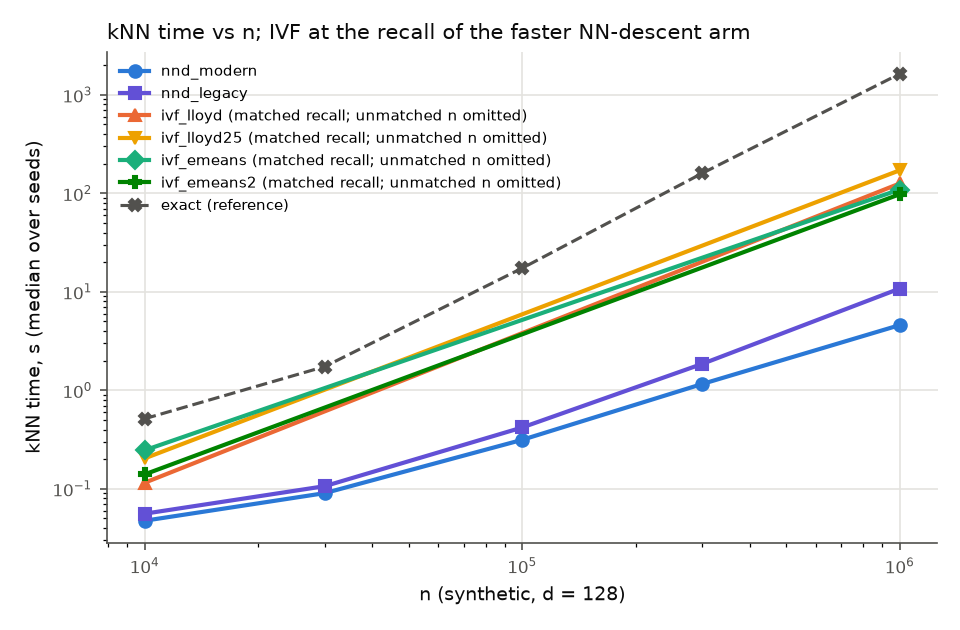

# eumap

UMAP with its nearest-neighbour graph built by a [Faiss](https://github.com/facebookresearch/faiss)
IVF index whose centroids are trained with
[e-means](https://e-means.github.io/) (Bessa et al., 2026).

**Status: negative result, not maintained.** In the benchmark in this repository eumap was slower
than stock UMAP on every dataset, with no gain in embedding quality. The code works and is kept as
a record of the experiment. See [Results](#results) before using it.

## What it is, and what it is not

UMAP has no k-means step: it builds an approximate k-nearest-neighbour graph (NN-descent), turns
it into a fuzzy graph and optimises a layout. e-means is a faster k-means. The only place the two
meet is the nearest-neighbour stage, where a k-means-partitioned index (IVF) is an alternative to
NN-descent.

eumap does exactly that and nothing else:

1. train the IVF centroids with e-means (`faiss.contrib.e_means`),
2. build a Faiss `IndexIVFFlat` on those centroids and search it for every point's neighbours,
3. hand the neighbours to an unmodified `umap.UMAP` through its `precomputed_knn` argument.

It is a thin wrapper around [umap-learn](https://github.com/lmcinnes/umap), not a fork. The graph
construction, layout and `transform` are UMAP's own.

## Install

```bash
pip install git+https://github.com/nico142857/eumap
```

Requires Python 3.12 or newer, `umap-learn >= 0.6.0` and `faiss-cpu >= 1.16.0` (the first release
that ships e-means).

## Usage

```python
from eumap import EUMAP

model = EUMAP(n_neighbors=15, metric="euclidean", random_state=0)
embedding = model.fit_transform(X)        # X: (n_samples, n_features) array
new_points = model.transform(X_new)       # works like umap.UMAP.transform

model.knn_info_    # how the graph was built: method, nlist, nprobe, estimated recall, stage times
model.umap_        # the fitted umap.UMAP object
```

Any other keyword is passed to `umap.UMAP` unchanged (`min_dist`, `n_components`, `n_epochs`, ...).

The neighbour graph can also be used on its own:

```python
from eumap import ivf_knn

graph = ivf_knn(X, n_neighbors=15, metric="cosine", target_recall=0.95)
graph.indices, graph.distances   # in the format umap.UMAP(precomputed_knn=...) expects
graph.info
```

### Parameters specific to eumap

| Parameter | Default | Meaning |
|---|---|---|
| `metric` | `"euclidean"` | `"euclidean"` or `"cosine"`. Other metrics raise an error; use `umap.UMAP` for them. |
| `nlist` | about `4 * sqrt(n)` | Number of IVF cells (centroids). |
| `nprobe` | `"auto"` | Cells searched per point. `"auto"` doubles it until the recall measured on a sample of points reaches `target_recall`. |
| `target_recall` | `0.95` | Target for the automatic `nprobe`. |
| `trainer` | `"emeans"` | `"emeans"`, or `"lloyd"` for Faiss' ordinary k-means. |
| `exact_below` | `100000` | Below this many points the graph is computed exactly by brute force. |
| `random_state` | `None` | An int seeds the trainer, the `nprobe` tuning sample and UMAP. |
| `n_jobs` | `-1` | Threads for Faiss and UMAP. |

## Behaviour worth knowing

- **Small data uses exact neighbours.** e-means' automatic batch-size and step-size rules were
  fitted by its authors for at least 100,000 points, and brute force takes seconds below that.
- **Missing neighbours are repaired.** An IVF search can return fewer than `n_neighbors` results
  for a point; those points are re-searched exactly, so the graph handed to UMAP is complete.
- **Euclidean data is centred internally** before indexing. This does not change any distance; it
  avoids float32 cancellation in Faiss when the data sits far from the origin.
- **`transform` works**, through a small adapter around the Faiss index. `update` is not supported.
- Dense input only.

## Benchmark

`benchmarks/` compares, on the same node and with the same threads:

- stock UMAP's NN-descent (both the default and the newer settings of umap-learn 0.6),
- an IVF graph trained with ordinary k-means (to separate "using Faiss IVF" from "using e-means"),
- the same IVF graph trained with e-means,
- exact brute force, as the reference.

It records per-stage wall times, recall against the exact graph, end-to-end time and embedding
quality over three seeds, and compares methods at matched recall. The protocol, including the
criteria for "worth using" and "e-means contributes", was written down before any result existed:
[`benchmarks/PROTOCOL.md`](benchmarks/PROTOCOL.md).

Datasets: a synthetic size sweep (10,000 to 1,000,000 points), MNIST, Fashion-MNIST, Covertype,
SIFT1M and GloVe-100.

### Results

**eumap is not worth using on CPU.** By the criteria fixed in the protocol beforehand, none of the
three positive readings holds on any of the four evaluation datasets, and the "not worth using"
reading holds.

Medians over three seeds, one exclusive 36-core node per dataset (Xeon E5-2697 v4), umap-learn
0.6.0 with its new pipeline (`optimizer="adam"`), faiss-cpu 1.16.0:

| Dataset | Points | kNN stage: IVF + e-means vs NN-descent, at equal recall | UMAP end to end | eumap end to end | Slowdown |
|---|---|---|---|---|---|
| MNIST | 70,000 | 18.1x slower | 5.3 s | 13.4 s | 2.5x |
| Fashion-MNIST | 70,000 | 17.7x slower | 4.5 s | 13.0 s | 2.9x |
| Covertype | 581,012 | 7.2x slower | 43.7 s | 60.1 s | 1.4x |
| SIFT1M | 1,000,000 | 15.0x slower | 88.7 s | 206.4 s | 2.3x |
| Synthetic (d = 128) | 1,000,000 | 23.8x slower | 81.2 s | 133.6 s | 1.6x |
| GloVe-100 (cosine) | 1,183,514 | 8.4x slower | 106.5 s | 547.0 s | 5.1x |



- **The IVF graph never beats NN-descent.** At the recall NN-descent reaches, every IVF variant
  was slower on all ten dataset sizes, and the gap does not close as the data grows: on the
  synthetic sweep there is no crossover up to 1,000,000 points.
- **e-means trains faster, and it does not matter.** From about 580,000 points up, e-means trained
  the centroids in 0.69 to 0.79 of the time of Faiss' default k-means (0.28 to 0.33 with two
  epochs). At 70,000 points it was about 3 times slower. Either way the search over the lists
  dominates the IVF cost, so eumap with e-means ran within 5% of eumap with ordinary k-means on
  the four large datasets, and about 1.5 times slower on the two small ones.
- **Embedding quality is the same**, within the protocol's tolerance, on five of the six datasets.
  On GloVe-100 trustworthiness was 2.2% lower (0.810 against 0.829). The layout built from the
  exact neighbour graph scores about the same (0.804), so this is not caused by IVF errors.
- **GloVe-100 is the worst case.** NN-descent stops at recall 0.66 there, while eumap's default
  target of 0.95 needed 256 probes, which is where the 5x comes from.

Not tested: UMAP's optional RINND neighbour backend (new in 0.6, and not installed for these
runs), GPU indexes, and datasets above 1.2 million points.

Full tables, per-dataset verdict lines and figures are in
[`results/RESULTS.md`](results/RESULTS.md); the raw records are in `results/raw/` (node names
replaced by labels) and `results/summary.csv`.

### Running it

The scripts assume a Slurm cluster; `slurm/submit.sh` submits each job with a clean environment.

```bash
uv sync --group bench
slurm/submit_all.sh --dry-run core     # show what would be submitted
slurm/submit_all.sh core               # ground truth + benchmark per dataset, at most 3 at once
.venv/bin/python -I benchmarks/aggregate.py   # tables, verdicts and figures under results/
```

A single dataset can be run without Slurm:

```bash
python benchmarks/run_benchmark.py --dataset fashion_mnist --seeds 0 1 2
```

## Tests

```bash
uv sync
uv run pytest
```

## References

- McInnes, Healy and Melville. *UMAP: Uniform Manifold Approximation and Projection for Dimension
  Reduction.* arXiv:1802.03426.
- Bessa, Mazaré, Szilvasy, Touvron, Picard, Douze and Jégou. *e-means: outperforming k-means in
  one-tenth the epochs.* arXiv:2611.09501.
- Douze et al. *The Faiss library.* arXiv:2401.08281.

## Licence

BSD 3-Clause. See [LICENSE](LICENSE).
