# eumap benchmark results

Generated by `benchmarks/aggregate.py` on 2026-11-12 08:33 from `results/raw` (310 ok records, 0 unresolved error records, 0 unreadable lines). Protocol and pre-registered criteria: `benchmarks/PROTOCOL.md`. Times in seconds; `median [min–max]` over seeds.

## Verdicts

```
OVERALL (pre-registered reading, benchmarks/PROTOCOL.md):
   no  eUMAP is worth using: (a)-(c) hold on 0 of 4 evaluated (none); needs 3 of 4
   no  e-means contributes: holds on 0 of 4 evaluated (none); needs 3 of 4
   no  'the Faiss IVF graph helps, e-means does not': holds on 0 of 4 evaluated (none); needs 3 of 4
  YES  Not worth using: IVF beats NN-descent at matched recall on 0 of 9 datasets with n <= 1e6 (none); quality (c) fails on glove100 of 4 evaluated [PARTIAL: 9 datasets with n <= 1e6 and 4 of 4 evaluation datasets have the needed records]
  synthetic crossover (ivf_emeans vs faster NN-descent): none up to 1e6  (median ratios: n=1e4: 5.143, n=3e4: inf (>= 10.786 at the end of the sweep), n=1e5: inf (>= 15.438 at the end of the sweep), n=3e5: inf (>= 40.645 at the end of the sweep), n=1e6: 23.798)
  synthetic crossover (best IVF arm vs faster NN-descent): none up to 1e6  (median ratios: n=1e4: 2.431, n=3e4: inf (>= 7.191 at the end of the sweep), n=1e5: inf (>= 13.115 at the end of the sweep), n=3e5: inf (>= 37.245 at the end of the sweep), n=1e6: 21.824)
```

## Runs

| dataset | n | host(s) | CPU | threads | thread parity | records per arm |
|---|---|---|---|---|---|---|
| covtype | 581012 | node-A | Intel(R) Xeon(R) CPU E5-2697 v4 @ 2.30GHz | 36 | yes | nnd_modern:3, nnd_legacy:3, ivf_lloyd:3, ivf_lloyd25:3, ivf_emeans:3, ivf_emeans2:3, umap_e2e:3, eumap_e2e:3, eumap_lloyd_e2e:3, layout_exact:3 |
| fashion_mnist | 70000 | node-C | Intel(R) Xeon(R) CPU E5-2697 v4 @ 2.30GHz | 36 | yes | nnd_modern:3, nnd_legacy:3, ivf_lloyd:3, ivf_lloyd25:3, ivf_emeans:3, ivf_emeans2:3, umap_e2e:3, eumap_e2e:3, eumap_lloyd_e2e:3, layout_exact:3 |
| glove100 | 1183514 | node-E | Intel(R) Xeon(R) CPU E5-2697 v4 @ 2.30GHz | 36 | yes | nnd_modern:3, nnd_legacy:3, ivf_lloyd:3, ivf_lloyd25:3, ivf_emeans:3, ivf_emeans2:3, umap_e2e:3, eumap_e2e:3, eumap_lloyd_e2e:3, layout_exact:3 |
| mnist | 70000 | node-C | Intel(R) Xeon(R) CPU E5-2697 v4 @ 2.30GHz | 36 | yes | nnd_modern:3, nnd_legacy:3, ivf_lloyd:3, ivf_lloyd25:3, ivf_emeans:3, ivf_emeans2:3, umap_e2e:3, eumap_e2e:3, eumap_lloyd_e2e:3, layout_exact:3 |
| sift1m | 1000000 | node-A, node-D | Intel(R) Xeon(R) CPU E5-2697 v4 @ 2.30GHz | 36 | yes | nnd_modern:3, nnd_legacy:3, ivf_lloyd:3, ivf_lloyd25:3, ivf_emeans:3, ivf_emeans2:3, umap_e2e:3, eumap_e2e:3, eumap_lloyd_e2e:3, layout_exact:3 |
| synthetic n=1e4 | 10000 | node-A | Intel(R) Xeon(R) CPU E5-2697 v4 @ 2.30GHz | 36 | yes | nnd_modern:3, nnd_legacy:3, ivf_lloyd:3, ivf_lloyd25:3, ivf_emeans:3, ivf_emeans2:3, umap_e2e:3, eumap_e2e:3, eumap_lloyd_e2e:3, layout_exact:3 |
| synthetic n=3e4 | 30000 | node-A | Intel(R) Xeon(R) CPU E5-2697 v4 @ 2.30GHz | 36 | yes | nnd_modern:3, nnd_legacy:3, ivf_lloyd:3, ivf_lloyd25:3, ivf_emeans:3, ivf_emeans2:3, umap_e2e:3, eumap_e2e:3, eumap_lloyd_e2e:3, layout_exact:3 |
| synthetic n=1e5 | 100000 | node-A | Intel(R) Xeon(R) CPU E5-2697 v4 @ 2.30GHz | 36 | yes | nnd_modern:3, nnd_legacy:3, ivf_lloyd:3, ivf_lloyd25:3, ivf_emeans:3, ivf_emeans2:3, umap_e2e:3, eumap_e2e:3, eumap_lloyd_e2e:3, layout_exact:3 |
| synthetic n=3e5 | 300000 | node-A | Intel(R) Xeon(R) CPU E5-2697 v4 @ 2.30GHz | 36 | yes | nnd_modern:3, nnd_legacy:3, ivf_lloyd:3, ivf_lloyd25:3, ivf_emeans:3, ivf_emeans2:3, umap_e2e:3, eumap_e2e:3, eumap_lloyd_e2e:3, layout_exact:3 |
| synthetic n=1e6 | 1000000 | node-B, node-C | Intel(R) Xeon(R) CPU E5-2697 v4 @ 2.30GHz | 36 | yes | nnd_modern:3, nnd_legacy:3, ivf_lloyd:3, ivf_lloyd25:3, ivf_emeans:3, ivf_emeans2:3, umap_e2e:3, eumap_e2e:3, eumap_lloyd_e2e:3, layout_exact:3 |

## covtype

### kNN stage

| arm | recall@15 | t_knn | t_prepare | t_train | t_add | centroid MSE | imbalance | peak RSS GB |
|---|---|---|---|---|---|---|---|---|
| exact | 1.000 | 408.80 | – | – | – | – | – | 1.2 |
| nnd_modern | 0.9996 [0.9996–0.9997] | 2.44 [2.41–2.50] | – | – | – | – | – | 2.9 |
| nnd_legacy | 1.0000 [1.0000–1.0000] | 4.36 [4.35–7.71] | – | – | – | – | – | 3.5 |
| ivf_lloyd | max 0.9999 [0.9999–0.9999] @nprobe 16 [16–16] | see sweep | 0.10 [0.10–0.13] | 16.18 [15.11–16.82] | 1.60 [1.30–1.66] | 0.7835 [0.7787–0.7897] | 1.180 [1.177–1.188] | 2.7 |
| ivf_lloyd25 | max 0.9999 [0.9999–0.9999] @nprobe 16 [16–16] | see sweep | 0.12 [0.10–0.13] | 38.06 [33.67–38.57] | 1.36 [1.33–1.55] | 0.7652 [0.7605–0.7700] | 1.180 [1.180–1.190] | 2.7 |
| ivf_emeans | max 0.9999 [0.9999–0.9999] @nprobe 16 [16–16] | see sweep | 0.13 [0.10–0.13] | 11.19 [10.95–11.21] | 1.61 [1.57–1.68] | 0.7610 [0.7607–0.7641] | 1.174 [1.171–1.179] | 2.7 |
| ivf_emeans2 | max 0.9999 [0.9999–0.9999] @nprobe 16 [16–16] | see sweep | 0.15 [0.12–0.16] | 4.53 [4.32–4.68] | 1.55 [1.36–1.65] | 1.6598 [1.1686–1.7306] | 1.183 [1.171–1.187] | 2.7 |

### IVF nprobe sweep

| arm | nprobe | recall | recall (tie-aware) | missing | t_search | t_train+add+search |
|---|---|---|---|---|---|---|
| ivf_lloyd | 1 | 0.7795 [0.7793–0.7798] | 0.7795 [0.7793–0.7798] | 0.0000 [0.0000–0.0001] | 3.97 [3.71–4.00] | 21.78 [20.12–22.45] |
| ivf_lloyd | 2 | 0.9230 [0.9228–0.9231] | 0.9230 [0.9228–0.9231] | 0.0000 [0.0000–0.0000] | 4.37 [4.35–4.39] | 22.15 [20.76–22.87] |
| ivf_lloyd | 4 | 0.9835 [0.9835–0.9838] | 0.9835 [0.9835–0.9838] | 0.0000 [0.0000–0.0000] | 4.50 [4.48–4.57] | 22.25 [20.91–23.05] |
| ivf_lloyd | 8 | 0.9980 [0.9980–0.9980] | 0.9980 [0.9980–0.9980] | 0.0000 [0.0000–0.0000] | 4.75 [4.63–4.76] | 22.40 [21.16–23.24] |
| ivf_lloyd | 16 | 0.9999 [0.9999–0.9999] | 0.9999 [0.9999–0.9999] | 0.0000 [0.0000–0.0000] | 4.82 [4.75–4.86] | 22.53 [21.23–23.34] |
| ivf_lloyd25 | 1 | 0.7895 [0.7883–0.7896] | 0.7895 [0.7883–0.7896] | 0.0000 [0.0000–0.0001] | 4.06 [4.04–4.06] | 43.67 [39.09–43.93] |
| ivf_lloyd25 | 2 | 0.9276 [0.9274–0.9277] | 0.9276 [0.9274–0.9277] | 0.0000 [0.0000–0.0000] | 4.39 [4.39–4.48] | 44.08 [39.42–44.28] |
| ivf_lloyd25 | 4 | 0.9849 [0.9848–0.9849] | 0.9849 [0.9848–0.9849] | 0.0000 [0.0000–0.0000] | 4.55 [4.54–4.61] | 44.15 [39.58–44.51] |
| ivf_lloyd25 | 8 | 0.9982 [0.9982–0.9982] | 0.9982 [0.9982–0.9982] | 0.0000 [0.0000–0.0000] | 4.71 [4.69–4.73] | 44.30 [39.74–44.63] |
| ivf_lloyd25 | 16 | 0.9999 [0.9999–0.9999] | 0.9999 [0.9999–0.9999] | 0.0000 [0.0000–0.0000] | 4.84 [4.81–4.88] | 44.45 [39.84–44.77] |
| ivf_emeans | 1 | 0.7907 [0.7903–0.7912] | 0.7907 [0.7903–0.7912] | 0.0000 [0.0000–0.0000] | 4.06 [4.06–4.06] | 16.83 [16.63–16.95] |
| ivf_emeans | 2 | 0.9284 [0.9282–0.9285] | 0.9284 [0.9282–0.9285] | 0.0000 [0.0000–0.0000] | 4.41 [4.35–4.44] | 17.11 [16.98–17.33] |
| ivf_emeans | 4 | 0.9851 [0.9850–0.9852] | 0.9851 [0.9850–0.9852] | 0.0000 [0.0000–0.0000] | 4.55 [4.51–4.56] | 17.27 [17.12–17.45] |
| ivf_emeans | 8 | 0.9982 [0.9982–0.9983] | 0.9982 [0.9982–0.9983] | 0.0000 [0.0000–0.0000] | 4.70 [4.58–4.72] | 17.34 [17.29–17.59] |
| ivf_emeans | 16 | 0.9999 [0.9999–0.9999] | 0.9999 [0.9999–0.9999] | 0.0000 [0.0000–0.0000] | 4.83 [4.82–4.88] | 17.64 [17.39–17.71] |
| ivf_emeans2 | 1 | 0.7835 [0.7830–0.7851] | 0.7835 [0.7830–0.7851] | 0.0000 [0.0000–0.0000] | 4.08 [4.05–4.14] | 10.15 [9.82–10.38] |
| ivf_emeans2 | 2 | 0.9251 [0.9246–0.9253] | 0.9251 [0.9246–0.9253] | 0.0000 [0.0000–0.0000] | 4.43 [4.39–4.50] | 10.46 [10.18–10.76] |
| ivf_emeans2 | 4 | 0.9841 [0.9840–0.9842] | 0.9841 [0.9840–0.9842] | 0.0000 [0.0000–0.0000] | 4.55 [4.55–4.60] | 10.62 [10.28–10.88] |
| ivf_emeans2 | 8 | 0.9981 [0.9980–0.9981] | 0.9981 [0.9981–0.9981] | 0.0000 [0.0000–0.0000] | 4.69 [4.69–4.72] | 10.79 [10.37–11.02] |
| ivf_emeans2 | 16 | 0.9999 [0.9999–0.9999] | 0.9999 [0.9999–0.9999] | 0.0000 [0.0000–0.0000] | 4.79 [4.79–4.85] | 10.93 [10.47–11.12] |

### kNN time to reach a fixed recall (informational)

IVF: train + add + search at the smallest swept nprobe reaching the recall (inf: not reached within the sweep). NN-descent has one operating point, shown for reference.

| arm | recall >= 0.90 | recall >= 0.95 | recall >= 0.99 |
|---|---|---|---|
| ivf_lloyd | 22.15 [20.76–22.87] | 22.25 [20.91–23.05] | 22.40 [21.16–23.24] |
| ivf_lloyd25 | 44.08 [39.42–44.28] | 44.15 [39.58–44.51] | 44.30 [39.74–44.63] |
| ivf_emeans | 17.11 [16.98–17.33] | 17.27 [17.12–17.45] | 17.34 [17.29–17.59] |
| ivf_emeans2 | 10.46 [10.18–10.76] | 10.62 [10.28–10.88] | 10.79 [10.37–11.02] |
| nnd_modern (single point, recall 0.9996 [0.9996–0.9997]) | 2.44 [2.41–2.50] | 2.44 [2.41–2.50] | 2.44 [2.41–2.50] |
| nnd_legacy (single point, recall 1.0000 [1.0000–1.0000]) | 4.36 [4.35–7.71] | 4.36 [4.35–7.71] | 4.36 [4.35–7.71] |

### Matched recall (faster NN-descent arm: `nnd_modern`)

| NN-descent arm | IVF arm | NN-descent recall | target | nprobe per seed | IVF kNN time | NN-descent time | ratio IVF/NND | ratio, interpolated (informational) | unmatched: ratio lower bound |
|---|---|---|---|---|---|---|---|---|---|
| nnd_modern | ivf_lloyd | 0.9996 [0.9996–0.9997] | capped 0.9990 [0.9990–0.9990] | 16,16,16 | 22.53 [21.23–23.34] | 2.44 [2.41–2.50] | 9.336 [8.716–9.345] | 9.318 [8.702–9.321] | – |
| nnd_modern | ivf_lloyd25 | 0.9996 [0.9996–0.9997] | capped 0.9990 [0.9990–0.9990] | 16,16,16 | 44.45 [39.84–44.77] | 2.44 [2.41–2.50] | 17.910 [16.356–18.441] | 17.879 [16.335–18.408] | – |
| nnd_modern | ivf_emeans | 0.9996 [0.9996–0.9997] | capped 0.9990 [0.9990–0.9990] | 16,16,16 | 17.64 [17.39–17.71] | 2.44 [2.41–2.50] | 7.241 [6.958–7.347] | 7.176 [6.935–7.321] | – |
| nnd_modern | ivf_emeans2 | 0.9996 [0.9996–0.9997] | capped 0.9990 [0.9990–0.9990] | 16,16,16 | 10.93 [10.47–11.12] | 2.44 [2.41–2.50] | 4.486 [4.188–4.614] | 4.459 [4.170–4.593] | – |
| nnd_legacy | ivf_lloyd | 1.0000 [1.0000–1.0000] | capped 0.9990 [0.9990–0.9990] | 16,16,16 | 22.53 [21.23–23.34] | 4.36 [4.35–7.71] | 5.162 [2.754–5.369] | 5.149 [2.750–5.358] | – |
| nnd_legacy | ivf_lloyd25 | 1.0000 [1.0000–1.0000] | capped 0.9990 [0.9990–0.9990] | 16,16,16 | 44.45 [39.84–44.77] | 4.36 [4.35–7.71] | 10.187 [5.168–10.299] | 10.169 [5.162–10.282] | – |
| nnd_legacy | ivf_emeans | 1.0000 [1.0000–1.0000] | capped 0.9990 [0.9990–0.9990] | 16,16,16 | 17.64 [17.39–17.71] | 4.36 [4.35–7.71] | 4.001 [2.288–4.058] | 3.988 [2.268–4.044] | – |
| nnd_legacy | ivf_emeans2 | 1.0000 [1.0000–1.0000] | capped 0.9990 [0.9990–0.9990] | 16,16,16 | 10.93 [10.47–11.12] | 4.36 [4.35–7.71] | 2.408 [1.418–2.549] | 2.398 [1.409–2.537] | – |

The pre-registered ratio uses the smallest swept power-of-two nprobe that reaches the target. *Interpolated* charges IVF the search time interpolated linearly in recall between the two swept nprobes that bracket the target, to show how much of the ratio is grid overshoot. *Unmatched (cap)* means the sweep stopped at nprobe = 256 (the spec's limit) below the target; *(nlist)* means every list was probed. For those seeds the ratio is inf, and the IVF cost at the last swept nprobe gives a lower bound on what a longer sweep could have reached.

### End to end and embedding quality

| arm | t_e2e | t_knn | t_graph | t_layout | graph recall | NP@15 | trustworthiness | kNN acc | notes |
|---|---|---|---|---|---|---|---|---|---|
| umap_e2e | 43.7 [43.5–46.1] | 2.5 [2.4–2.5] | 0.5 [0.5–0.5] | 40.7 [40.4–43.1] | 0.9996 [0.9996–0.9997] | 0.3150 [0.3131–0.3195] | 0.9705 [0.9683–0.9709] | 0.8440 [0.8438–0.8444] |  |
| eumap_e2e | 60.1 [59.6–63.5] | 18.3 [18.2–18.6] | 0.5 [0.5–0.6] | 41.3 [40.9–44.3] | 0.9851 [0.9850–0.9852] | 0.3133 [0.3087–0.3172] | 0.9724 [0.9699–0.9728] | 0.8423 [0.8389–0.8429] | nprobe 4,4,4 |
| eumap_lloyd_e2e | 62.9 [60.8–65.5] | 22.6 [20.9–23.1] | 0.5 [0.5–0.5] | 39.8 [39.4–41.9] | 0.9835 [0.9835–0.9838] | 0.3137 [0.3111–0.3150] | 0.9709 [0.9704–0.9723] | 0.8410 [0.8401–0.8428] | nprobe 4,4,4 |
| layout_exact | 41.8 [41.2–42.0] | 0.0 [0.0–0.0] | 0.5 [0.5–0.5] | 41.2 [40.7–41.5] | 1.0000 [1.0000–1.0000] | 0.3162 [0.3134–0.3192] | 0.9703 [0.9703–0.9728] | 0.8432 [0.8423–0.8436] |  |

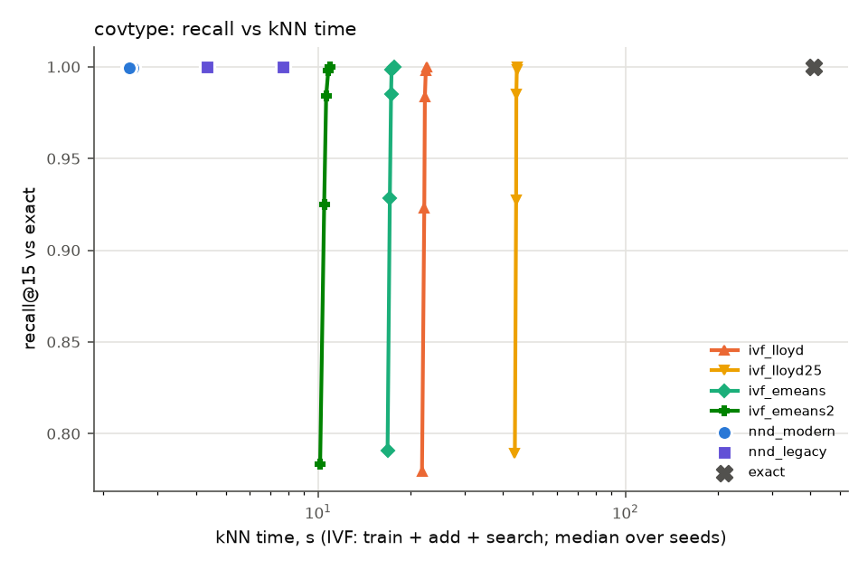

### Verdict lines

```
covtype:
   no  (a) ivf_emeans kNN time at matched recall / nnd_modern = 7.241 [6.958–7.347] over 3 seeds (needs <= 0.8); informational: 7.176 with search time interpolated between swept nprobes
   no  (b) eumap_e2e / umap_e2e end-to-end = 1.377 (60.1 s vs 43.7 s, medians) (needs <= 0.85)
  YES  (c) eumap_e2e quality: np15 0.3133 vs umap 0.3150 [0.3131–0.3195] (-0.5% of the umap median) ok; trustworthiness 0.9724 vs umap 0.9705 [0.9683–0.9709] (+0.2% of the umap median) ok; knn_acc 0.8423 vs umap 0.8440 [0.8438–0.8444] (-0.2% of the umap median) ok
   no  (a)+(b)+(c) all hold (eUMAP worth using on this dataset)
   no  [Lloyd variant] (a) ivf_lloyd kNN time at matched recall / nnd_modern = 9.336 [8.716–9.345] over 3 seeds (needs <= 0.8); informational: 9.318 with search time interpolated between swept nprobes
   no  [Lloyd variant] (b) eumap_lloyd_e2e / umap_e2e end-to-end = 1.442 (62.9 s vs 43.7 s, medians) (needs <= 0.85)
  YES  [Lloyd variant] (c) eumap_lloyd_e2e quality: np15 0.3137 vs umap 0.3150 [0.3131–0.3195] (-0.4% of the umap median) ok; trustworthiness 0.9709 vs umap 0.9705 [0.9683–0.9709] (+0.0% of the umap median) ok; knn_acc 0.8410 vs umap 0.8440 [0.8438–0.8444] (-0.4% of the umap median) ok
   no  e-means contributes: ivf_emeans t_train/lloyd 0.691 (<= 0.7), matched search 4.83 s vs lloyd max 4.86 s -> ok; ivf_emeans2 t_train/lloyd 0.280 (<= 0.7), matched search 4.79 s vs lloyd max 4.86 s -> ok; eumap_e2e / eumap_lloyd_e2e = 0.955 (needs <= 0.95)
   no  the Faiss IVF graph helps, e-means does not (e-means end-to-end gain 0.045, needs < 0.05 with (a)-(c) met by an IVF pair)
   no  some IVF arm beats the faster NN-descent arm at matched recall (median ratios: ivf_lloyd 9.336, ivf_lloyd25 17.910, ivf_emeans 7.241, ivf_emeans2 4.486)
```

## fashion_mnist

### kNN stage

| arm | recall@15 | t_knn | t_prepare | t_train | t_add | centroid MSE | imbalance | peak RSS GB |
|---|---|---|---|---|---|---|---|---|
| exact | 1.000 | 19.31 | – | – | – | – | – | 1.1 |
| nnd_modern | 0.9912 [0.9912–0.9912] | 0.62 [0.60–0.63] | – | – | – | – | – | 2.6 |
| nnd_legacy | 0.9969 [0.9969–0.9969] | 0.76 [0.75–0.86] | – | – | – | – | – | 2.6 |
| ivf_lloyd | max 0.9998 [0.9997–0.9998] @nprobe 64 [64–64] | see sweep | 0.19 [0.19–0.20] | 2.21 [1.86–2.39] | 0.24 [0.21–0.25] | 965968 [962887–967322] | 1.272 [1.261–1.272] | 2.6 |
| ivf_lloyd25 | max 0.9998 [0.9997–0.9998] @nprobe 64 [64–64] | see sweep | 0.20 [0.19–0.20] | 4.95 [4.61–5.63] | 0.21 [0.20–0.24] | 960606 [958358–962008] | 1.261 [1.253–1.261] | 2.6 |
| ivf_emeans | max 0.9998 [0.9998–0.9998] @nprobe 64 [64–64] | see sweep | 0.19 [0.19–0.20] | 6.35 [6.26–6.37] | 0.21 [0.18–0.24] | 948348 [948053–949039] | 1.198 [1.175–1.202] | 2.6 |
| ivf_emeans2 | max 0.9998 [0.9998–0.9998] @nprobe 64 [64–64] | see sweep | 0.20 [0.20–0.20] | 2.70 [2.69–2.71] | 0.20 [0.20–0.22] | 957650 [956049–957985] | 1.215 [1.193–1.218] | 2.6 |

### IVF nprobe sweep

| arm | nprobe | recall | recall (tie-aware) | missing | t_search | t_train+add+search |
|---|---|---|---|---|---|---|
| ivf_lloyd | 1 | 0.4839 [0.4832–0.4852] | 0.4839 [0.4833–0.4853] | 0.0021 [0.0018–0.0022] | 0.49 [0.49–0.50] | 2.94 [2.56–3.12] |
| ivf_lloyd | 2 | 0.6825 [0.6817–0.6839] | 0.6825 [0.6818–0.6840] | 0.0000 [0.0000–0.0000] | 0.54 [0.54–0.54] | 3.00 [2.60–3.17] |
| ivf_lloyd | 4 | 0.8516 [0.8500–0.8517] | 0.8517 [0.8501–0.8518] | 0.0000 [0.0000–0.0000] | 0.71 [0.70–0.72] | 3.16 [2.78–3.33] |
| ivf_lloyd | 8 | 0.9503 [0.9497–0.9510] | 0.9504 [0.9497–0.9511] | 0.0000 [0.0000–0.0000] | 1.30 [1.26–1.34] | 3.75 [3.40–3.89] |
| ivf_lloyd | 16 | 0.9886 [0.9882–0.9888] | 0.9887 [0.9883–0.9889] | 0.0000 [0.0000–0.0000] | 2.41 [2.37–2.53] | 4.86 [4.59–5.00] |
| ivf_lloyd | 32 | 0.9981 [0.9981–0.9982] | 0.9981 [0.9981–0.9982] | 0.0000 [0.0000–0.0000] | 4.65 [4.61–4.86] | 7.06 [6.92–7.28] |
| ivf_lloyd | 64 | 0.9998 [0.9997–0.9998] | 0.9998 [0.9998–0.9998] | 0.0000 [0.0000–0.0000] | 8.96 [8.83–9.29] | 11.35 [11.28–11.59] |
| ivf_lloyd25 | 1 | 0.4902 [0.4895–0.4928] | 0.4902 [0.4895–0.4929] | 0.0020 [0.0017–0.0021] | 0.49 [0.49–0.49] | 5.64 [5.30–6.36] |
| ivf_lloyd25 | 2 | 0.6881 [0.6880–0.6903] | 0.6882 [0.6881–0.6904] | 0.0000 [0.0000–0.0000] | 0.54 [0.54–0.54] | 5.69 [5.35–6.41] |
| ivf_lloyd25 | 4 | 0.8553 [0.8540–0.8556] | 0.8553 [0.8540–0.8557] | 0.0000 [0.0000–0.0000] | 0.70 [0.70–0.71] | 5.86 [5.52–6.57] |
| ivf_lloyd25 | 8 | 0.9523 [0.9514–0.9531] | 0.9523 [0.9515–0.9532] | 0.0000 [0.0000–0.0000] | 1.32 [1.26–1.32] | 6.47 [6.13–7.13] |
| ivf_lloyd25 | 16 | 0.9891 [0.9887–0.9895] | 0.9891 [0.9887–0.9895] | 0.0000 [0.0000–0.0000] | 2.51 [2.36–2.59] | 7.67 [7.40–8.23] |
| ivf_lloyd25 | 32 | 0.9982 [0.9981–0.9983] | 0.9982 [0.9981–0.9983] | 0.0000 [0.0000–0.0000] | 4.52 [4.46–5.03] | 9.84 [9.61–10.39] |
| ivf_lloyd25 | 64 | 0.9998 [0.9997–0.9998] | 0.9998 [0.9998–0.9998] | 0.0000 [0.0000–0.0000] | 8.69 [8.58–9.65] | 14.46 [13.74–14.55] |
| ivf_emeans | 1 | 0.4895 [0.4880–0.4914] | 0.4896 [0.4881–0.4915] | 0.0002 [0.0001–0.0002] | 0.49 [0.49–0.49] | 7.04 [6.96–7.08] |
| ivf_emeans | 2 | 0.6875 [0.6852–0.6880] | 0.6876 [0.6853–0.6881] | 0.0000 [0.0000–0.0000] | 0.54 [0.54–0.54] | 7.09 [7.01–7.13] |
| ivf_emeans | 4 | 0.8545 [0.8521–0.8551] | 0.8546 [0.8522–0.8552] | 0.0000 [0.0000–0.0000] | 0.68 [0.68–0.70] | 7.23 [7.15–7.29] |
| ivf_emeans | 8 | 0.9519 [0.9504–0.9525] | 0.9519 [0.9504–0.9526] | 0.0000 [0.0000–0.0000] | 1.25 [1.18–1.25] | 7.80 [7.65–7.84] |
| ivf_emeans | 16 | 0.9893 [0.9887–0.9894] | 0.9893 [0.9887–0.9894] | 0.0000 [0.0000–0.0000] | 2.33 [2.21–2.39] | 8.92 [8.68–8.94] |
| ivf_emeans | 32 | 0.9983 [0.9982–0.9983] | 0.9983 [0.9982–0.9983] | 0.0000 [0.0000–0.0000] | 4.40 [4.25–4.56] | 11.00 [10.72–11.11] |
| ivf_emeans | 64 | 0.9998 [0.9998–0.9998] | 0.9998 [0.9998–0.9998] | 0.0000 [0.0000–0.0000] | 8.55 [8.19–8.99] | 15.14 [14.66–15.54] |
| ivf_emeans2 | 1 | 0.4787 [0.4768–0.4807] | 0.4788 [0.4769–0.4808] | 0.0002 [0.0001–0.0004] | 0.49 [0.49–0.49] | 3.39 [3.38–3.42] |
| ivf_emeans2 | 2 | 0.6783 [0.6765–0.6787] | 0.6784 [0.6766–0.6788] | 0.0000 [0.0000–0.0000] | 0.54 [0.54–0.54] | 3.44 [3.43–3.47] |
| ivf_emeans2 | 4 | 0.8489 [0.8481–0.8495] | 0.8490 [0.8482–0.8496] | 0.0000 [0.0000–0.0000] | 0.68 [0.68–0.69] | 3.59 [3.57–3.61] |
| ivf_emeans2 | 8 | 0.9497 [0.9491–0.9503] | 0.9498 [0.9491–0.9504] | 0.0000 [0.0000–0.0000] | 1.22 [1.19–1.25] | 4.11 [4.10–4.18] |
| ivf_emeans2 | 16 | 0.9886 [0.9884–0.9888] | 0.9886 [0.9884–0.9888] | 0.0000 [0.0000–0.0000] | 2.30 [2.27–2.39] | 5.20 [5.16–5.32] |
| ivf_emeans2 | 32 | 0.9982 [0.9982–0.9982] | 0.9982 [0.9982–0.9982] | 0.0000 [0.0000–0.0000] | 4.38 [4.37–4.55] | 7.27 [7.27–7.48] |
| ivf_emeans2 | 64 | 0.9998 [0.9998–0.9998] | 0.9998 [0.9998–0.9998] | 0.0000 [0.0000–0.0000] | 8.65 [8.34–8.69] | 11.58 [11.22–11.59] |

### kNN time to reach a fixed recall (informational)

IVF: train + add + search at the smallest swept nprobe reaching the recall (inf: not reached within the sweep). NN-descent has one operating point, shown for reference.

| arm | recall >= 0.90 | recall >= 0.95 | recall >= 0.99 |
|---|---|---|---|
| ivf_lloyd | 3.75 [3.40–3.89] | 3.75 [3.40–5.00] | 7.06 [6.92–7.28] |
| ivf_lloyd25 | 6.47 [6.13–7.13] | 6.47 [6.13–7.13] | 9.84 [9.61–10.39] |
| ivf_emeans | 7.80 [7.65–7.84] | 7.80 [7.65–7.84] | 11.00 [10.72–11.11] |
| ivf_emeans2 | 4.11 [4.10–4.18] | 5.16 [4.18–5.20] | 7.27 [7.27–7.48] |
| nnd_modern (single point, recall 0.9912 [0.9912–0.9912]) | 0.62 [0.60–0.63] | 0.62 [0.60–0.63] | 0.62 [0.60–0.63] |
| nnd_legacy (single point, recall 0.9969 [0.9969–0.9969]) | 0.76 [0.75–0.86] | 0.76 [0.75–0.86] | 0.76 [0.75–0.86] |

### Matched recall (faster NN-descent arm: `nnd_modern`)

| NN-descent arm | IVF arm | NN-descent recall | target | nprobe per seed | IVF kNN time | NN-descent time | ratio IVF/NND | ratio, interpolated (informational) | unmatched: ratio lower bound |
|---|---|---|---|---|---|---|---|---|---|
| nnd_modern | ivf_lloyd | 0.9912 [0.9912–0.9912] | 0.9912 [0.9912–0.9912] | 32,32,32 | 7.06 [6.92–7.28] | 0.62 [0.60–0.63] | 11.607 [11.168–11.723] | 8.994 [8.437–9.060] | – |
| nnd_modern | ivf_lloyd25 | 0.9912 [0.9912–0.9912] | 0.9912 [0.9912–0.9912] | 32,32,32 | 9.84 [9.61–10.39] | 0.62 [0.60–0.63] | 15.686 [15.522–17.232] | 13.111 [12.835–14.363] | – |
| nnd_modern | ivf_emeans | 0.9912 [0.9912–0.9912] | 0.9912 [0.9912–0.9912] | 32,32,32 | 11.00 [10.72–11.11] | 0.62 [0.60–0.63] | 17.709 [17.308–18.246] | 14.986 [14.889–15.508] | – |
| nnd_modern | ivf_emeans2 | 0.9912 [0.9912–0.9912] | 0.9912 [0.9912–0.9912] | 32,32,32 | 7.27 [7.27–7.48] | 0.62 [0.60–0.63] | 11.933 [11.742–12.061] | 9.350 [9.279–9.614] | – |
| nnd_legacy | ivf_lloyd | 0.9969 [0.9969–0.9969] | 0.9969 [0.9969–0.9969] | 32,32,32 | 7.06 [6.92–7.28] | 0.76 [0.75–0.86] | 9.281 [8.066–9.689] | 8.883 [7.728–9.343] | – |
| nnd_legacy | ivf_lloyd25 | 0.9969 [0.9969–0.9969] | 0.9969 [0.9969–0.9969] | 32,32,32 | 9.84 [9.61–10.39] | 0.76 [0.75–0.86] | 13.094 [11.211–13.643] | 12.684 [10.893–13.201] | – |
| nnd_legacy | ivf_emeans | 0.9969 [0.9969–0.9969] | 0.9969 [0.9969–0.9969] | 32,32,32 | 11.00 [10.72–11.11] | 0.76 [0.75–0.86] | 14.446 [12.501–14.783] | 14.021 [12.183–14.342] | – |
| nnd_legacy | ivf_emeans2 | 0.9969 [0.9969–0.9969] | 0.9969 [0.9969–0.9969] | 32,32,32 | 7.27 [7.27–7.48] | 0.76 [0.75–0.86] | 9.549 [8.481–9.961] | 9.193 [8.165–9.567] | – |

The pre-registered ratio uses the smallest swept power-of-two nprobe that reaches the target. *Interpolated* charges IVF the search time interpolated linearly in recall between the two swept nprobes that bracket the target, to show how much of the ratio is grid overshoot. *Unmatched (cap)* means the sweep stopped at nprobe = 256 (the spec's limit) below the target; *(nlist)* means every list was probed. For those seeds the ratio is inf, and the IVF cost at the last swept nprobe gives a lower bound on what a longer sweep could have reached.

### End to end and embedding quality

| arm | t_e2e | t_knn | t_graph | t_layout | graph recall | NP@15 | trustworthiness | kNN acc | notes |
|---|---|---|---|---|---|---|---|---|---|
| umap_e2e | 4.5 [4.5–4.5] | 0.6 [0.6–0.6] | 0.1 [0.1–0.1] | 3.8 [3.8–3.9] | 0.9912 [0.9912–0.9912] | 0.1265 [0.1253–0.1279] | 0.9749 [0.9741–0.9750] | 0.7866 [0.7856–0.7870] |  |
| eumap_e2e | 13.0 [12.1–13.2] | 9.2 [8.3–9.3] | 0.1 [0.1–0.1] | 3.7 [3.7–3.8] | 0.9887 [0.9525–0.9893] | 0.1286 [0.1277–0.1290] | 0.9756 [0.9753–0.9762] | 0.7867 [0.7867–0.7879] | nprobe 8,16,16 |
| eumap_lloyd_e2e | 8.7 [8.4–9.7] | 4.8 [4.5–5.7] | 0.1 [0.1–0.1] | 3.9 [3.8–3.9] | 0.9510 [0.9503–0.9882] | 0.1277 [0.1269–0.1289] | 0.9757 [0.9741–0.9758] | 0.7882 [0.7815–0.7884] | nprobe 8,16,8 |
| layout_exact | 3.9 [3.8–4.0] | 0.0 [0.0–0.0] | 0.1 [0.1–0.1] | 3.8 [3.8–3.9] | 1.0000 [1.0000–1.0000] | 0.1265 [0.1263–0.1278] | 0.9738 [0.9736–0.9753] | 0.7827 [0.7808–0.7875] |  |

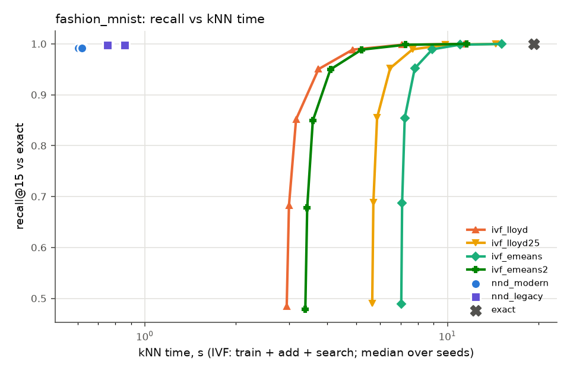

### Verdict lines

```
fashion_mnist [informational: not in the evaluation set]:
   no  (a) ivf_emeans kNN time at matched recall / nnd_modern = 17.709 [17.308–18.246] over 3 seeds (needs <= 0.8); informational: 14.986 with search time interpolated between swept nprobes
   no  (b) eumap_e2e / umap_e2e end-to-end = 2.889 (13.0 s vs 4.5 s, medians) (needs <= 0.85)
  YES  (c) eumap_e2e quality: np15 0.1286 vs umap 0.1265 [0.1253–0.1279] (+1.6% of the umap median) ok; trustworthiness 0.9756 vs umap 0.9749 [0.9741–0.9750] (+0.1% of the umap median) ok; knn_acc 0.7867 vs umap 0.7866 [0.7856–0.7870] (+0.0% of the umap median) ok
   no  (a)+(b)+(c) all hold (eUMAP worth using on this dataset)
   no  [Lloyd variant] (a) ivf_lloyd kNN time at matched recall / nnd_modern = 11.607 [11.168–11.723] over 3 seeds (needs <= 0.8); informational: 8.994 with search time interpolated between swept nprobes
   no  [Lloyd variant] (b) eumap_lloyd_e2e / umap_e2e end-to-end = 1.933 (8.7 s vs 4.5 s, medians) (needs <= 0.85)
  YES  [Lloyd variant] (c) eumap_lloyd_e2e quality: np15 0.1277 vs umap 0.1265 [0.1253–0.1279] (+0.9% of the umap median) ok; trustworthiness 0.9757 vs umap 0.9749 [0.9741–0.9750] (+0.1% of the umap median) ok; knn_acc 0.7882 vs umap 0.7866 [0.7856–0.7870] (+0.2% of the umap median) ok
   no  e-means contributes: ivf_emeans t_train/lloyd 2.880 (<= 0.7), matched search 4.40 s vs lloyd max 4.86 s -> no; ivf_emeans2 t_train/lloyd 1.223 (<= 0.7), matched search 4.38 s vs lloyd max 4.86 s -> no; eumap_e2e / eumap_lloyd_e2e = 1.494 (needs <= 0.95)
   no  the Faiss IVF graph helps, e-means does not (e-means end-to-end gain -0.494, needs < 0.05 with (a)-(c) met by an IVF pair)
   no  some IVF arm beats the faster NN-descent arm at matched recall (median ratios: ivf_lloyd 11.607, ivf_lloyd25 15.686, ivf_emeans 17.709, ivf_emeans2 11.933)
```

## glove100

### kNN stage

| arm | recall@15 | t_knn | t_prepare | t_train | t_add | centroid MSE | imbalance | peak RSS GB |
|---|---|---|---|---|---|---|---|---|
| exact | 1.000 | 1169 | – | – | – | – | – | 2.2 |
| nnd_modern | 0.6626 [0.6625–0.6627] | 7.53 [7.47–9.80] | – | – | – | – | – | 5.7 |
| nnd_legacy | 0.7564 [0.7564–0.7567] | 14.07 [13.92–14.46] | – | – | – | – | – | 6.8 |
| ivf_lloyd | max 0.9550 [0.9550–0.9552] @nprobe 256 [256–256] | see sweep | 0.28 [0.28–0.29] | 58.54 [53.67–60.20] | 6.34 [5.76–6.76] | 0.7456 [0.7455–0.7459] | 1.213 [1.213–1.233] | 5.3 |
| ivf_lloyd25 | max 0.9576 [0.9571–0.9578] @nprobe 256 [256–256] | see sweep | 0.28 [0.27–0.29] | 160.84 [152.24–165.98] | 6.60 [5.60–6.80] | 0.7397 [0.7394–0.7397] | 1.182 [1.181–1.194] | 5.0 |
| ivf_emeans | max 0.9602 [0.9602–0.9607] @nprobe 256 [256–256] | see sweep | 0.28 [0.28–0.39] | 41.26 [41.07–42.78] | 6.75 [6.38–6.77] | 0.7366 [0.7364–0.7369] | 1.186 [1.185–1.186] | 5.0 |
| ivf_emeans2 | max 0.9579 [0.9577–0.9579] @nprobe 256 [256–256] | see sweep | 0.28 [0.27–0.39] | 16.19 [16.11–16.85] | 6.30 [6.29–6.31] | 0.7425 [0.7425–0.7426] | 1.241 [1.233–1.245] | 5.0 |

### IVF nprobe sweep

| arm | nprobe | recall | recall (tie-aware) | missing | t_search | t_train+add+search |
|---|---|---|---|---|---|---|
| ivf_lloyd | 1 | 0.3211 [0.3206–0.3219] | 0.3211 [0.3207–0.3219] | 0.0000 [0.0000–0.0000] | 8.36 [8.32–8.38] | 73.25 [67.75–75.33] |
| ivf_lloyd | 2 | 0.4409 [0.4406–0.4421] | 0.4409 [0.4407–0.4422] | 0.0000 [0.0000–0.0000] | 8.82 [8.78–8.91] | 73.67 [68.34–75.78] |
| ivf_lloyd | 4 | 0.5543 [0.5540–0.5555] | 0.5543 [0.5541–0.5555] | 0.0000 [0.0000–0.0000] | 9.83 [9.80–9.94] | 74.69 [69.38–76.78] |
| ivf_lloyd | 8 | 0.6544 [0.6541–0.6552] | 0.6545 [0.6542–0.6552] | 0.0000 [0.0000–0.0000] | 13.75 [13.73–14.02] | 78.91 [73.16–80.70] |
| ivf_lloyd | 16 | 0.7401 [0.7400–0.7404] | 0.7402 [0.7401–0.7405] | 0.0000 [0.0000–0.0000] | 25.12 [24.61–25.13] | 90.01 [84.04–92.09] |
| ivf_lloyd | 32 | 0.8124 [0.8124–0.8124] | 0.8125 [0.8124–0.8125] | 0.0000 [0.0000–0.0000] | 47.04 [46.19–47.19] | 111.93 [105.63–114.14] |
| ivf_lloyd | 64 | 0.8720 [0.8718–0.8720] | 0.8721 [0.8719–0.8721] | 0.0000 [0.0000–0.0000] | 90.11 [88.81–105.91] | 157.07 [148.25–170.80] |
| ivf_lloyd | 128 | 0.9193 [0.9192–0.9194] | 0.9194 [0.9193–0.9195] | 0.0000 [0.0000–0.0000] | 176.15 [172.16–213.63] | 243.11 [231.59–278.52] |
| ivf_lloyd | 256 | 0.9550 [0.9550–0.9552] | 0.9551 [0.9550–0.9553] | 0.0000 [0.0000–0.0000] | 338.60 [336.01–428.71] | 405.55 [395.45–493.60] |
| ivf_lloyd25 | 1 | 0.3321 [0.3316–0.3336] | 0.3321 [0.3316–0.3336] | 0.0000 [0.0000–0.0000] | 8.33 [8.31–8.44] | 175.94 [166.17–181.02] |
| ivf_lloyd25 | 2 | 0.4514 [0.4508–0.4529] | 0.4515 [0.4509–0.4529] | 0.0000 [0.0000–0.0000] | 8.80 [8.76–8.99] | 176.40 [166.63–181.57] |
| ivf_lloyd25 | 4 | 0.5638 [0.5633–0.5648] | 0.5639 [0.5634–0.5648] | 0.0000 [0.0000–0.0000] | 9.97 [9.95–10.72] | 177.59 [167.80–183.31] |
| ivf_lloyd25 | 8 | 0.6630 [0.6624–0.6635] | 0.6630 [0.6624–0.6635] | 0.0000 [0.0000–0.0000] | 14.80 [13.62–17.63] | 182.44 [171.46–190.21] |
| ivf_lloyd25 | 16 | 0.7477 [0.7468–0.7477] | 0.7478 [0.7469–0.7478] | 0.0000 [0.0000–0.0000] | 27.51 [24.63–32.84] | 195.15 [182.46–205.43] |
| ivf_lloyd25 | 32 | 0.8184 [0.8180–0.8188] | 0.8185 [0.8181–0.8189] | 0.0000 [0.0000–0.0000] | 51.71 [46.50–62.18] | 219.35 [204.34–234.77] |
| ivf_lloyd25 | 64 | 0.8767 [0.8766–0.8772] | 0.8768 [0.8767–0.8773] | 0.0000 [0.0000–0.0000] | 98.31 [89.49–118.30] | 265.94 [247.33–290.88] |
| ivf_lloyd25 | 128 | 0.9229 [0.9226–0.9233] | 0.9230 [0.9227–0.9234] | 0.0000 [0.0000–0.0000] | 189.10 [173.70–227.99] | 356.74 [331.54–400.57] |
| ivf_lloyd25 | 256 | 0.9576 [0.9571–0.9578] | 0.9577 [0.9572–0.9578] | 0.0000 [0.0000–0.0000] | 369.80 [340.11–455.23] | 537.44 [497.94–627.81] |
| ivf_emeans | 1 | 0.3364 [0.3358–0.3368] | 0.3364 [0.3358–0.3368] | 0.0000 [0.0000–0.0000] | 8.40 [8.28–8.47] | 56.31 [56.29–57.56] |
| ivf_emeans | 2 | 0.4575 [0.4560–0.4579] | 0.4576 [0.4560–0.4579] | 0.0000 [0.0000–0.0000] | 8.92 [8.87–9.05] | 56.89 [56.87–58.09] |
| ivf_emeans | 4 | 0.5717 [0.5700–0.5718] | 0.5718 [0.5701–0.5719] | 0.0000 [0.0000–0.0000] | 10.00 [9.94–11.06] | 58.90 [58.01–59.10] |
| ivf_emeans | 8 | 0.6713 [0.6701–0.6720] | 0.6714 [0.6702–0.6721] | 0.0000 [0.0000–0.0000] | 15.03 [13.99–19.31] | 63.15 [63.04–67.15] |
| ivf_emeans | 16 | 0.7558 [0.7550–0.7567] | 0.7558 [0.7550–0.7568] | 0.0000 [0.0000–0.0000] | 27.90 [25.49–36.48] | 75.90 [74.66–84.32] |
| ivf_emeans | 32 | 0.8260 [0.8254–0.8268] | 0.8260 [0.8255–0.8269] | 0.0000 [0.0000–0.0000] | 52.54 [48.31–63.94] | 100.55 [97.48–111.78] |
| ivf_emeans | 64 | 0.8829 [0.8827–0.8836] | 0.8829 [0.8828–0.8837] | 0.0000 [0.0000–0.0000] | 104.48 [103.44–116.19] | 152.60 [152.49–164.03] |
| ivf_emeans | 128 | 0.9273 [0.9272–0.9279] | 0.9274 [0.9273–0.9280] | 0.0000 [0.0000–0.0000] | 212.01 [180.02–237.41] | 260.02 [227.86–286.58] |
| ivf_emeans | 256 | 0.9602 [0.9602–0.9607] | 0.9603 [0.9603–0.9607] | 0.0000 [0.0000–0.0000] | 409.51 [352.24–413.93] | 457.51 [400.08–463.10] |
| ivf_emeans2 | 1 | 0.3300 [0.3281–0.3302] | 0.3300 [0.3282–0.3302] | 0.0000 [0.0000–0.0000] | 8.33 [8.28–8.40] | 30.88 [30.75–31.44] |
| ivf_emeans2 | 2 | 0.4498 [0.4482–0.4507] | 0.4498 [0.4483–0.4508] | 0.0000 [0.0000–0.0000] | 8.84 [8.81–8.88] | 31.36 [31.26–31.96] |
| ivf_emeans2 | 4 | 0.5641 [0.5629–0.5655] | 0.5641 [0.5630–0.5655] | 0.0000 [0.0000–0.0000] | 9.95 [9.88–10.36] | 32.84 [32.37–33.04] |
| ivf_emeans2 | 8 | 0.6646 [0.6639–0.6656] | 0.6647 [0.6640–0.6657] | 0.0000 [0.0000–0.0000] | 15.01 [14.19–16.32] | 38.17 [36.60–38.80] |
| ivf_emeans2 | 16 | 0.7496 [0.7495–0.7506] | 0.7497 [0.7496–0.7507] | 0.0000 [0.0000–0.0000] | 28.24 [25.49–30.29] | 51.40 [47.90–52.77] |
| ivf_emeans2 | 32 | 0.8206 [0.8205–0.8213] | 0.8207 [0.8206–0.8214] | 0.0000 [0.0000–0.0000] | 53.39 [47.98–56.73] | 76.55 [70.39–79.21] |
| ivf_emeans2 | 64 | 0.8785 [0.8782–0.8788] | 0.8785 [0.8783–0.8789] | 0.0000 [0.0000–0.0000] | 102.56 [93.15–107.59] | 125.71 [115.56–130.07] |
| ivf_emeans2 | 128 | 0.9239 [0.9236–0.9240] | 0.9240 [0.9236–0.9240] | 0.0000 [0.0000–0.0000] | 197.80 [180.95–208.43] | 220.95 [203.36–230.90] |
| ivf_emeans2 | 256 | 0.9579 [0.9577–0.9579] | 0.9580 [0.9577–0.9580] | 0.0000 [0.0000–0.0000] | 384.51 [364.65–402.89] | 407.66 [387.07–425.37] |

### kNN time to reach a fixed recall (informational)

IVF: train + add + search at the smallest swept nprobe reaching the recall (inf: not reached within the sweep). NN-descent has one operating point, shown for reference.

| arm | recall >= 0.90 | recall >= 0.95 | recall >= 0.99 |
|---|---|---|---|
| ivf_lloyd | 243.11 [231.59–278.52] | 405.55 [395.45–493.60] | inf [inf–inf] |
| ivf_lloyd25 | 356.74 [331.54–400.57] | 537.44 [497.94–627.81] | inf [inf–inf] |
| ivf_emeans | 260.02 [227.86–286.58] | 457.51 [400.08–463.10] | inf [inf–inf] |
| ivf_emeans2 | 220.95 [203.36–230.90] | 407.66 [387.07–425.37] | inf [inf–inf] |
| nnd_modern (single point, recall 0.6626 [0.6625–0.6627]) | not reached | not reached | not reached |
| nnd_legacy (single point, recall 0.7564 [0.7564–0.7567]) | not reached | not reached | not reached |

### Matched recall (faster NN-descent arm: `nnd_modern`)

| NN-descent arm | IVF arm | NN-descent recall | target | nprobe per seed | IVF kNN time | NN-descent time | ratio IVF/NND | ratio, interpolated (informational) | unmatched: ratio lower bound |
|---|---|---|---|---|---|---|---|---|---|
| nnd_modern | ivf_lloyd | 0.6626 [0.6625–0.6627] | 0.6626 [0.6625–0.6627] | 16,16,16 | 90.01 [84.04–92.09] | 7.53 [7.47–9.80] | 11.949 [8.578–12.327] | 10.602 [7.575–10.956] | – |
| nnd_modern | ivf_lloyd25 | 0.6626 [0.6625–0.6627] | 0.6626 [0.6625–0.6627] | 8,8,16 | 190.21 [171.46–195.15] | 7.53 [7.47–9.80] | 25.463 [17.501–25.906] | 24.221 [17.500–25.456] | – |
| nnd_modern | ivf_emeans | 0.6626 [0.6625–0.6627] | 0.6626 [0.6625–0.6627] | 8,8,8 | 63.15 [63.04–67.15] | 7.53 [7.47–9.80] | 8.368 [6.446–8.989] | 8.309 [6.407–8.908] | – |
| nnd_modern | ivf_emeans2 | 0.6626 [0.6625–0.6627] | 0.6626 [0.6625–0.6627] | 8,8,8 | 38.17 [36.60–38.80] | 7.53 [7.47–9.80] | 4.900 [3.896–5.150] | 4.893 [3.880–5.134] | – |
| nnd_legacy | ivf_lloyd | 0.7564 [0.7564–0.7567] | 0.7564 [0.7564–0.7567] | 32,32,32 | 111.93 [105.63–114.14] | 14.07 [13.92–14.46] | 7.956 [7.302–8.199] | 6.745 [6.147–6.979] | – |
| nnd_legacy | ivf_lloyd25 | 0.7564 [0.7564–0.7567] | 0.7564 [0.7564–0.7567] | 32,32,32 | 219.35 [204.34–234.77] | 14.07 [13.92–14.46] | 15.592 [14.126–16.863] | 14.104 [12.800–15.023] | – |
| nnd_legacy | ivf_emeans | 0.7564 [0.7564–0.7567] | 0.7564 [0.7564–0.7567] | 16,32,32 | 100.55 [74.66–111.78] | 14.07 [13.92–14.46] | 7.148 [5.161–8.029] | 5.411 [5.158–6.104] | – |
| nnd_legacy | ivf_emeans2 | 0.7564 [0.7564–0.7567] | 0.7564 [0.7564–0.7567] | 32,32,32 | 76.55 [70.39–79.21] | 14.07 [13.92–14.46] | 5.292 [5.056–5.631] | 3.696 [3.603–3.930] | – |

The pre-registered ratio uses the smallest swept power-of-two nprobe that reaches the target. *Interpolated* charges IVF the search time interpolated linearly in recall between the two swept nprobes that bracket the target, to show how much of the ratio is grid overshoot. *Unmatched (cap)* means the sweep stopped at nprobe = 256 (the spec's limit) below the target; *(nlist)* means every list was probed. For those seeds the ratio is inf, and the IVF cost at the last swept nprobe gives a lower bound on what a longer sweep could have reached.

### End to end and embedding quality

| arm | t_e2e | t_knn | t_graph | t_layout | graph recall | NP@15 | trustworthiness | kNN acc | notes |
|---|---|---|---|---|---|---|---|---|---|
| umap_e2e | 106.5 [104.9–111.3] | 7.5 [7.4–8.0] | 1.9 [1.9–2.0] | 97.1 [95.0–101.8] | 0.6626 [0.6625–0.6627] | 0.0234 [0.0230–0.0250] | 0.8290 [0.8290–0.8320] | – |  |
| eumap_e2e | 547.0 [502.0–572.6] | 445.3 [404.5–474.9] | 2.0 [2.0–2.0] | 95.7 [95.5–99.8] | 0.9602 [0.9602–0.9607] | 0.0227 [0.0208–0.0231] | 0.8104 [0.8069–0.8105] | – | nprobe 256,256,256 |
| eumap_lloyd_e2e | 521.1 [509.5–612.6] | 422.1 [410.9–515.1] | 2.0 [2.0–2.1] | 96.6 [95.5–97.0] | 0.9550 [0.9550–0.9552] | 0.0238 [0.0232–0.0242] | 0.8084 [0.8080–0.8093] | – | nprobe 256,256,256 |
| layout_exact | 98.3 [97.6–99.1] | 0.0 [0.0–0.0] | 2.0 [1.9–2.0] | 96.2 [95.6–97.1] | 1.0000 [1.0000–1.0000] | 0.0232 [0.0213–0.0236] | 0.8039 [0.7976–0.8068] | – |  |

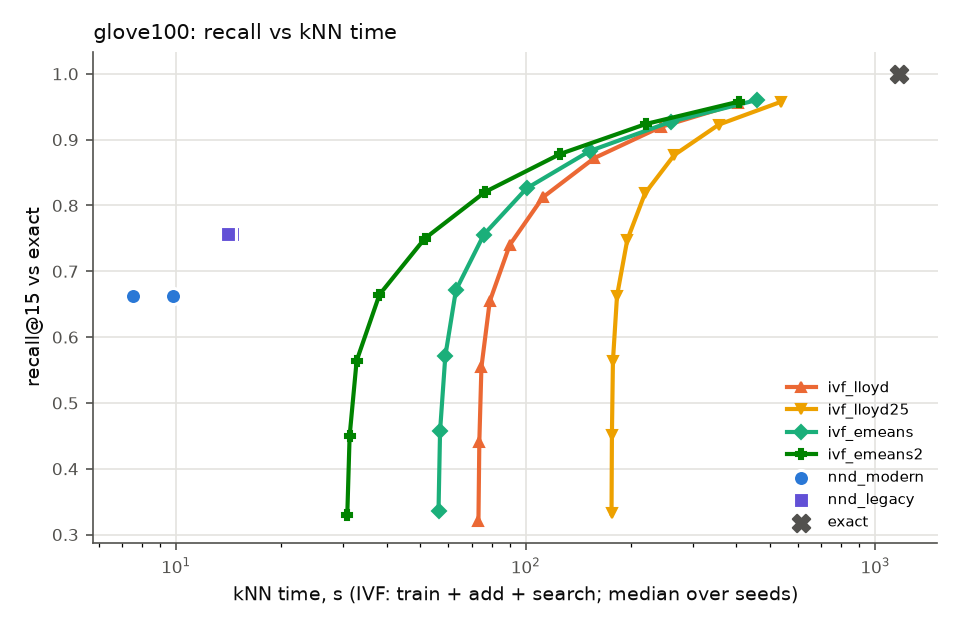

### Verdict lines

```
glove100:
   no  (a) ivf_emeans kNN time at matched recall / nnd_modern = 8.368 [6.446–8.989] over 3 seeds (needs <= 0.8); informational: 8.309 with search time interpolated between swept nprobes
   no  (b) eumap_e2e / umap_e2e end-to-end = 5.136 (547.0 s vs 106.5 s, medians) (needs <= 0.85)
   no  (c) eumap_e2e quality: np15 0.0227 vs umap 0.0234 [0.0230–0.0250] (-2.7% of the umap median) ok; trustworthiness 0.8104 vs umap 0.8290 [0.8290–0.8320] (-2.2% of the umap median) WORSE
   no  (a)+(b)+(c) all hold (eUMAP worth using on this dataset)
   no  [Lloyd variant] (a) ivf_lloyd kNN time at matched recall / nnd_modern = 11.949 [8.578–12.327] over 3 seeds (needs <= 0.8); informational: 10.602 with search time interpolated between swept nprobes
   no  [Lloyd variant] (b) eumap_lloyd_e2e / umap_e2e end-to-end = 4.892 (521.1 s vs 106.5 s, medians) (needs <= 0.85)
   no  [Lloyd variant] (c) eumap_lloyd_e2e quality: np15 0.0238 vs umap 0.0234 [0.0230–0.0250] (+1.7% of the umap median) ok; trustworthiness 0.8084 vs umap 0.8290 [0.8290–0.8320] (-2.5% of the umap median) WORSE
   no  e-means contributes: ivf_emeans t_train/lloyd 0.705 (<= 0.7), matched search 15.03 s vs lloyd max 25.13 s -> no; ivf_emeans2 t_train/lloyd 0.277 (<= 0.7), matched search 15.01 s vs lloyd max 25.13 s -> ok; eumap_e2e / eumap_lloyd_e2e = 1.050 (needs <= 0.95)
   no  the Faiss IVF graph helps, e-means does not (e-means end-to-end gain -0.050, needs < 0.05 with (a)-(c) met by an IVF pair)
   no  some IVF arm beats the faster NN-descent arm at matched recall (median ratios: ivf_lloyd 11.949, ivf_lloyd25 25.463, ivf_emeans 8.368, ivf_emeans2 4.900)
```

## mnist

### kNN stage

| arm | recall@15 | t_knn | t_prepare | t_train | t_add | centroid MSE | imbalance | peak RSS GB |
|---|---|---|---|---|---|---|---|---|
| exact | 1.000 | 20.68 | – | – | – | – | – | 1.1 |
| nnd_modern | 0.9913 [0.9912–0.9913] | 0.62 [0.61–0.71] | – | – | – | – | – | 2.6 |
| nnd_legacy | 0.9948 [0.9948–0.9949] | 0.74 [0.73–0.81] | – | – | – | – | – | 2.6 |
| ivf_lloyd | max 0.9991 [0.9990–0.9991] @nprobe 64 [64–64] | see sweep | 0.19 [0.18–0.19] | 2.08 [1.87–2.47] | 0.19 [0.18–0.24] | 1328936 [1327650–1329259] | 1.111 [1.104–1.115] | 2.7 |
| ivf_lloyd25 | max 0.9991 [0.9991–0.9992] @nprobe 64 [64–64] | see sweep | 0.19 [0.18–0.19] | 5.84 [4.95–6.17] | 0.23 [0.19–0.23] | 1320991 [1320251–1321434] | 1.103 [1.099–1.110] | 2.7 |
| ivf_emeans | max 0.9992 [0.9992–0.9992] @nprobe 64 [64–64] | see sweep | 0.20 [0.19–0.22] | 6.23 [6.21–6.70] | 0.25 [0.22–0.25] | 1312401 [1310687–1313710] | 1.111 [1.103–1.117] | 2.7 |
| ivf_emeans2 | max 0.9991 [0.9991–0.9991] @nprobe 64 [64–64] | see sweep | 0.19 [0.19–0.22] | 2.81 [2.73–2.82] | 0.21 [0.20–0.25] | 1326257 [1325104–1327592] | 1.107 [1.097–1.113] | 2.7 |

### IVF nprobe sweep

| arm | nprobe | recall | recall (tie-aware) | missing | t_search | t_train+add+search |
|---|---|---|---|---|---|---|
| ivf_lloyd | 1 | 0.4529 [0.4514–0.4533] | 0.4530 [0.4514–0.4533] | 0.0002 [0.0002–0.0003] | 0.49 [0.48–0.49] | 2.76 [2.53–3.19] |
| ivf_lloyd | 2 | 0.6441 [0.6437–0.6459] | 0.6442 [0.6438–0.6460] | 0.0000 [0.0000–0.0000] | 0.53 [0.52–0.53] | 2.79 [2.57–3.23] |
| ivf_lloyd | 4 | 0.8203 [0.8196–0.8223] | 0.8203 [0.8196–0.8224] | 0.0000 [0.0000–0.0000] | 0.65 [0.65–0.66] | 2.93 [2.70–3.36] |
| ivf_lloyd | 8 | 0.9348 [0.9339–0.9355] | 0.9349 [0.9339–0.9356] | 0.0000 [0.0000–0.0000] | 1.20 [1.12–1.23] | 3.47 [3.27–3.83] |
| ivf_lloyd | 16 | 0.9820 [0.9814–0.9821] | 0.9820 [0.9814–0.9822] | 0.0000 [0.0000–0.0000] | 2.35 [2.28–2.43] | 4.55 [4.40–5.13] |
| ivf_lloyd | 32 | 0.9956 [0.9954–0.9956] | 0.9956 [0.9955–0.9957] | 0.0000 [0.0000–0.0000] | 4.44 [4.35–4.93] | 6.62 [6.49–7.64] |
| ivf_lloyd | 64 | 0.9991 [0.9990–0.9991] | 0.9991 [0.9990–0.9991] | 0.0000 [0.0000–0.0000] | 8.88 [8.52–9.36] | 10.93 [10.79–12.06] |
| ivf_lloyd25 | 1 | 0.4605 [0.4590–0.4616] | 0.4606 [0.4590–0.4616] | 0.0002 [0.0002–0.0003] | 0.48 [0.48–0.49] | 6.55 [5.62–6.89] |
| ivf_lloyd25 | 2 | 0.6517 [0.6506–0.6528] | 0.6518 [0.6506–0.6528] | 0.0000 [0.0000–0.0000] | 0.53 [0.52–0.53] | 6.59 [5.66–6.94] |
| ivf_lloyd25 | 4 | 0.8257 [0.8248–0.8269] | 0.8258 [0.8249–0.8270] | 0.0000 [0.0000–0.0000] | 0.67 [0.66–0.67] | 6.73 [5.80–7.08] |
| ivf_lloyd25 | 8 | 0.9374 [0.9365–0.9379] | 0.9375 [0.9365–0.9379] | 0.0000 [0.0000–0.0000] | 1.24 [1.23–1.25] | 7.30 [6.38–7.66] |
| ivf_lloyd25 | 16 | 0.9829 [0.9825–0.9829] | 0.9829 [0.9825–0.9830] | 0.0000 [0.0000–0.0000] | 2.38 [2.36–2.38] | 8.44 [7.50–8.79] |
| ivf_lloyd25 | 32 | 0.9958 [0.9957–0.9960] | 0.9958 [0.9957–0.9960] | 0.0000 [0.0000–0.0000] | 4.56 [4.51–4.62] | 10.68 [9.64–10.96] |
| ivf_lloyd25 | 64 | 0.9991 [0.9991–0.9992] | 0.9991 [0.9991–0.9992] | 0.0000 [0.0000–0.0000] | 8.76 [8.66–8.90] | 14.96 [13.90–15.06] |
| ivf_emeans | 1 | 0.4683 [0.4673–0.4684] | 0.4683 [0.4674–0.4684] | 0.0000 [0.0000–0.0001] | 0.49 [0.48–0.49] | 6.96 [6.95–7.41] |
| ivf_emeans | 2 | 0.6591 [0.6583–0.6593] | 0.6591 [0.6583–0.6594] | 0.0000 [0.0000–0.0000] | 0.53 [0.53–0.53] | 7.00 [6.99–7.45] |
| ivf_emeans | 4 | 0.8310 [0.8310–0.8317] | 0.8311 [0.8310–0.8318] | 0.0000 [0.0000–0.0000] | 0.67 [0.66–0.67] | 7.14 [7.13–7.58] |
| ivf_emeans | 8 | 0.9399 [0.9398–0.9400] | 0.9399 [0.9399–0.9401] | 0.0000 [0.0000–0.0000] | 1.23 [1.23–1.27] | 7.73 [7.71–8.14] |
| ivf_emeans | 16 | 0.9837 [0.9836–0.9837] | 0.9837 [0.9836–0.9838] | 0.0000 [0.0000–0.0000] | 2.34 [2.32–2.41] | 8.86 [8.79–9.26] |
| ivf_emeans | 32 | 0.9961 [0.9960–0.9961] | 0.9961 [0.9960–0.9962] | 0.0000 [0.0000–0.0000] | 4.52 [4.47–4.71] | 11.17 [11.00–11.39] |
| ivf_emeans | 64 | 0.9992 [0.9992–0.9992] | 0.9992 [0.9992–0.9992] | 0.0000 [0.0000–0.0000] | 8.88 [8.68–8.90] | 15.37 [15.34–15.60] |
| ivf_emeans2 | 1 | 0.4554 [0.4539–0.4570] | 0.4554 [0.4539–0.4570] | 0.0001 [0.0001–0.0001] | 0.49 [0.48–0.49] | 3.51 [3.42–3.56] |
| ivf_emeans2 | 2 | 0.6477 [0.6463–0.6491] | 0.6478 [0.6464–0.6492] | 0.0000 [0.0000–0.0000] | 0.53 [0.53–0.53] | 3.55 [3.46–3.60] |
| ivf_emeans2 | 4 | 0.8237 [0.8222–0.8243] | 0.8238 [0.8223–0.8244] | 0.0000 [0.0000–0.0000] | 0.66 [0.65–0.67] | 3.68 [3.59–3.73] |
| ivf_emeans2 | 8 | 0.9367 [0.9361–0.9369] | 0.9367 [0.9361–0.9370] | 0.0000 [0.0000–0.0000] | 1.23 [1.14–1.24] | 4.17 [4.16–4.30] |
| ivf_emeans2 | 16 | 0.9828 [0.9826–0.9832] | 0.9828 [0.9826–0.9832] | 0.0000 [0.0000–0.0000] | 2.34 [2.16–2.37] | 5.27 [5.18–5.45] |
| ivf_emeans2 | 32 | 0.9958 [0.9957–0.9959] | 0.9958 [0.9957–0.9959] | 0.0000 [0.0000–0.0000] | 4.49 [4.21–4.53] | 7.42 [7.23–7.60] |
| ivf_emeans2 | 64 | 0.9991 [0.9991–0.9991] | 0.9991 [0.9991–0.9991] | 0.0000 [0.0000–0.0000] | 8.58 [7.96–8.67] | 11.60 [10.98–11.66] |

### kNN time to reach a fixed recall (informational)

IVF: train + add + search at the smallest swept nprobe reaching the recall (inf: not reached within the sweep). NN-descent has one operating point, shown for reference.

| arm | recall >= 0.90 | recall >= 0.95 | recall >= 0.99 |
|---|---|---|---|
| ivf_lloyd | 3.47 [3.27–3.83] | 4.55 [4.40–5.13] | 6.62 [6.49–7.64] |
| ivf_lloyd25 | 7.30 [6.38–7.66] | 8.44 [7.50–8.79] | 10.68 [9.64–10.96] |
| ivf_emeans | 7.73 [7.71–8.14] | 8.86 [8.79–9.26] | 11.17 [11.00–11.39] |
| ivf_emeans2 | 4.17 [4.16–4.30] | 5.27 [5.18–5.45] | 7.42 [7.23–7.60] |
| nnd_modern (single point, recall 0.9913 [0.9912–0.9913]) | 0.62 [0.61–0.71] | 0.62 [0.61–0.71] | 0.62 [0.61–0.71] |
| nnd_legacy (single point, recall 0.9948 [0.9948–0.9949]) | 0.74 [0.73–0.81] | 0.74 [0.73–0.81] | 0.74 [0.73–0.81] |

### Matched recall (faster NN-descent arm: `nnd_modern`)

| NN-descent arm | IVF arm | NN-descent recall | target | nprobe per seed | IVF kNN time | NN-descent time | ratio IVF/NND | ratio, interpolated (informational) | unmatched: ratio lower bound |
|---|---|---|---|---|---|---|---|---|---|
| nnd_modern | ivf_lloyd | 0.9913 [0.9912–0.9913] | 0.9913 [0.9912–0.9913] | 32,32,32 | 6.62 [6.49–7.64] | 0.62 [0.61–0.71] | 10.911 [9.126–12.259] | 9.800 [8.265–10.965] | – |
| nnd_modern | ivf_lloyd25 | 0.9913 [0.9912–0.9913] | 0.9913 [0.9912–0.9913] | 32,32,32 | 10.68 [9.64–10.96] | 0.62 [0.61–0.71] | 15.908 [15.412–17.141] | 14.612 [14.409–15.882] | – |
| nnd_modern | ivf_emeans | 0.9913 [0.9912–0.9913] | 0.9913 [0.9912–0.9913] | 32,32,32 | 11.17 [11.00–11.39] | 0.62 [0.61–0.71] | 18.141 [15.705–18.273] | 16.704 [14.477–16.938] | – |
| nnd_modern | ivf_emeans2 | 0.9913 [0.9912–0.9913] | 0.9913 [0.9912–0.9913] | 32,32,32 | 7.42 [7.23–7.60] | 0.62 [0.61–0.71] | 11.600 [10.426–12.539] | 10.409 [9.401–11.297] | – |
| nnd_legacy | ivf_lloyd | 0.9948 [0.9948–0.9949] | 0.9948 [0.9948–0.9949] | 32,32,32 | 6.62 [6.49–7.64] | 0.74 [0.73–0.81] | 8.959 [8.035–10.422] | 8.784 [7.916–10.232] | – |
| nnd_legacy | ivf_lloyd25 | 0.9948 [0.9948–0.9949] | 0.9948 [0.9948–0.9949] | 32,32,32 | 10.68 [9.64–10.96] | 0.74 [0.73–0.81] | 13.569 [13.062–14.572] | 13.395 [12.800–14.352] | – |
| nnd_legacy | ivf_emeans | 0.9948 [0.9948–0.9949] | 0.9948 [0.9948–0.9949] | 32,32,32 | 11.17 [11.00–11.39] | 0.74 [0.73–0.81] | 14.896 [13.828–15.535] | 14.589 [13.544–15.236] | – |
| nnd_legacy | ivf_emeans2 | 0.9948 [0.9948–0.9949] | 0.9948 [0.9948–0.9949] | 32,32,32 | 7.42 [7.23–7.60] | 0.74 [0.73–0.81] | 9.862 [9.180–10.296] | 9.634 [8.991–10.073] | – |

The pre-registered ratio uses the smallest swept power-of-two nprobe that reaches the target. *Interpolated* charges IVF the search time interpolated linearly in recall between the two swept nprobes that bracket the target, to show how much of the ratio is grid overshoot. *Unmatched (cap)* means the sweep stopped at nprobe = 256 (the spec's limit) below the target; *(nlist)* means every list was probed. For those seeds the ratio is inf, and the IVF cost at the last swept nprobe gives a lower bound on what a longer sweep could have reached.

### End to end and embedding quality

| arm | t_e2e | t_knn | t_graph | t_layout | graph recall | NP@15 | trustworthiness | kNN acc | notes |
|---|---|---|---|---|---|---|---|---|---|
| umap_e2e | 5.3 [4.5–7.1] | 0.6 [0.6–1.5] | 0.1 [0.1–0.1] | 4.6 [3.7–5.5] | 0.9913 [0.9912–0.9913] | 0.1148 [0.1131–0.1173] | 0.9542 [0.9497–0.9544] | 0.9689 [0.9670–0.9696] |  |
| eumap_e2e | 13.4 [13.4–14.1] | 9.6 [9.5–9.6] | 0.1 [0.1–0.1] | 3.7 [3.7–4.5] | 0.9837 [0.9836–0.9837] | 0.1161 [0.1140–0.1172] | 0.9536 [0.9532–0.9564] | 0.9684 [0.9683–0.9686] | nprobe 16,16,16 |
| eumap_lloyd_e2e | 9.1 [8.6–9.8] | 5.3 [5.1–5.3] | 0.1 [0.1–0.1] | 3.7 [3.5–4.5] | 0.9820 [0.9814–0.9821] | 0.1153 [0.1139–0.1160] | 0.9528 [0.9523–0.9538] | 0.9686 [0.9684–0.9693] | nprobe 16,16,16 |
| layout_exact | 4.5 [4.1–9.3] | 0.0 [0.0–0.0] | 0.1 [0.1–0.1] | 4.5 [4.0–9.2] | 1.0000 [1.0000–1.0000] | 0.1140 [0.1122–0.1149] | 0.9525 [0.9516–0.9540] | 0.9691 [0.9685–0.9696] |  |

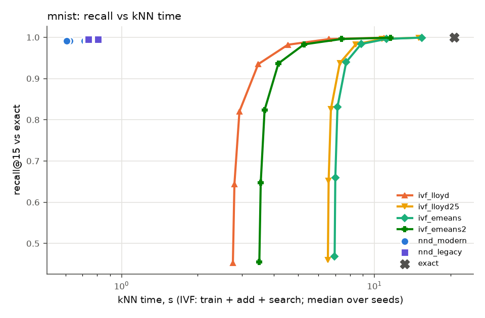

### Verdict lines

```
mnist [informational: not in the evaluation set]:
   no  (a) ivf_emeans kNN time at matched recall / nnd_modern = 18.141 [15.705–18.273] over 3 seeds (needs <= 0.8); informational: 16.704 with search time interpolated between swept nprobes
   no  (b) eumap_e2e / umap_e2e end-to-end = 2.539 (13.4 s vs 5.3 s, medians) (needs <= 0.85)
  YES  (c) eumap_e2e quality: np15 0.1161 vs umap 0.1148 [0.1131–0.1173] (+1.1% of the umap median) ok; trustworthiness 0.9536 vs umap 0.9542 [0.9497–0.9544] (-0.1% of the umap median) ok; knn_acc 0.9684 vs umap 0.9689 [0.9670–0.9696] (-0.1% of the umap median) ok
   no  (a)+(b)+(c) all hold (eUMAP worth using on this dataset)
   no  [Lloyd variant] (a) ivf_lloyd kNN time at matched recall / nnd_modern = 10.911 [9.126–12.259] over 3 seeds (needs <= 0.8); informational: 9.800 with search time interpolated between swept nprobes
   no  [Lloyd variant] (b) eumap_lloyd_e2e / umap_e2e end-to-end = 1.715 (9.1 s vs 5.3 s, medians) (needs <= 0.85)
  YES  [Lloyd variant] (c) eumap_lloyd_e2e quality: np15 0.1153 vs umap 0.1148 [0.1131–0.1173] (+0.4% of the umap median) ok; trustworthiness 0.9528 vs umap 0.9542 [0.9497–0.9544] (-0.2% of the umap median) ok; knn_acc 0.9686 vs umap 0.9689 [0.9670–0.9696] (-0.0% of the umap median) ok
   no  e-means contributes: ivf_emeans t_train/lloyd 2.993 (<= 0.7), matched search 4.52 s vs lloyd max 4.93 s -> no; ivf_emeans2 t_train/lloyd 1.348 (<= 0.7), matched search 4.49 s vs lloyd max 4.93 s -> no; eumap_e2e / eumap_lloyd_e2e = 1.480 (needs <= 0.95)
   no  the Faiss IVF graph helps, e-means does not (e-means end-to-end gain -0.480, needs < 0.05 with (a)-(c) met by an IVF pair)
   no  some IVF arm beats the faster NN-descent arm at matched recall (median ratios: ivf_lloyd 10.911, ivf_lloyd25 15.908, ivf_emeans 18.141, ivf_emeans2 11.600)
```

## sift1m

### kNN stage

| arm | recall@15 | t_knn | t_prepare | t_train | t_add | centroid MSE | imbalance | peak RSS GB |
|---|---|---|---|---|---|---|---|---|
| exact | 1.000 | 1638 | – | – | – | – | – | 2.2 |
| nnd_modern | 0.9179 [0.9179–0.9180] | 5.03 [4.92–5.74] | – | – | – | – | – | 5.0 |
| nnd_legacy | 0.9663 [0.9662–0.9664] | 9.70 [9.68–10.32] | – | – | – | – | – | 5.9 |
| ivf_lloyd | max 0.9988 [0.9987–0.9988] @nprobe 256 [256–256] | see sweep | 0.49 [0.47–0.50] | 36.22 [34.85–45.62] | 3.69 [3.53–4.52] | 44677 [44672–44678] | 1.140 [1.129–1.140] | 4.9 |
| ivf_lloyd25 | max 0.9989 [0.9988–0.9989] @nprobe 256 [256–256] | see sweep | 0.47 [0.46–0.49] | 90.01 [88.74–98.77] | 3.95 [3.64–4.03] | 44391 [44388–44392] | 1.124 [1.120–1.126] | 4.7 |
| ivf_emeans | max 0.9989 [0.9989–0.9989] @nprobe 256 [256–256] | see sweep | 0.48 [0.47–0.59] | 28.50 [27.28–29.62] | 3.03 [3.03–3.50] | 44195 [44193–44204] | 1.137 [1.137–1.142] | 4.4 |
| ivf_emeans2 | max 0.9989 [0.9988–0.9989] @nprobe 256 [256–256] | see sweep | 0.49 [0.47–0.60] | 12.06 [11.51–12.62] | 3.53 [3.30–4.32] | 44494 [44489–44496] | 1.140 [1.137–1.145] | 4.4 |

### IVF nprobe sweep

| arm | nprobe | recall | recall (tie-aware) | missing | t_search | t_train+add+search |
|---|---|---|---|---|---|---|
| ivf_lloyd | 1 | 0.3041 [0.3033–0.3046] | 0.3044 [0.3036–0.3049] | 0.0000 [0.0000–0.0000] | 7.11 [7.09–7.23] | 46.83 [45.76–57.25] |
| ivf_lloyd | 2 | 0.4417 [0.4407–0.4420] | 0.4421 [0.4411–0.4424] | 0.0000 [0.0000–0.0000] | 7.98 [7.89–8.04] | 47.79 [46.51–58.03] |
| ivf_lloyd | 4 | 0.5900 [0.5895–0.5902] | 0.5906 [0.5900–0.5908] | 0.0000 [0.0000–0.0000] | 9.19 [9.01–9.22] | 48.94 [47.75–59.15] |
| ivf_lloyd | 8 | 0.7304 [0.7304–0.7308] | 0.7311 [0.7311–0.7315] | 0.0000 [0.0000–0.0000] | 13.56 [13.31–13.67] | 53.42 [51.84–63.70] |
| ivf_lloyd | 16 | 0.8465 [0.8462–0.8468] | 0.8473 [0.8470–0.8476] | 0.0000 [0.0000–0.0000] | 24.59 [23.78–25.43] | 65.17 [62.31–74.73] |
| ivf_lloyd | 32 | 0.9275 [0.9273–0.9278] | 0.9282 [0.9279–0.9284] | 0.0000 [0.0000–0.0000] | 45.41 [44.35–47.28] | 87.03 [82.88–95.55] |
| ivf_lloyd | 64 | 0.9734 [0.9732–0.9734] | 0.9738 [0.9736–0.9739] | 0.0000 [0.0000–0.0000] | 86.47 [85.16–89.87] | 129.62 [123.69–136.61] |
| ivf_lloyd | 128 | 0.9930 [0.9929–0.9930] | 0.9933 [0.9932–0.9933] | 0.0000 [0.0000–0.0000] | 164.76 [163.40–172.74] | 212.49 [201.93–214.90] |
| ivf_lloyd | 256 | 0.9988 [0.9987–0.9988] | 0.9990 [0.9989–0.9990] | 0.0000 [0.0000–0.0000] | 317.70 [316.21–333.99] | 367.84 [354.74–373.73] |
| ivf_lloyd25 | 1 | 0.3113 [0.3111–0.3118] | 0.3116 [0.3114–0.3121] | 0.0000 [0.0000–0.0000] | 7.16 [7.09–7.20] | 100.84 [99.85–109.90] |
| ivf_lloyd25 | 2 | 0.4498 [0.4490–0.4501] | 0.4502 [0.4495–0.4505] | 0.0000 [0.0000–0.0000] | 8.02 [8.00–8.10] | 101.65 [100.71–110.90] |
| ivf_lloyd25 | 4 | 0.5982 [0.5975–0.5982] | 0.5987 [0.5981–0.5988] | 0.0000 [0.0000–0.0000] | 9.11 [9.08–9.12] | 102.76 [101.78–111.92] |
| ivf_lloyd25 | 8 | 0.7375 [0.7373–0.7379] | 0.7382 [0.7380–0.7386] | 0.0000 [0.0000–0.0000] | 13.10 [13.07–13.56] | 106.71 [106.26–115.91] |
| ivf_lloyd25 | 16 | 0.8515 [0.8515–0.8518] | 0.8523 [0.8523–0.8526] | 0.0000 [0.0000–0.0000] | 23.64 [23.44–25.17] | 117.87 [117.09–126.45] |
| ivf_lloyd25 | 32 | 0.9306 [0.9305–0.9306] | 0.9313 [0.9312–0.9313] | 0.0000 [0.0000–0.0000] | 44.26 [44.19–46.72] | 139.41 [137.83–147.06] |
| ivf_lloyd25 | 64 | 0.9747 [0.9747–0.9748] | 0.9751 [0.9751–0.9753] | 0.0000 [0.0000–0.0000] | 84.17 [83.85–89.40] | 182.10 [177.81–186.66] |
| ivf_lloyd25 | 128 | 0.9934 [0.9934–0.9935] | 0.9937 [0.9936–0.9938] | 0.0000 [0.0000–0.0000] | 163.77 [162.44–171.97] | 264.66 [257.42–265.24] |
| ivf_lloyd25 | 256 | 0.9989 [0.9988–0.9989] | 0.9990 [0.9990–0.9991] | 0.0000 [0.0000–0.0000] | 334.19 [318.37–355.55] | 426.88 [412.01–458.35] |
| ivf_emeans | 1 | 0.3173 [0.3172–0.3175] | 0.3176 [0.3175–0.3178] | 0.0000 [0.0000–0.0000] | 7.09 [7.03–7.20] | 38.56 [37.39–40.32] |
| ivf_emeans | 2 | 0.4566 [0.4565–0.4567] | 0.4570 [0.4570–0.4571] | 0.0000 [0.0000–0.0000] | 8.03 [7.99–8.16] | 39.53 [38.33–41.28] |
| ivf_emeans | 4 | 0.6050 [0.6049–0.6051] | 0.6056 [0.6055–0.6056] | 0.0000 [0.0000–0.0000] | 9.17 [9.15–9.19] | 40.72 [39.45–42.29] |
| ivf_emeans | 8 | 0.7437 [0.7436–0.7437] | 0.7444 [0.7443–0.7445] | 0.0000 [0.0000–0.0000] | 13.26 [13.14–13.87] | 45.40 [43.45–46.38] |
| ivf_emeans | 16 | 0.8561 [0.8561–0.8563] | 0.8569 [0.8568–0.8571] | 0.0000 [0.0000–0.0000] | 23.98 [23.87–25.08] | 56.62 [54.17–57.10] |
| ivf_emeans | 32 | 0.9332 [0.9332–0.9334] | 0.9339 [0.9339–0.9341] | 0.0000 [0.0000–0.0000] | 45.09 [45.06–47.60] | 78.18 [75.40–79.13] |
| ivf_emeans | 64 | 0.9760 [0.9759–0.9760] | 0.9764 [0.9763–0.9765] | 0.0000 [0.0000–0.0000] | 86.52 [85.52–89.95] | 118.64 [116.82–121.49] |
| ivf_emeans | 128 | 0.9938 [0.9938–0.9939] | 0.9941 [0.9941–0.9941] | 0.0000 [0.0000–0.0000] | 170.93 [164.78–174.06] | 201.24 [197.90–205.59] |
| ivf_emeans | 256 | 0.9989 [0.9989–0.9989] | 0.9991 [0.9991–0.9991] | 0.0000 [0.0000–0.0000] | 338.07 [318.81–338.34] | 368.65 [351.93–369.61] |
| ivf_emeans2 | 1 | 0.3080 [0.3077–0.3081] | 0.3083 [0.3080–0.3084] | 0.0000 [0.0000–0.0000] | 7.06 [6.99–7.15] | 22.59 [21.96–23.99] |
| ivf_emeans2 | 2 | 0.4467 [0.4463–0.4469] | 0.4471 [0.4468–0.4473] | 0.0000 [0.0000–0.0000] | 8.06 [7.98–8.08] | 23.57 [22.89–25.00] |
| ivf_emeans2 | 4 | 0.5958 [0.5956–0.5959] | 0.5964 [0.5962–0.5965] | 0.0000 [0.0000–0.0000] | 9.18 [9.15–9.25] | 24.75 [24.06–26.12] |
| ivf_emeans2 | 8 | 0.7362 [0.7362–0.7364] | 0.7369 [0.7369–0.7371] | 0.0000 [0.0000–0.0000] | 13.49 [13.26–14.15] | 29.75 [28.30–30.19] |
| ivf_emeans2 | 16 | 0.8511 [0.8510–0.8512] | 0.8519 [0.8518–0.8519] | 0.0000 [0.0000–0.0000] | 24.57 [23.84–25.26] | 40.77 [39.38–40.86] |
| ivf_emeans2 | 32 | 0.9304 [0.9303–0.9305] | 0.9311 [0.9309–0.9312] | 0.0000 [0.0000–0.0000] | 46.09 [44.98–47.34] | 61.92 [60.90–62.93] |
| ivf_emeans2 | 64 | 0.9747 [0.9746–0.9747] | 0.9751 [0.9751–0.9752] | 0.0000 [0.0000–0.0000] | 86.31 [85.96–89.69] | 103.25 [100.77–105.29] |
| ivf_emeans2 | 128 | 0.9934 [0.9934–0.9935] | 0.9937 [0.9937–0.9937] | 0.0000 [0.0000–0.0000] | 166.41 [165.69–166.88] | 181.29 [181.22–183.82] |
| ivf_emeans2 | 256 | 0.9989 [0.9988–0.9989] | 0.9990 [0.9990–0.9991] | 0.0000 [0.0000–0.0000] | 325.14 [322.12–333.97] | 339.95 [337.71–350.90] |

### kNN time to reach a fixed recall (informational)

IVF: train + add + search at the smallest swept nprobe reaching the recall (inf: not reached within the sweep). NN-descent has one operating point, shown for reference.

| arm | recall >= 0.90 | recall >= 0.95 | recall >= 0.99 |
|---|---|---|---|
| ivf_lloyd | 87.03 [82.88–95.55] | 129.62 [123.69–136.61] | 212.49 [201.93–214.90] |
| ivf_lloyd25 | 139.41 [137.83–147.06] | 182.10 [177.81–186.66] | 264.66 [257.42–265.24] |
| ivf_emeans | 78.18 [75.40–79.13] | 118.64 [116.82–121.49] | 201.24 [197.90–205.59] |
| ivf_emeans2 | 61.92 [60.90–62.93] | 103.25 [100.77–105.29] | 181.29 [181.22–183.82] |
| nnd_modern (single point, recall 0.9179 [0.9179–0.9180]) | 5.03 [4.92–5.74] | not reached | not reached |
| nnd_legacy (single point, recall 0.9663 [0.9662–0.9664]) | 9.70 [9.68–10.32] | 9.70 [9.68–10.32] | not reached |

### Matched recall (faster NN-descent arm: `nnd_modern`)

| NN-descent arm | IVF arm | NN-descent recall | target | nprobe per seed | IVF kNN time | NN-descent time | ratio IVF/NND | ratio, interpolated (informational) | unmatched: ratio lower bound |
|---|---|---|---|---|---|---|---|---|---|
| nnd_modern | ivf_lloyd | 0.9179 [0.9179–0.9180] | 0.9179 [0.9179–0.9180] | 32,32,32 | 87.03 [82.88–95.55] | 5.03 [4.92–5.74] | 16.852 [16.635–17.310] | 16.367 [16.208–16.780] | – |
| nnd_modern | ivf_lloyd25 | 0.9179 [0.9179–0.9180] | 0.9179 [0.9179–0.9180] | 32,32,32 | 139.41 [137.83–147.06] | 5.03 [4.92–5.74] | 27.729 [25.602–28.025] | 27.042 [25.024–27.346] | – |
| nnd_modern | ivf_emeans | 0.9179 [0.9179–0.9180] | 0.9179 [0.9179–0.9180] | 32,32,32 | 78.18 [75.40–79.13] | 5.03 [4.92–5.74] | 14.997 [13.777–15.896] | 14.147 [13.000–15.043] | – |
| nnd_modern | ivf_emeans2 | 0.9179 [0.9179–0.9180] | 0.9179 [0.9179–0.9180] | 32,32,32 | 61.92 [60.90–62.93] | 5.03 [4.92–5.74] | 12.383 [10.779–12.518] | 11.699 [10.197–11.823] | – |
| nnd_legacy | ivf_lloyd | 0.9663 [0.9662–0.9664] | 0.9663 [0.9662–0.9664] | 64,64,64 | 129.62 [123.69–136.61] | 9.70 [9.68–10.32] | 13.240 [12.775–13.369] | 12.624 [12.154–12.676] | – |
| nnd_legacy | ivf_lloyd25 | 0.9663 [0.9662–0.9664] | 0.9663 [0.9662–0.9664] | 64,64,64 | 182.10 [177.81–186.66] | 9.70 [9.68–10.32] | 18.364 [18.091–18.782] | 17.591 [17.348–17.938] | – |
| nnd_legacy | ivf_emeans | 0.9663 [0.9662–0.9664] | 0.9663 [0.9662–0.9664] | 64,64,64 | 118.64 [116.82–121.49] | 9.70 [9.68–10.32] | 12.050 [11.774–12.253] | 11.069 [10.841–11.324] | – |
| nnd_legacy | ivf_emeans2 | 0.9663 [0.9662–0.9664] | 0.9663 [0.9662–0.9664] | 64,64,64 | 103.25 [100.77–105.29] | 9.70 [9.68–10.32] | 10.407 [10.007–10.860] | 9.645 [9.239–10.025] | – |

The pre-registered ratio uses the smallest swept power-of-two nprobe that reaches the target. *Interpolated* charges IVF the search time interpolated linearly in recall between the two swept nprobes that bracket the target, to show how much of the ratio is grid overshoot. *Unmatched (cap)* means the sweep stopped at nprobe = 256 (the spec's limit) below the target; *(nlist)* means every list was probed. For those seeds the ratio is inf, and the IVF cost at the last swept nprobe gives a lower bound on what a longer sweep could have reached.

### End to end and embedding quality

| arm | t_e2e | t_knn | t_graph | t_layout | graph recall | NP@15 | trustworthiness | kNN acc | notes |
|---|---|---|---|---|---|---|---|---|---|
| umap_e2e | 88.7 [85.1–96.0] | 5.1 [5.0–5.3] | 1.5 [1.5–1.5] | 82.0 [78.3–89.4] | 0.9179 [0.9179–0.9180] | 0.0131 [0.0124–0.0131] | 0.9137 [0.9128–0.9180] | – |  |
| eumap_e2e | 206.4 [202.7–217.2] | 118.8 [118.3–129.5] | 1.5 [1.5–1.6] | 86.1 [82.4–86.6] | 0.9760 [0.9759–0.9760] | 0.0122 [0.0121–0.0124] | 0.9119 [0.9110–0.9162] | – | nprobe 64,64,64 |
| eumap_lloyd_e2e | 211.6 [205.3–216.5] | 122.5 [121.6–129.2] | 1.5 [1.5–1.5] | 85.8 [81.4–88.5] | 0.9734 [0.9732–0.9734] | 0.0124 [0.0124–0.0127] | 0.9142 [0.9141–0.9158] | – | nprobe 64,64,64 |
| layout_exact | 85.7 [85.1–89.0] | 0.0 [0.0–0.0] | 1.5 [1.5–1.6] | 84.1 [83.5–87.5] | 1.0000 [1.0000–1.0000] | 0.0123 [0.0119–0.0126] | 0.9142 [0.9140–0.9153] | – |  |

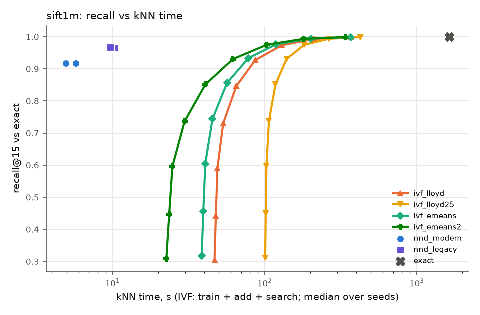

### Verdict lines

```
sift1m:
   no  (a) ivf_emeans kNN time at matched recall / nnd_modern = 14.997 [13.777–15.896] over 3 seeds (needs <= 0.8); informational: 14.147 with search time interpolated between swept nprobes
   no  (b) eumap_e2e / umap_e2e end-to-end = 2.327 (206.4 s vs 88.7 s, medians) (needs <= 0.85)
  YES  (c) eumap_e2e quality: np15 0.0122 vs umap 0.0131 [0.0124–0.0131] (-6.4% of the umap median) ok; trustworthiness 0.9119 vs umap 0.9137 [0.9128–0.9180] (-0.2% of the umap median) ok
   no  (a)+(b)+(c) all hold (eUMAP worth using on this dataset)
   no  [Lloyd variant] (a) ivf_lloyd kNN time at matched recall / nnd_modern = 16.852 [16.635–17.310] over 3 seeds (needs <= 0.8); informational: 16.367 with search time interpolated between swept nprobes
   no  [Lloyd variant] (b) eumap_lloyd_e2e / umap_e2e end-to-end = 2.386 (211.6 s vs 88.7 s, medians) (needs <= 0.85)
  YES  [Lloyd variant] (c) eumap_lloyd_e2e quality: np15 0.0124 vs umap 0.0131 [0.0124–0.0131] (-5.3% of the umap median) ok; trustworthiness 0.9142 vs umap 0.9137 [0.9128–0.9180] (+0.1% of the umap median) ok
   no  e-means contributes: ivf_emeans t_train/lloyd 0.787 (<= 0.7), matched search 45.09 s vs lloyd max 47.28 s -> no; ivf_emeans2 t_train/lloyd 0.333 (<= 0.7), matched search 46.09 s vs lloyd max 47.28 s -> ok; eumap_e2e / eumap_lloyd_e2e = 0.975 (needs <= 0.95)
   no  the Faiss IVF graph helps, e-means does not (e-means end-to-end gain 0.025, needs < 0.05 with (a)-(c) met by an IVF pair)
   no  some IVF arm beats the faster NN-descent arm at matched recall (median ratios: ivf_lloyd 16.852, ivf_lloyd25 27.729, ivf_emeans 14.997, ivf_emeans2 12.383)
```

## synthetic n=1e4

### kNN stage

| arm | recall@15 | t_knn | t_prepare | t_train | t_add | centroid MSE | imbalance | peak RSS GB |
|---|---|---|---|---|---|---|---|---|
| exact | 1.000 | 0.51 | – | – | – | – | – | 0.7 |
| nnd_modern | 0.9691 [0.9683–0.9695] | 0.05 [0.05–0.05] | – | – | – | – | – | 1.4 |
| nnd_legacy | 0.9812 [0.9809–0.9813] | 0.06 [0.05–0.06] | – | – | – | – | – | 1.4 |
| ivf_lloyd | max 1.0000 [1.0000–1.0000] @nprobe 256 [256–256] | see sweep | 0.00 [0.00–0.00] | 0.05 [0.04–0.06] | 0.00 [0.00–0.01] | 1193 [1189–1195] | 2.067 [1.901–2.154] | 1.2 |
| ivf_lloyd25 | max 1.0000 [1.0000–1.0000] @nprobe 256 [256–256] | see sweep | 0.00 [0.00–0.00] | 0.13 [0.11–0.14] | 0.01 [0.00–0.01] | 1187 [1185–1189] | 2.048 [1.870–2.055] | 1.2 |
| ivf_emeans | max 1.0000 [1.0000–1.0000] @nprobe 256 [256–256] | see sweep | 0.00 [0.00–0.00] | 0.18 [0.17–0.18] | 0.01 [0.00–0.01] | 1174 [1173–1179] | 1.861 [1.794–1.952] | 1.2 |
| ivf_emeans2 | max 1.0000 [1.0000–1.0000] @nprobe 256 [256–256] | see sweep | 0.00 [0.00–0.00] | 0.07 [0.07–0.07] | 0.01 [0.01–0.01] | 1207 [1202–1209] | 1.752 [1.661–1.858] | 1.2 |

### IVF nprobe sweep

| arm | nprobe | recall | recall (tie-aware) | missing | t_search | t_train+add+search |
|---|---|---|---|---|---|---|
| ivf_lloyd | 1 | 0.3709 [0.3615–0.3727] | 0.3710 [0.3615–0.3728] | 0.0085 [0.0079–0.0094] | 0.06 [0.06–0.06] | 0.11 [0.11–0.12] |
| ivf_lloyd | 2 | 0.4839 [0.4835–0.4924] | 0.4840 [0.4835–0.4924] | 0.0000 [0.0000–0.0001] | 0.06 [0.06–0.06] | 0.11 [0.11–0.12] |
| ivf_lloyd | 4 | 0.5896 [0.5834–0.5970] | 0.5897 [0.5835–0.5970] | 0.0000 [0.0000–0.0000] | 0.06 [0.06–0.06] | 0.11 [0.11–0.12] |
| ivf_lloyd | 8 | 0.6987 [0.6858–0.7061] | 0.6988 [0.6859–0.7062] | 0.0000 [0.0000–0.0000] | 0.06 [0.06–0.06] | 0.11 [0.11–0.12] |
| ivf_lloyd | 16 | 0.8041 [0.7865–0.8130] | 0.8042 [0.7866–0.8131] | 0.0000 [0.0000–0.0000] | 0.06 [0.06–0.06] | 0.11 [0.11–0.12] |
| ivf_lloyd | 32 | 0.8898 [0.8741–0.8971] | 0.8899 [0.8742–0.8972] | 0.0000 [0.0000–0.0000] | 0.06 [0.06–0.06] | 0.11 [0.11–0.13] |
| ivf_lloyd | 64 | 0.9493 [0.9404–0.9527] | 0.9494 [0.9405–0.9528] | 0.0000 [0.0000–0.0000] | 0.07 [0.07–0.07] | 0.12 [0.12–0.13] |
| ivf_lloyd | 128 | 0.9831 [0.9811–0.9838] | 0.9832 [0.9811–0.9838] | 0.0000 [0.0000–0.0000] | 0.07 [0.06–0.07] | 0.12 [0.12–0.13] |
| ivf_lloyd | 256 | 1.0000 [1.0000–1.0000] | 1.0000 [1.0000–1.0000] | 0.0000 [0.0000–0.0000] | 0.09 [0.09–0.09] | 0.14 [0.14–0.15] |
| ivf_lloyd25 | 1 | 0.3785 [0.3703–0.3812] | 0.3785 [0.3703–0.3813] | 0.0081 [0.0077–0.0090] | 0.06 [0.06–0.06] | 0.20 [0.17–0.21] |
| ivf_lloyd25 | 2 | 0.4927 [0.4873–0.4980] | 0.4927 [0.4873–0.4980] | 0.0000 [0.0000–0.0001] | 0.06 [0.06–0.06] | 0.20 [0.17–0.20] |
| ivf_lloyd25 | 4 | 0.5887 [0.5884–0.6034] | 0.5888 [0.5885–0.6034] | 0.0000 [0.0000–0.0000] | 0.06 [0.06–0.06] | 0.20 [0.17–0.21] |
| ivf_lloyd25 | 8 | 0.6976 [0.6871–0.7127] | 0.6976 [0.6872–0.7128] | 0.0000 [0.0000–0.0000] | 0.06 [0.06–0.06] | 0.20 [0.17–0.21] |
| ivf_lloyd25 | 16 | 0.8008 [0.7836–0.8138] | 0.8009 [0.7837–0.8140] | 0.0000 [0.0000–0.0000] | 0.06 [0.06–0.06] | 0.20 [0.17–0.21] |
| ivf_lloyd25 | 32 | 0.8864 [0.8705–0.8930] | 0.8865 [0.8706–0.8931] | 0.0000 [0.0000–0.0000] | 0.06 [0.06–0.06] | 0.20 [0.17–0.21] |
| ivf_lloyd25 | 64 | 0.9471 [0.9382–0.9488] | 0.9472 [0.9382–0.9489] | 0.0000 [0.0000–0.0000] | 0.07 [0.07–0.07] | 0.21 [0.18–0.21] |
| ivf_lloyd25 | 128 | 0.9815 [0.9807–0.9819] | 0.9815 [0.9807–0.9819] | 0.0000 [0.0000–0.0000] | 0.06 [0.06–0.06] | 0.20 [0.18–0.21] |
| ivf_lloyd25 | 256 | 1.0000 [1.0000–1.0000] | 1.0000 [1.0000–1.0000] | 0.0000 [0.0000–0.0000] | 0.09 [0.09–0.09] | 0.23 [0.20–0.23] |
| ivf_emeans | 1 | 0.3718 [0.3683–0.3725] | 0.3718 [0.3684–0.3725] | 0.0054 [0.0051–0.0055] | 0.06 [0.06–0.06] | 0.24 [0.23–0.24] |
| ivf_emeans | 2 | 0.4823 [0.4821–0.4856] | 0.4824 [0.4821–0.4856] | 0.0000 [0.0000–0.0000] | 0.06 [0.06–0.06] | 0.24 [0.23–0.24] |
| ivf_emeans | 4 | 0.5805 [0.5755–0.5931] | 0.5806 [0.5756–0.5932] | 0.0000 [0.0000–0.0000] | 0.06 [0.06–0.06] | 0.24 [0.23–0.24] |
| ivf_emeans | 8 | 0.6833 [0.6723–0.7054] | 0.6834 [0.6723–0.7055] | 0.0000 [0.0000–0.0000] | 0.06 [0.06–0.06] | 0.24 [0.24–0.24] |
| ivf_emeans | 16 | 0.7904 [0.7773–0.8124] | 0.7905 [0.7774–0.8124] | 0.0000 [0.0000–0.0000] | 0.06 [0.06–0.06] | 0.24 [0.24–0.25] |
| ivf_emeans | 32 | 0.8823 [0.8759–0.8957] | 0.8825 [0.8760–0.8958] | 0.0000 [0.0000–0.0000] | 0.06 [0.06–0.06] | 0.25 [0.24–0.25] |
| ivf_emeans | 64 | 0.9469 [0.9441–0.9503] | 0.9471 [0.9442–0.9503] | 0.0000 [0.0000–0.0000] | 0.07 [0.07–0.07] | 0.25 [0.24–0.25] |
| ivf_emeans | 128 | 0.9816 [0.9803–0.9822] | 0.9816 [0.9804–0.9823] | 0.0000 [0.0000–0.0000] | 0.06 [0.06–0.07] | 0.25 [0.24–0.25] |
| ivf_emeans | 256 | 1.0000 [1.0000–1.0000] | 1.0000 [1.0000–1.0000] | 0.0000 [0.0000–0.0000] | 0.09 [0.09–0.09] | 0.27 [0.26–0.27] |
| ivf_emeans2 | 1 | 0.3161 [0.3143–0.3293] | 0.3161 [0.3143–0.3293] | 0.0095 [0.0087–0.0128] | 0.06 [0.06–0.06] | 0.13 [0.13–0.13] |
| ivf_emeans2 | 2 | 0.4242 [0.4230–0.4391] | 0.4242 [0.4230–0.4392] | 0.0000 [0.0000–0.0001] | 0.06 [0.06–0.06] | 0.13 [0.13–0.13] |
| ivf_emeans2 | 4 | 0.5230 [0.5199–0.5315] | 0.5231 [0.5199–0.5315] | 0.0000 [0.0000–0.0000] | 0.06 [0.06–0.06] | 0.13 [0.13–0.13] |
| ivf_emeans2 | 8 | 0.6251 [0.6179–0.6280] | 0.6251 [0.6179–0.6281] | 0.0000 [0.0000–0.0000] | 0.06 [0.06–0.06] | 0.13 [0.13–0.13] |
| ivf_emeans2 | 16 | 0.7329 [0.7247–0.7391] | 0.7330 [0.7248–0.7392] | 0.0000 [0.0000–0.0000] | 0.06 [0.06–0.06] | 0.14 [0.13–0.14] |
| ivf_emeans2 | 32 | 0.8401 [0.8355–0.8548] | 0.8403 [0.8356–0.8549] | 0.0000 [0.0000–0.0000] | 0.06 [0.06–0.06] | 0.14 [0.14–0.14] |
| ivf_emeans2 | 64 | 0.9311 [0.9308–0.9461] | 0.9312 [0.9310–0.9462] | 0.0000 [0.0000–0.0000] | 0.07 [0.07–0.07] | 0.14 [0.14–0.14] |
| ivf_emeans2 | 128 | 0.9839 [0.9830–0.9848] | 0.9839 [0.9830–0.9848] | 0.0000 [0.0000–0.0000] | 0.07 [0.06–0.07] | 0.14 [0.14–0.14] |
| ivf_emeans2 | 256 | 1.0000 [1.0000–1.0000] | 1.0000 [1.0000–1.0000] | 0.0000 [0.0000–0.0000] | 0.09 [0.09–0.09] | 0.16 [0.16–0.16] |

### kNN time to reach a fixed recall (informational)

IVF: train + add + search at the smallest swept nprobe reaching the recall (inf: not reached within the sweep). NN-descent has one operating point, shown for reference.

| arm | recall >= 0.90 | recall >= 0.95 | recall >= 0.99 |
|---|---|---|---|
| ivf_lloyd | 0.12 [0.12–0.13] | 0.12 [0.12–0.13] | 0.14 [0.14–0.15] |
| ivf_lloyd25 | 0.21 [0.18–0.21] | 0.20 [0.18–0.21] | 0.23 [0.20–0.23] |
| ivf_emeans | 0.25 [0.24–0.25] | 0.25 [0.24–0.25] | 0.27 [0.26–0.27] |
| ivf_emeans2 | 0.14 [0.14–0.14] | 0.14 [0.14–0.14] | 0.16 [0.16–0.16] |
| nnd_modern (single point, recall 0.9691 [0.9683–0.9695]) | 0.05 [0.05–0.05] | 0.05 [0.05–0.05] | not reached |
| nnd_legacy (single point, recall 0.9812 [0.9809–0.9813]) | 0.06 [0.05–0.06] | 0.06 [0.05–0.06] | not reached |

### Matched recall (faster NN-descent arm: `nnd_modern`)

| NN-descent arm | IVF arm | NN-descent recall | target | nprobe per seed | IVF kNN time | NN-descent time | ratio IVF/NND | ratio, interpolated (informational) | unmatched: ratio lower bound |
|---|---|---|---|---|---|---|---|---|---|
| nnd_modern | ivf_lloyd | 0.9691 [0.9683–0.9695] | 0.9691 [0.9683–0.9695] | 128,128,128 | 0.12 [0.12–0.13] | 0.05 [0.05–0.05] | 2.431 [2.372–2.688] | 2.430 [2.395–2.700] | – |
| nnd_modern | ivf_lloyd25 | 0.9691 [0.9683–0.9695] | 0.9691 [0.9683–0.9695] | 128,128,128 | 0.20 [0.18–0.21] | 0.05 [0.05–0.05] | 4.344 [3.704–4.353] | 4.360 [3.716–4.365] | – |
| nnd_modern | ivf_emeans | 0.9691 [0.9683–0.9695] | 0.9691 [0.9683–0.9695] | 128,128,128 | 0.25 [0.24–0.25] | 0.05 [0.05–0.05] | 5.143 [5.052–5.248] | 5.139 [5.063–5.266] | – |
| nnd_modern | ivf_emeans2 | 0.9691 [0.9683–0.9695] | 0.9691 [0.9683–0.9695] | 128,128,128 | 0.14 [0.14–0.14] | 0.05 [0.05–0.05] | 2.921 [2.914–2.987] | 2.931 [2.915–2.998] | – |
| nnd_legacy | ivf_lloyd | 0.9812 [0.9809–0.9813] | 0.9812 [0.9809–0.9813] | 128,128,128 | 0.12 [0.12–0.13] | 0.06 [0.05–0.06] | 2.167 [2.020–2.256] | 2.167 [2.023–2.257] | – |
| nnd_legacy | ivf_lloyd25 | 0.9812 [0.9809–0.9813] | 0.9812 [0.9809–0.9813] | 128,128,256 | 0.20 [0.20–0.21] | 0.06 [0.05–0.06] | 3.706 [3.645–3.722] | 3.646 [3.306–3.706] | – |
| nnd_legacy | ivf_emeans | 0.9812 [0.9809–0.9813] | 0.9812 [0.9809–0.9813] | 128,256,128 | 0.25 [0.24–0.27] | 0.06 [0.05–0.06] | 4.503 [4.404–4.743] | 4.405 [4.397–4.504] | – |
| nnd_legacy | ivf_emeans2 | 0.9812 [0.9809–0.9813] | 0.9812 [0.9809–0.9813] | 128,128,128 | 0.14 [0.14–0.14] | 0.06 [0.05–0.06] | 2.507 [2.481–2.603] | 2.508 [2.481–2.605] | – |

The pre-registered ratio uses the smallest swept power-of-two nprobe that reaches the target. *Interpolated* charges IVF the search time interpolated linearly in recall between the two swept nprobes that bracket the target, to show how much of the ratio is grid overshoot. *Unmatched (cap)* means the sweep stopped at nprobe = 256 (the spec's limit) below the target; *(nlist)* means every list was probed. For those seeds the ratio is inf, and the IVF cost at the last swept nprobe gives a lower bound on what a longer sweep could have reached.

### End to end and embedding quality

| arm | t_e2e | t_knn | t_graph | t_layout | graph recall | NP@15 | trustworthiness | kNN acc | notes |
|---|---|---|---|---|---|---|---|---|---|
| umap_e2e | 1.3 [1.2–2.3] | 0.0 [0.0–0.1] | 0.0 [0.0–0.0] | 1.3 [1.1–2.2] | 0.9691 [0.9683–0.9695] | 0.1717 [0.1685–0.1762] | 0.6661 [0.6655–0.6699] | 0.9981 [0.9979–0.9984] |  |
| eumap_e2e | 1.5 [1.5–3.7] | 0.4 [0.3–0.7] | 0.0 [0.0–0.0] | 1.2 [1.1–3.0] | 0.9816 [0.9803–0.9822] | 0.1770 [0.1768–0.1791] | 0.6733 [0.6724–0.6739] | 0.9991 [0.9990–0.9997] | nprobe 128,128,128 |
| eumap_lloyd_e2e | 1.6 [1.5–1.7] | 0.2 [0.2–0.4] | 0.0 [0.0–0.0] | 1.3 [1.2–1.4] | 0.9527 [0.9493–0.9811] | 0.1784 [0.1773–0.1799] | 0.6737 [0.6710–0.6759] | 0.9995 [0.9991–0.9996] | nprobe 64,64,128 |
| layout_exact | 1.2 [1.2–1.2] | 0.0 [0.0–0.0] | 0.0 [0.0–0.0] | 1.2 [1.1–1.2] | 1.0000 [1.0000–1.0000] | 0.1728 [0.1691–0.1728] | 0.6650 [0.6625–0.6675] | 0.9994 [0.9991–0.9995] |  |

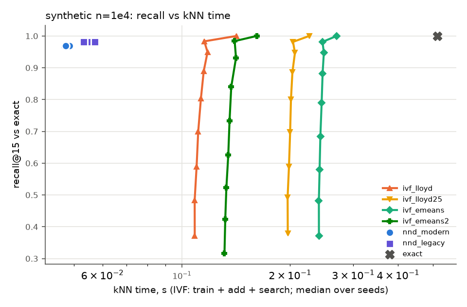

### Verdict lines

```
synthetic n=1e4 [informational: not in the evaluation set]:
   no  (a) ivf_emeans kNN time at matched recall / nnd_modern = 5.143 [5.052–5.248] over 3 seeds (needs <= 0.8); informational: 5.139 with search time interpolated between swept nprobes
   no  (b) eumap_e2e / umap_e2e end-to-end = 1.149 (1.5 s vs 1.3 s, medians) (needs <= 0.85)
  YES  (c) eumap_e2e quality: np15 0.1770 vs umap 0.1717 [0.1685–0.1762] (+3.0% of the umap median) ok; trustworthiness 0.6733 vs umap 0.6661 [0.6655–0.6699] (+1.1% of the umap median) ok; knn_acc 0.9991 vs umap 0.9981 [0.9979–0.9984] (+0.1% of the umap median) ok
   no  (a)+(b)+(c) all hold (eUMAP worth using on this dataset)
   no  [Lloyd variant] (a) ivf_lloyd kNN time at matched recall / nnd_modern = 2.431 [2.372–2.688] over 3 seeds (needs <= 0.8); informational: 2.430 with search time interpolated between swept nprobes
   no  [Lloyd variant] (b) eumap_lloyd_e2e / umap_e2e end-to-end = 1.157 (1.6 s vs 1.3 s, medians) (needs <= 0.85)
  YES  [Lloyd variant] (c) eumap_lloyd_e2e quality: np15 0.1784 vs umap 0.1717 [0.1685–0.1762] (+3.9% of the umap median) ok; trustworthiness 0.6737 vs umap 0.6661 [0.6655–0.6699] (+1.1% of the umap median) ok; knn_acc 0.9995 vs umap 0.9981 [0.9979–0.9984] (+0.1% of the umap median) ok
   no  e-means contributes: ivf_emeans t_train/lloyd 3.810 (<= 0.7), matched search 0.06 s vs lloyd max 0.07 s -> no; ivf_emeans2 t_train/lloyd 1.485 (<= 0.7), matched search 0.07 s vs lloyd max 0.07 s -> no; eumap_e2e / eumap_lloyd_e2e = 0.992 (needs <= 0.95)
   no  the Faiss IVF graph helps, e-means does not (e-means end-to-end gain 0.008, needs < 0.05 with (a)-(c) met by an IVF pair)
   no  some IVF arm beats the faster NN-descent arm at matched recall (median ratios: ivf_lloyd 2.431, ivf_lloyd25 4.344, ivf_emeans 5.143, ivf_emeans2 2.921)
```

## synthetic n=3e4

### kNN stage

| arm | recall@15 | t_knn | t_prepare | t_train | t_add | centroid MSE | imbalance | peak RSS GB |
|---|---|---|---|---|---|---|---|---|
| exact | 1.000 | 1.74 | – | – | – | – | – | 0.7 |
| nnd_modern | 0.9956 [0.9954–0.9959] | 0.09 [0.09–0.10] | – | – | – | – | – | 1.5 |
| nnd_legacy | 0.9972 [0.9971–0.9973] | 0.11 [0.11–0.11] | – | – | – | – | – | 1.5 |
| ivf_lloyd | max 0.9830 [0.9829–0.9832] @nprobe 256 [256–256] | see sweep | 0.01 [0.01–0.01] | 0.17 [0.15–0.20] | 0.02 [0.01–0.02] | 1085 [1085–1086] | 1.324 [1.319–1.369] | 1.3 |
| ivf_lloyd25 | max 0.9831 [0.9827–0.9832] @nprobe 256 [256–256] | see sweep | 0.01 [0.01–0.01] | 0.44 [0.39–0.46] | 0.02 [0.02–0.02] | 1078 [1078–1078] | 1.382 [1.350–1.418] | 1.3 |
| ivf_emeans | max 0.9833 [0.9831–0.9835] @nprobe 256 [256–256] | see sweep | 0.01 [0.01–0.01] | 0.50 [0.49–0.50] | 0.02 [0.02–0.02] | 1068 [1068–1069] | 1.344 [1.338–1.358] | 1.3 |
| ivf_emeans2 | max 0.9837 [0.9833–0.9844] @nprobe 256 [256–256] | see sweep | 0.01 [0.01–0.01] | 0.22 [0.22–0.30] | 0.02 [0.02–0.02] | 1085 [1085–1087] | 1.279 [1.256–1.332] | 1.3 |

### IVF nprobe sweep

| arm | nprobe | recall | recall (tie-aware) | missing | t_search | t_train+add+search |
|---|---|---|---|---|---|---|
| ivf_lloyd | 1 | 0.4923 [0.4921–0.4937] | 0.4923 [0.4921–0.4937] | 0.0006 [0.0002–0.0009] | 0.17 [0.17–0.17] | 0.36 [0.34–0.39] |
| ivf_lloyd | 2 | 0.6511 [0.6501–0.6539] | 0.6512 [0.6501–0.6539] | 0.0000 [0.0000–0.0000] | 0.18 [0.18–0.18] | 0.36 [0.34–0.40] |
| ivf_lloyd | 4 | 0.7414 [0.7369–0.7451] | 0.7415 [0.7369–0.7452] | 0.0000 [0.0000–0.0000] | 0.19 [0.18–0.19] | 0.37 [0.35–0.41] |
| ivf_lloyd | 8 | 0.8043 [0.7998–0.8092] | 0.8044 [0.7999–0.8093] | 0.0000 [0.0000–0.0000] | 0.19 [0.19–0.19] | 0.37 [0.35–0.41] |
| ivf_lloyd | 16 | 0.8573 [0.8543–0.8587] | 0.8574 [0.8543–0.8588] | 0.0000 [0.0000–0.0000] | 0.19 [0.19–0.20] | 0.38 [0.36–0.42] |
| ivf_lloyd | 32 | 0.8993 [0.8979–0.8996] | 0.8994 [0.8980–0.8997] | 0.0000 [0.0000–0.0000] | 0.20 [0.20–0.20] | 0.39 [0.37–0.42] |
| ivf_lloyd | 64 | 0.9332 [0.9319–0.9333] | 0.9332 [0.9319–0.9333] | 0.0000 [0.0000–0.0000] | 0.21 [0.21–0.21] | 0.40 [0.37–0.43] |
| ivf_lloyd | 128 | 0.9603 [0.9602–0.9607] | 0.9603 [0.9603–0.9607] | 0.0000 [0.0000–0.0000] | 0.28 [0.28–0.29] | 0.46 [0.44–0.51] |
| ivf_lloyd | 256 | 0.9830 [0.9829–0.9832] | 0.9831 [0.9829–0.9832] | 0.0000 [0.0000–0.0000] | 0.47 [0.47–0.47] | 0.65 [0.64–0.69] |
| ivf_lloyd25 | 1 | 0.5026 [0.5018–0.5043] | 0.5026 [0.5018–0.5043] | 0.0005 [0.0002–0.0008] | 0.17 [0.17–0.17] | 0.63 [0.58–0.65] |
| ivf_lloyd25 | 2 | 0.6608 [0.6605–0.6624] | 0.6608 [0.6606–0.6625] | 0.0000 [0.0000–0.0000] | 0.18 [0.18–0.18] | 0.64 [0.58–0.66] |
| ivf_lloyd25 | 4 | 0.7511 [0.7503–0.7550] | 0.7511 [0.7504–0.7550] | 0.0000 [0.0000–0.0000] | 0.19 [0.18–0.19] | 0.65 [0.59–0.66] |
| ivf_lloyd25 | 8 | 0.8156 [0.8142–0.8204] | 0.8157 [0.8143–0.8204] | 0.0000 [0.0000–0.0000] | 0.19 [0.19–0.19] | 0.65 [0.59–0.67] |
| ivf_lloyd25 | 16 | 0.8662 [0.8644–0.8680] | 0.8662 [0.8644–0.8681] | 0.0000 [0.0000–0.0000] | 0.19 [0.19–0.20] | 0.65 [0.60–0.67] |
| ivf_lloyd25 | 32 | 0.9034 [0.9030–0.9040] | 0.9034 [0.9031–0.9041] | 0.0000 [0.0000–0.0000] | 0.20 [0.20–0.20] | 0.66 [0.61–0.68] |
| ivf_lloyd25 | 64 | 0.9347 [0.9341–0.9350] | 0.9347 [0.9342–0.9351] | 0.0000 [0.0000–0.0000] | 0.21 [0.21–0.21] | 0.67 [0.62–0.69] |
| ivf_lloyd25 | 128 | 0.9608 [0.9607–0.9613] | 0.9608 [0.9608–0.9614] | 0.0000 [0.0000–0.0000] | 0.29 [0.27–0.29] | 0.75 [0.70–0.75] |
| ivf_lloyd25 | 256 | 0.9831 [0.9827–0.9832] | 0.9831 [0.9828–0.9832] | 0.0000 [0.0000–0.0000] | 0.47 [0.46–0.47] | 0.93 [0.87–0.95] |
| ivf_emeans | 1 | 0.4987 [0.4983–0.5043] | 0.4987 [0.4983–0.5044] | 0.0001 [0.0000–0.0001] | 0.17 [0.17–0.17] | 0.69 [0.68–0.69] |
| ivf_emeans | 2 | 0.6570 [0.6553–0.6598] | 0.6570 [0.6554–0.6599] | 0.0000 [0.0000–0.0000] | 0.18 [0.18–0.18] | 0.69 [0.69–0.70] |
| ivf_emeans | 4 | 0.7437 [0.7430–0.7476] | 0.7438 [0.7430–0.7476] | 0.0000 [0.0000–0.0000] | 0.19 [0.19–0.19] | 0.70 [0.70–0.70] |
| ivf_emeans | 8 | 0.8097 [0.8070–0.8127] | 0.8098 [0.8070–0.8127] | 0.0000 [0.0000–0.0000] | 0.19 [0.19–0.19] | 0.71 [0.70–0.71] |
| ivf_emeans | 16 | 0.8656 [0.8636–0.8664] | 0.8657 [0.8636–0.8665] | 0.0000 [0.0000–0.0000] | 0.20 [0.19–0.20] | 0.71 [0.71–0.71] |
| ivf_emeans | 32 | 0.9067 [0.9050–0.9071] | 0.9068 [0.9050–0.9071] | 0.0000 [0.0000–0.0000] | 0.20 [0.20–0.20] | 0.72 [0.71–0.72] |
| ivf_emeans | 64 | 0.9374 [0.9362–0.9380] | 0.9375 [0.9362–0.9381] | 0.0000 [0.0000–0.0000] | 0.21 [0.21–0.21] | 0.73 [0.72–0.73] |
| ivf_emeans | 128 | 0.9626 [0.9615–0.9628] | 0.9627 [0.9615–0.9628] | 0.0000 [0.0000–0.0000] | 0.27 [0.27–0.28] | 0.79 [0.78–0.80] |
| ivf_emeans | 256 | 0.9833 [0.9831–0.9835] | 0.9833 [0.9831–0.9835] | 0.0000 [0.0000–0.0000] | 0.46 [0.46–0.47] | 0.98 [0.97–0.98] |
| ivf_emeans2 | 1 | 0.4734 [0.4717–0.4746] | 0.4735 [0.4717–0.4746] | 0.0000 [0.0000–0.0001] | 0.17 [0.17–0.17] | 0.41 [0.41–0.49] |
| ivf_emeans2 | 2 | 0.6299 [0.6282–0.6317] | 0.6299 [0.6283–0.6317] | 0.0000 [0.0000–0.0000] | 0.18 [0.18–0.18] | 0.42 [0.41–0.49] |
| ivf_emeans2 | 4 | 0.7190 [0.7183–0.7239] | 0.7191 [0.7184–0.7239] | 0.0000 [0.0000–0.0000] | 0.18 [0.18–0.18] | 0.42 [0.42–0.50] |
| ivf_emeans2 | 8 | 0.7827 [0.7818–0.7905] | 0.7828 [0.7819–0.7906] | 0.0000 [0.0000–0.0000] | 0.19 [0.19–0.19] | 0.43 [0.42–0.50] |
| ivf_emeans2 | 16 | 0.8391 [0.8357–0.8453] | 0.8392 [0.8357–0.8454] | 0.0000 [0.0000–0.0000] | 0.19 [0.19–0.19] | 0.43 [0.43–0.51] |
| ivf_emeans2 | 32 | 0.8894 [0.8852–0.8931] | 0.8895 [0.8853–0.8932] | 0.0000 [0.0000–0.0000] | 0.20 [0.20–0.20] | 0.44 [0.44–0.51] |
| ivf_emeans2 | 64 | 0.9311 [0.9276–0.9323] | 0.9312 [0.9277–0.9323] | 0.0000 [0.0000–0.0000] | 0.20 [0.20–0.20] | 0.44 [0.44–0.51] |
| ivf_emeans2 | 128 | 0.9612 [0.9596–0.9618] | 0.9612 [0.9596–0.9619] | 0.0000 [0.0000–0.0000] | 0.28 [0.28–0.29] | 0.52 [0.52–0.60] |
| ivf_emeans2 | 256 | 0.9837 [0.9833–0.9844] | 0.9837 [0.9833–0.9844] | 0.0000 [0.0000–0.0000] | 0.47 [0.47–0.48] | 0.71 [0.71–0.79] |

### kNN time to reach a fixed recall (informational)

IVF: train + add + search at the smallest swept nprobe reaching the recall (inf: not reached within the sweep). NN-descent has one operating point, shown for reference.

| arm | recall >= 0.90 | recall >= 0.95 | recall >= 0.99 |
|---|---|---|---|
| ivf_lloyd | 0.40 [0.37–0.43] | 0.46 [0.44–0.51] | inf [inf–inf] |
| ivf_lloyd25 | 0.66 [0.61–0.68] | 0.75 [0.70–0.75] | inf [inf–inf] |
| ivf_emeans | 0.72 [0.71–0.72] | 0.79 [0.78–0.80] | inf [inf–inf] |
| ivf_emeans2 | 0.44 [0.44–0.51] | 0.52 [0.52–0.60] | inf [inf–inf] |
| nnd_modern (single point, recall 0.9956 [0.9954–0.9959]) | 0.09 [0.09–0.10] | 0.09 [0.09–0.10] | 0.09 [0.09–0.10] |
| nnd_legacy (single point, recall 0.9972 [0.9971–0.9973]) | 0.11 [0.11–0.11] | 0.11 [0.11–0.11] | 0.11 [0.11–0.11] |

### Matched recall (faster NN-descent arm: `nnd_modern`)

| NN-descent arm | IVF arm | NN-descent recall | target | nprobe per seed | IVF kNN time | NN-descent time | ratio IVF/NND | ratio, interpolated (informational) | unmatched: ratio lower bound |
|---|---|---|---|---|---|---|---|---|---|
| nnd_modern | ivf_lloyd | 0.9956 [0.9954–0.9959] | 0.9956 [0.9954–0.9959] | unmatched (cap),unmatched (cap),unmatched (cap) | inf [inf–inf] | 0.09 [0.09–0.10] | inf [inf–inf] | inf [inf–inf] | >= 7.191 [6.793–7.675] |
| nnd_modern | ivf_lloyd25 | 0.9956 [0.9954–0.9959] | 0.9956 [0.9954–0.9959] | unmatched (cap),unmatched (cap),unmatched (cap) | inf [inf–inf] | 0.09 [0.09–0.10] | inf [inf–inf] | inf [inf–inf] | >= 10.266 [9.052–10.634] |
| nnd_modern | ivf_emeans | 0.9956 [0.9954–0.9959] | 0.9956 [0.9954–0.9959] | unmatched (cap),unmatched (cap),unmatched (cap) | inf [inf–inf] | 0.09 [0.09–0.10] | inf [inf–inf] | inf [inf–inf] | >= 10.786 [10.209–10.881] |
| nnd_modern | ivf_emeans2 | 0.9956 [0.9954–0.9959] | 0.9956 [0.9954–0.9959] | unmatched (cap),unmatched (cap),unmatched (cap) | inf [inf–inf] | 0.09 [0.09–0.10] | inf [inf–inf] | inf [inf–inf] | >= 7.960 [7.900–8.177] |
| nnd_legacy | ivf_lloyd | 0.9972 [0.9971–0.9973] | 0.9972 [0.9971–0.9973] | unmatched (cap),unmatched (cap),unmatched (cap) | inf [inf–inf] | 0.11 [0.11–0.11] | inf [inf–inf] | inf [inf–inf] | >= 6.087 [5.911–6.523] |
| nnd_legacy | ivf_lloyd25 | 0.9972 [0.9971–0.9973] | 0.9972 [0.9971–0.9973] | unmatched (cap),unmatched (cap),unmatched (cap) | inf [inf–inf] | 0.11 [0.11–0.11] | inf [inf–inf] | inf [inf–inf] | >= 8.725 [7.876–9.001] |
| nnd_legacy | ivf_emeans | 0.9972 [0.9971–0.9973] | 0.9972 [0.9971–0.9973] | unmatched (cap),unmatched (cap),unmatched (cap) | inf [inf–inf] | 0.11 [0.11–0.11] | inf [inf–inf] | inf [inf–inf] | >= 9.167 [8.884–9.211] |
| nnd_legacy | ivf_emeans2 | 0.9972 [0.9971–0.9973] | 0.9972 [0.9971–0.9973] | unmatched (cap),unmatched (cap),unmatched (cap) | inf [inf–inf] | 0.11 [0.11–0.11] | inf [inf–inf] | inf [inf–inf] | >= 6.738 [6.714–7.115] |

The pre-registered ratio uses the smallest swept power-of-two nprobe that reaches the target. *Interpolated* charges IVF the search time interpolated linearly in recall between the two swept nprobes that bracket the target, to show how much of the ratio is grid overshoot. *Unmatched (cap)* means the sweep stopped at nprobe = 256 (the spec's limit) below the target; *(nlist)* means every list was probed. For those seeds the ratio is inf, and the IVF cost at the last swept nprobe gives a lower bound on what a longer sweep could have reached.

### End to end and embedding quality

| arm | t_e2e | t_knn | t_graph | t_layout | graph recall | NP@15 | trustworthiness | kNN acc | notes |
|---|---|---|---|---|---|---|---|---|---|
| umap_e2e | 1.6 [1.5–1.6] | 0.1 [0.1–0.1] | 0.0 [0.0–0.0] | 1.4 [1.4–1.5] | 0.9956 [0.9954–0.9959] | 0.0710 [0.0706–0.0717] | 0.6444 [0.6440–0.6446] | 0.9999 [0.9999–1.0000] |  |
| eumap_e2e | 2.5 [2.4–2.5] | 1.0 [0.9–1.0] | 0.0 [0.0–0.0] | 1.5 [1.4–1.6] | 0.9626 [0.9615–0.9628] | 0.0733 [0.0727–0.0740] | 0.6476 [0.6472–0.6494] | 1.0000 [1.0000–1.0000] | nprobe 128,128,128 |
| eumap_lloyd_e2e | 2.1 [2.0–2.2] | 0.6 [0.6–0.6] | 0.0 [0.0–0.0] | 1.5 [1.4–1.5] | 0.9603 [0.9602–0.9607] | 0.0738 [0.0732–0.0743] | 0.6497 [0.6482–0.6500] | 1.0000 [1.0000–1.0000] | nprobe 128,128,128 |
| layout_exact | 1.4 [1.4–1.5] | 0.0 [0.0–0.0] | 0.0 [0.0–0.1] | 1.4 [1.4–1.4] | 1.0000 [1.0000–1.0000] | 0.0710 [0.0709–0.0715] | 0.6441 [0.6435–0.6454] | 1.0000 [1.0000–1.0000] |  |

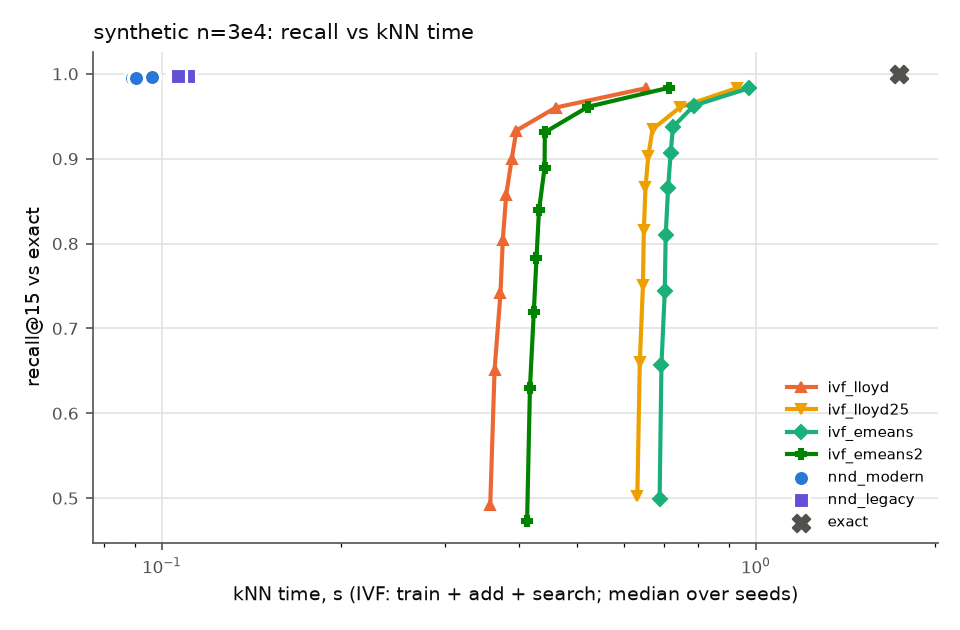

### Verdict lines

```
synthetic n=3e4 [informational: not in the evaluation set]:
   no  (a) ivf_emeans kNN time at matched recall / nnd_modern = inf [inf–inf] over 3 seeds (needs <= 0.8); unmatched seeds: cap 3; not decided by the nprobe cap: even with the end-of-sweep cost as a lower bound the median is >= 10.786; informational: inf with search time interpolated between swept nprobes
   no  (b) eumap_e2e / umap_e2e end-to-end = 1.594 (2.5 s vs 1.6 s, medians) (needs <= 0.85)
  YES  (c) eumap_e2e quality: np15 0.0733 vs umap 0.0710 [0.0706–0.0717] (+3.2% of the umap median) ok; trustworthiness 0.6476 vs umap 0.6444 [0.6440–0.6446] (+0.5% of the umap median) ok; knn_acc 1.0000 vs umap 0.9999 [0.9999–1.0000] (+0.0% of the umap median) ok
   no  (a)+(b)+(c) all hold (eUMAP worth using on this dataset)
   no  [Lloyd variant] (a) ivf_lloyd kNN time at matched recall / nnd_modern = inf [inf–inf] over 3 seeds (needs <= 0.8); unmatched seeds: cap 3; not decided by the nprobe cap: even with the end-of-sweep cost as a lower bound the median is >= 7.191; informational: inf with search time interpolated between swept nprobes
   no  [Lloyd variant] (b) eumap_lloyd_e2e / umap_e2e end-to-end = 1.348 (2.1 s vs 1.6 s, medians) (needs <= 0.85)
  YES  [Lloyd variant] (c) eumap_lloyd_e2e quality: np15 0.0738 vs umap 0.0710 [0.0706–0.0717] (+3.9% of the umap median) ok; trustworthiness 0.6497 vs umap 0.6444 [0.6440–0.6446] (+0.8% of the umap median) ok; knn_acc 1.0000 vs umap 0.9999 [0.9999–1.0000] (+0.0% of the umap median) ok
   no  e-means contributes: ivf_emeans t_train/lloyd 2.968 (<= 0.7), matched search inf s vs lloyd max inf s -> no; ivf_emeans2 t_train/lloyd 1.320 (<= 0.7), matched search inf s vs lloyd max inf s -> no; eumap_e2e / eumap_lloyd_e2e = 1.182 (needs <= 0.95)
   no  the Faiss IVF graph helps, e-means does not (e-means end-to-end gain -0.182, needs < 0.05 with (a)-(c) met by an IVF pair)
   no  some IVF arm beats the faster NN-descent arm at matched recall (median ratios: ivf_lloyd inf (>= 7.191 at the end of the sweep), ivf_lloyd25 inf (>= 10.266 at the end of the sweep), ivf_emeans inf (>= 10.786 at the end of the sweep), ivf_emeans2 inf (>= 7.960 at the end of the sweep))
```

## synthetic n=1e5

### kNN stage

| arm | recall@15 | t_knn | t_prepare | t_train | t_add | centroid MSE | imbalance | peak RSS GB |
|---|---|---|---|---|---|---|---|---|
| exact | 1.000 | 17.39 | – | – | – | – | – | 0.8 |
| nnd_modern | 0.9988 [0.9988–0.9988] | 0.31 [0.30–0.32] | – | – | – | – | – | 3.1 |
| nnd_legacy | 0.9992 [0.9992–0.9993] | 0.42 [0.42–0.42] | – | – | – | – | – | 3.2 |
| ivf_lloyd | max 0.9888 [0.9887–0.9890] @nprobe 256 [256–256] | see sweep | 0.03 [0.03–0.05] | 0.98 [0.93–1.04] | 0.10 [0.09–0.10] | 984.5088 [984.3601–985.9342] | 1.195 [1.190–1.233] | 2.9 |
| ivf_lloyd25 | max 0.9892 [0.9890–0.9893] @nprobe 256 [256–256] | see sweep | 0.05 [0.03–0.05] | 2.32 [2.14–2.38] | 0.09 [0.08–0.10] | 978.9174 [978.5974–980.0958] | 1.213 [1.198–1.241] | 2.9 |
| ivf_emeans | max 0.9895 [0.9892–0.9896] @nprobe 256 [256–256] | see sweep | 0.03 [0.03–0.06] | 1.76 [1.74–1.81] | 0.09 [0.09–0.09] | 973.1606 [973.0309–974.0294] | 1.180 [1.176–1.204] | 2.9 |
| ivf_emeans2 | max 0.9888 [0.9887–0.9889] @nprobe 256 [256–256] | see sweep | 0.05 [0.04–0.05] | 0.76 [0.73–0.81] | 0.10 [0.09–0.11] | 983.3358 [982.6705–983.3907] | 1.128 [1.123–1.153] | 2.9 |

### IVF nprobe sweep

| arm | nprobe | recall | recall (tie-aware) | missing | t_search | t_train+add+search |
|---|---|---|---|---|---|---|
| ivf_lloyd | 1 | 0.4845 [0.4826–0.4861] | 0.4845 [0.4826–0.4862] | 0.0000 [0.0000–0.0000] | 0.58 [0.58–0.59] | 1.66 [1.61–1.71] |
| ivf_lloyd | 2 | 0.6822 [0.6820–0.6843] | 0.6822 [0.6820–0.6844] | 0.0000 [0.0000–0.0000] | 0.61 [0.60–0.62] | 1.69 [1.64–1.74] |
| ivf_lloyd | 4 | 0.8175 [0.8161–0.8211] | 0.8176 [0.8161–0.8212] | 0.0000 [0.0000–0.0000] | 0.63 [0.63–0.64] | 1.71 [1.66–1.77] |
| ivf_lloyd | 8 | 0.8927 [0.8889–0.8932] | 0.8927 [0.8890–0.8933] | 0.0000 [0.0000–0.0000] | 0.65 [0.64–0.65] | 1.72 [1.67–1.78] |
| ivf_lloyd | 16 | 0.9287 [0.9269–0.9294] | 0.9287 [0.9270–0.9294] | 0.0000 [0.0000–0.0000] | 0.66 [0.66–0.66] | 1.74 [1.68–1.80] |
| ivf_lloyd | 32 | 0.9498 [0.9494–0.9505] | 0.9498 [0.9494–0.9506] | 0.0000 [0.0000–0.0000] | 0.70 [0.70–0.71] | 1.78 [1.72–1.84] |
| ivf_lloyd | 64 | 0.9657 [0.9655–0.9665] | 0.9657 [0.9655–0.9665] | 0.0000 [0.0000–0.0000] | 0.87 [0.87–0.90] | 1.95 [1.89–2.04] |
| ivf_lloyd | 128 | 0.9786 [0.9785–0.9790] | 0.9786 [0.9785–0.9790] | 0.0000 [0.0000–0.0000] | 1.56 [1.55–1.63] | 2.64 [2.57–2.76] |
| ivf_lloyd | 256 | 0.9888 [0.9887–0.9890] | 0.9888 [0.9887–0.9890] | 0.0000 [0.0000–0.0000] | 3.05 [3.02–3.11] | 4.12 [4.04–4.25] |
| ivf_lloyd25 | 1 | 0.4909 [0.4900–0.4933] | 0.4910 [0.4900–0.4934] | 0.0000 [0.0000–0.0000] | 0.59 [0.58–0.59] | 3.00 [2.81–3.06] |
| ivf_lloyd25 | 2 | 0.6881 [0.6865–0.6900] | 0.6881 [0.6865–0.6901] | 0.0000 [0.0000–0.0000] | 0.62 [0.61–0.62] | 3.03 [2.84–3.09] |
| ivf_lloyd25 | 4 | 0.8261 [0.8190–0.8264] | 0.8261 [0.8190–0.8264] | 0.0000 [0.0000–0.0000] | 0.64 [0.64–0.64] | 3.05 [2.86–3.12] |
| ivf_lloyd25 | 8 | 0.8985 [0.8966–0.8993] | 0.8985 [0.8966–0.8993] | 0.0000 [0.0000–0.0000] | 0.65 [0.64–0.65] | 3.06 [2.88–3.12] |
| ivf_lloyd25 | 16 | 0.9322 [0.9313–0.9324] | 0.9323 [0.9314–0.9325] | 0.0000 [0.0000–0.0000] | 0.66 [0.66–0.67] | 3.08 [2.89–3.14] |
| ivf_lloyd25 | 32 | 0.9522 [0.9516–0.9527] | 0.9522 [0.9517–0.9527] | 0.0000 [0.0000–0.0000] | 0.70 [0.70–0.70] | 3.12 [2.93–3.18] |
| ivf_lloyd25 | 64 | 0.9672 [0.9671–0.9678] | 0.9673 [0.9672–0.9678] | 0.0000 [0.0000–0.0000] | 0.90 [0.86–0.93] | 3.33 [3.13–3.34] |
| ivf_lloyd25 | 128 | 0.9795 [0.9793–0.9797] | 0.9795 [0.9793–0.9797] | 0.0000 [0.0000–0.0000] | 1.60 [1.52–1.64] | 4.00 [3.82–4.05] |
| ivf_lloyd25 | 256 | 0.9892 [0.9890–0.9893] | 0.9892 [0.9890–0.9893] | 0.0000 [0.0000–0.0000] | 3.07 [2.97–3.18] | 5.45 [5.30–5.60] |
| ivf_emeans | 1 | 0.4951 [0.4933–0.4951] | 0.4951 [0.4934–0.4951] | 0.0000 [0.0000–0.0000] | 0.58 [0.57–0.58] | 2.44 [2.41–2.48] |
| ivf_emeans | 2 | 0.6895 [0.6883–0.6917] | 0.6896 [0.6884–0.6918] | 0.0000 [0.0000–0.0000] | 0.62 [0.61–0.62] | 2.47 [2.45–2.51] |
| ivf_emeans | 4 | 0.8187 [0.8170–0.8232] | 0.8188 [0.8170–0.8233] | 0.0000 [0.0000–0.0000] | 0.64 [0.64–0.64] | 2.49 [2.47–2.54] |
| ivf_emeans | 8 | 0.8955 [0.8912–0.8988] | 0.8956 [0.8912–0.8988] | 0.0000 [0.0000–0.0000] | 0.65 [0.65–0.66] | 2.50 [2.48–2.56] |
| ivf_emeans | 16 | 0.9326 [0.9313–0.9334] | 0.9327 [0.9313–0.9334] | 0.0000 [0.0000–0.0000] | 0.66 [0.66–0.66] | 2.52 [2.49–2.56] |
| ivf_emeans | 32 | 0.9529 [0.9523–0.9534] | 0.9530 [0.9524–0.9534] | 0.0000 [0.0000–0.0000] | 0.70 [0.70–0.70] | 2.56 [2.53–2.60] |
| ivf_emeans | 64 | 0.9679 [0.9678–0.9681] | 0.9679 [0.9679–0.9681] | 0.0000 [0.0000–0.0000] | 0.89 [0.85–0.90] | 2.72 [2.71–2.81] |
| ivf_emeans | 128 | 0.9799 [0.9798–0.9802] | 0.9799 [0.9798–0.9802] | 0.0000 [0.0000–0.0000] | 1.56 [1.50–1.60] | 3.39 [3.36–3.50] |
| ivf_emeans | 256 | 0.9895 [0.9892–0.9896] | 0.9895 [0.9892–0.9896] | 0.0000 [0.0000–0.0000] | 3.02 [2.92–3.07] | 4.85 [4.77–4.97] |
| ivf_emeans2 | 1 | 0.4807 [0.4798–0.4808] | 0.4807 [0.4798–0.4808] | 0.0000 [0.0000–0.0000] | 0.58 [0.58–0.59] | 1.43 [1.41–1.51] |
| ivf_emeans2 | 2 | 0.6769 [0.6753–0.6776] | 0.6770 [0.6753–0.6776] | 0.0000 [0.0000–0.0000] | 0.61 [0.61–0.61] | 1.47 [1.43–1.53] |
| ivf_emeans2 | 4 | 0.8045 [0.8041–0.8079] | 0.8045 [0.8042–0.8080] | 0.0000 [0.0000–0.0000] | 0.63 [0.63–0.63] | 1.48 [1.45–1.55] |
| ivf_emeans2 | 8 | 0.8611 [0.8610–0.8689] | 0.8612 [0.8611–0.8690] | 0.0000 [0.0000–0.0000] | 0.65 [0.64–0.65] | 1.50 [1.48–1.56] |
| ivf_emeans2 | 16 | 0.9141 [0.9121–0.9179] | 0.9141 [0.9121–0.9180] | 0.0000 [0.0000–0.0000] | 0.66 [0.66–0.71] | 1.54 [1.51–1.58] |
| ivf_emeans2 | 32 | 0.9455 [0.9449–0.9470] | 0.9456 [0.9450–0.9470] | 0.0000 [0.0000–0.0000] | 0.70 [0.70–0.83] | 1.62 [1.55–1.65] |
| ivf_emeans2 | 64 | 0.9645 [0.9644–0.9652] | 0.9646 [0.9645–0.9652] | 0.0000 [0.0000–0.0000] | 0.89 [0.87–1.16] | 1.81 [1.72–1.98] |
| ivf_emeans2 | 128 | 0.9784 [0.9783–0.9788] | 0.9784 [0.9783–0.9788] | 0.0000 [0.0000–0.0000] | 1.58 [1.54–2.04] | 2.50 [2.39–2.86] |
| ivf_emeans2 | 256 | 0.9888 [0.9887–0.9889] | 0.9888 [0.9887–0.9889] | 0.0000 [0.0000–0.0000] | 3.09 [3.07–3.84] | 4.01 [3.92–4.67] |

### kNN time to reach a fixed recall (informational)

IVF: train + add + search at the smallest swept nprobe reaching the recall (inf: not reached within the sweep). NN-descent has one operating point, shown for reference.

| arm | recall >= 0.90 | recall >= 0.95 | recall >= 0.99 |
|---|---|---|---|
| ivf_lloyd | 1.74 [1.68–1.80] | 1.89 [1.78–2.04] | inf [inf–inf] |
| ivf_lloyd25 | 3.08 [2.89–3.14] | 3.12 [2.93–3.18] | inf [inf–inf] |
| ivf_emeans | 2.52 [2.49–2.56] | 2.56 [2.53–2.60] | inf [inf–inf] |
| ivf_emeans2 | 1.54 [1.51–1.58] | 1.81 [1.72–1.98] | inf [inf–inf] |
| nnd_modern (single point, recall 0.9988 [0.9988–0.9988]) | 0.31 [0.30–0.32] | 0.31 [0.30–0.32] | 0.31 [0.30–0.32] |
| nnd_legacy (single point, recall 0.9992 [0.9992–0.9993]) | 0.42 [0.42–0.42] | 0.42 [0.42–0.42] | 0.42 [0.42–0.42] |

### Matched recall (faster NN-descent arm: `nnd_modern`)

| NN-descent arm | IVF arm | NN-descent recall | target | nprobe per seed | IVF kNN time | NN-descent time | ratio IVF/NND | ratio, interpolated (informational) | unmatched: ratio lower bound |
|---|---|---|---|---|---|---|---|---|---|
| nnd_modern | ivf_lloyd | 0.9988 [0.9988–0.9988] | 0.9988 [0.9988–0.9988] | unmatched (cap),unmatched (cap),unmatched (cap) | inf [inf–inf] | 0.31 [0.30–0.32] | inf [inf–inf] | inf [inf–inf] | >= 13.115 [12.535–14.205] |
| nnd_modern | ivf_lloyd25 | 0.9988 [0.9988–0.9988] | 0.9988 [0.9988–0.9988] | unmatched (cap),unmatched (cap),unmatched (cap) | inf [inf–inf] | 0.31 [0.30–0.32] | inf [inf–inf] | inf [inf–inf] | >= 17.796 [16.427–18.209] |
| nnd_modern | ivf_emeans | 0.9988 [0.9988–0.9988] | 0.9988 [0.9988–0.9988] | unmatched (cap),unmatched (cap),unmatched (cap) | inf [inf–inf] | 0.31 [0.30–0.32] | inf [inf–inf] | inf [inf–inf] | >= 15.438 [14.790–16.620] |
| nnd_modern | ivf_emeans2 | 0.9988 [0.9988–0.9988] | 0.9988 [0.9988–0.9988] | unmatched (cap),unmatched (cap),unmatched (cap) | inf [inf–inf] | 0.31 [0.30–0.32] | inf [inf–inf] | inf [inf–inf] | >= 13.117 [12.745–14.465] |
| nnd_legacy | ivf_lloyd | 0.9992 [0.9992–0.9993] | capped 0.9990 [0.9990–0.9990] | unmatched (cap),unmatched (cap),unmatched (cap) | inf [inf–inf] | 0.42 [0.42–0.42] | inf [inf–inf] | inf [inf–inf] | >= 9.828 [9.694–10.077] |
| nnd_legacy | ivf_lloyd25 | 0.9992 [0.9992–0.9993] | capped 0.9990 [0.9990–0.9990] | unmatched (cap),unmatched (cap),unmatched (cap) | inf [inf–inf] | 0.42 [0.42–0.42] | inf [inf–inf] | inf [inf–inf] | >= 12.918 [12.703–13.336] |
| nnd_legacy | ivf_emeans | 0.9992 [0.9992–0.9993] | capped 0.9990 [0.9990–0.9990] | unmatched (cap),unmatched (cap),unmatched (cap) | inf [inf–inf] | 0.42 [0.42–0.42] | inf [inf–inf] | inf [inf–inf] | >= 11.569 [11.437–11.790] |
| nnd_legacy | ivf_emeans2 | 0.9992 [0.9992–0.9993] | capped 0.9990 [0.9990–0.9990] | unmatched (cap),unmatched (cap),unmatched (cap) | inf [inf–inf] | 0.42 [0.42–0.42] | inf [inf–inf] | inf [inf–inf] | >= 9.550 [9.305–11.186] |

The pre-registered ratio uses the smallest swept power-of-two nprobe that reaches the target. *Interpolated* charges IVF the search time interpolated linearly in recall between the two swept nprobes that bracket the target, to show how much of the ratio is grid overshoot. *Unmatched (cap)* means the sweep stopped at nprobe = 256 (the spec's limit) below the target; *(nlist)* means every list was probed. For those seeds the ratio is inf, and the IVF cost at the last swept nprobe gives a lower bound on what a longer sweep could have reached.

### End to end and embedding quality

| arm | t_e2e | t_knn | t_graph | t_layout | graph recall | NP@15 | trustworthiness | kNN acc | notes |
|---|---|---|---|---|---|---|---|---|---|
| umap_e2e | 5.4 [5.4–5.4] | 0.3 [0.3–0.3] | 0.1 [0.1–0.1] | 5.0 [5.0–5.0] | 0.9988 [0.9988–0.9988] | 0.0275 [0.0271–0.0277] | 0.6618 [0.6599–0.6635] | 1.0000 [0.9999–1.0000] |  |
| eumap_e2e | 8.1 [8.0–8.1] | 2.9 [2.9–3.0] | 0.1 [0.1–0.1] | 5.0 [5.0–5.0] | 0.9529 [0.9523–0.9534] | 0.0282 [0.0282–0.0287] | 0.6671 [0.6656–0.6682] | 1.0000 [1.0000–1.0000] | nprobe 32,32,32 |
| eumap_lloyd_e2e | 7.2 [7.2–7.4] | 2.1 [2.1–2.2] | 0.1 [0.1–0.1] | 4.9 [4.9–5.1] | 0.9505 [0.9498–0.9657] | 0.0279 [0.0278–0.0283] | 0.6655 [0.6653–0.6665] | 1.0000 [1.0000–1.0000] | nprobe 64,32,32 |
| layout_exact | 5.1 [4.9–5.3] | 0.0 [0.0–0.0] | 0.1 [0.1–0.1] | 5.0 [4.8–5.1] | 1.0000 [1.0000–1.0000] | 0.0272 [0.0268–0.0272] | 0.6601 [0.6568–0.6628] | 1.0000 [1.0000–1.0000] |  |

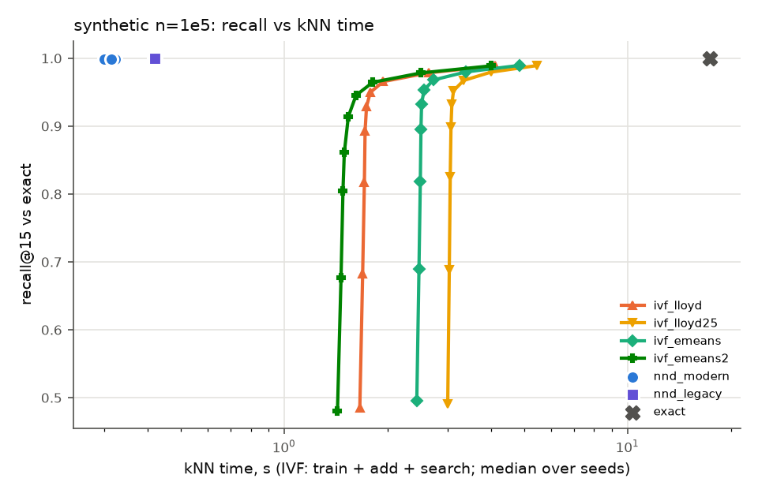

### Verdict lines

```
synthetic n=1e5 [informational: not in the evaluation set]:
   no  (a) ivf_emeans kNN time at matched recall / nnd_modern = inf [inf–inf] over 3 seeds (needs <= 0.8); unmatched seeds: cap 3; not decided by the nprobe cap: even with the end-of-sweep cost as a lower bound the median is >= 15.438; informational: inf with search time interpolated between swept nprobes
   no  (b) eumap_e2e / umap_e2e end-to-end = 1.492 (8.1 s vs 5.4 s, medians) (needs <= 0.85)
  YES  (c) eumap_e2e quality: np15 0.0282 vs umap 0.0275 [0.0271–0.0277] (+2.3% of the umap median) ok; trustworthiness 0.6671 vs umap 0.6618 [0.6599–0.6635] (+0.8% of the umap median) ok; knn_acc 1.0000 vs umap 1.0000 [0.9999–1.0000] (+0.0% of the umap median) ok
   no  (a)+(b)+(c) all hold (eUMAP worth using on this dataset)
   no  [Lloyd variant] (a) ivf_lloyd kNN time at matched recall / nnd_modern = inf [inf–inf] over 3 seeds (needs <= 0.8); unmatched seeds: cap 3; not decided by the nprobe cap: even with the end-of-sweep cost as a lower bound the median is >= 13.115; informational: inf with search time interpolated between swept nprobes
   no  [Lloyd variant] (b) eumap_lloyd_e2e / umap_e2e end-to-end = 1.328 (7.2 s vs 5.4 s, medians) (needs <= 0.85)
  YES  [Lloyd variant] (c) eumap_lloyd_e2e quality: np15 0.0279 vs umap 0.0275 [0.0271–0.0277] (+1.2% of the umap median) ok; trustworthiness 0.6655 vs umap 0.6618 [0.6599–0.6635] (+0.5% of the umap median) ok; knn_acc 1.0000 vs umap 1.0000 [0.9999–1.0000] (+0.0% of the umap median) ok
   no  e-means contributes: ivf_emeans t_train/lloyd 1.796 (<= 0.7), matched search inf s vs lloyd max inf s -> no; ivf_emeans2 t_train/lloyd 0.771 (<= 0.7), matched search inf s vs lloyd max inf s -> no; eumap_e2e / eumap_lloyd_e2e = 1.123 (needs <= 0.95)
   no  the Faiss IVF graph helps, e-means does not (e-means end-to-end gain -0.123, needs < 0.05 with (a)-(c) met by an IVF pair)
   no  some IVF arm beats the faster NN-descent arm at matched recall (median ratios: ivf_lloyd inf (>= 13.115 at the end of the sweep), ivf_lloyd25 inf (>= 17.796 at the end of the sweep), ivf_emeans inf (>= 15.438 at the end of the sweep), ivf_emeans2 inf (>= 13.117 at the end of the sweep))
```

## synthetic n=3e5

### kNN stage

| arm | recall@15 | t_knn | t_prepare | t_train | t_add | centroid MSE | imbalance | peak RSS GB |
|---|---|---|---|---|---|---|---|---|
| exact | 1.000 | 160.00 | – | – | – | – | – | 1.1 |
| nnd_modern | 0.9980 [0.9980–0.9981] | 1.16 [1.14–1.22] | – | – | – | – | – | 4.0 |
| nnd_legacy | 0.9989 [0.9988–0.9989] | 1.86 [1.81–1.88] | – | – | – | – | – | 4.3 |
| ivf_lloyd | max 0.9959 [0.9959–0.9959] @nprobe 256 [256–256] | see sweep | 0.14 [0.14–0.14] | 5.71 [5.43–5.73] | 0.58 [0.51–0.69] | 891.8406 [891.0474–891.8482] | 1.116 [1.112–1.117] | 3.9 |
| ivf_lloyd25 | max 0.9962 [0.9961–0.9962] @nprobe 256 [256–256] | see sweep | 0.14 [0.14–0.15] | 14.57 [14.38–15.58] | 0.63 [0.57–0.64] | 885.8504 [885.1269–886.1189] | 1.119 [1.112–1.123] | 3.8 |
| ivf_emeans | max 0.9963 [0.9962–0.9963] @nprobe 256 [256–256] | see sweep | 0.14 [0.14–0.14] | 6.96 [6.59–7.11] | 0.63 [0.58–0.65] | 880.3764 [880.3405–880.7194] | 1.088 [1.084–1.092] | 3.9 |
| ivf_emeans2 | max 0.9960 [0.9959–0.9960] @nprobe 256 [256–256] | see sweep | 0.14 [0.14–0.14] | 2.89 [2.78–2.95] | 0.61 [0.60–0.66] | 887.6718 [887.3782–888.8605] | 1.078 [1.071–1.079] | 3.8 |

### IVF nprobe sweep

| arm | nprobe | recall | recall (tie-aware) | missing | t_search | t_train+add+search |
|---|---|---|---|---|---|---|
| ivf_lloyd | 1 | 0.4469 [0.4461–0.4471] | 0.4470 [0.4462–0.4471] | 0.0000 [0.0000–0.0000] | 1.88 [1.86–1.90] | 8.17 [7.81–8.31] |
| ivf_lloyd | 2 | 0.6457 [0.6453–0.6457] | 0.6457 [0.6454–0.6458] | 0.0000 [0.0000–0.0000] | 2.00 [2.00–2.03] | 8.29 [7.95–8.44] |
| ivf_lloyd | 4 | 0.8234 [0.8232–0.8274] | 0.8234 [0.8233–0.8275] | 0.0000 [0.0000–0.0000] | 2.10 [2.08–2.12] | 8.40 [8.03–8.53] |
| ivf_lloyd | 8 | 0.9231 [0.9225–0.9296] | 0.9231 [0.9225–0.9297] | 0.0000 [0.0000–0.0000] | 2.27 [2.26–2.31] | 8.57 [8.21–8.73] |
| ivf_lloyd | 16 | 0.9642 [0.9640–0.9653] | 0.9643 [0.9640–0.9654] | 0.0000 [0.0000–0.0000] | 2.69 [2.68–2.89] | 8.98 [8.63–9.30] |
| ivf_lloyd | 32 | 0.9784 [0.9781–0.9787] | 0.9784 [0.9781–0.9787] | 0.0000 [0.0000–0.0000] | 4.84 [4.60–5.30] | 10.89 [10.78–11.71] |
| ivf_lloyd | 64 | 0.9865 [0.9863–0.9866] | 0.9866 [0.9863–0.9866] | 0.0000 [0.0000–0.0000] | 9.38 [8.86–10.49] | 15.33 [15.15–16.90] |
| ivf_lloyd | 128 | 0.9921 [0.9919–0.9921] | 0.9921 [0.9919–0.9921] | 0.0000 [0.0000–0.0000] | 18.60 [18.15–21.51] | 24.55 [24.44–27.92] |
| ivf_lloyd | 256 | 0.9959 [0.9959–0.9959] | 0.9959 [0.9959–0.9959] | 0.0000 [0.0000–0.0000] | 38.69 [37.94–45.16] | 44.64 [44.23–51.58] |
| ivf_lloyd25 | 1 | 0.4549 [0.4542–0.4550] | 0.4549 [0.4543–0.4551] | 0.0000 [0.0000–0.0000] | 1.89 [1.89–1.90] | 17.10 [16.84–18.10] |
| ivf_lloyd25 | 2 | 0.6523 [0.6519–0.6528] | 0.6524 [0.6520–0.6528] | 0.0000 [0.0000–0.0000] | 2.02 [2.01–2.02] | 17.22 [16.98–18.22] |
| ivf_lloyd25 | 4 | 0.8308 [0.8271–0.8315] | 0.8309 [0.8272–0.8316] | 0.0000 [0.0000–0.0000] | 2.13 [2.11–2.13] | 17.32 [17.08–18.34] |
| ivf_lloyd25 | 8 | 0.9328 [0.9250–0.9337] | 0.9329 [0.9251–0.9338] | 0.0000 [0.0000–0.0000] | 2.30 [2.29–2.31] | 17.51 [17.27–18.50] |
| ivf_lloyd25 | 16 | 0.9668 [0.9659–0.9674] | 0.9668 [0.9659–0.9675] | 0.0000 [0.0000–0.0000] | 2.82 [2.73–2.97] | 17.94 [17.93–19.02] |
| ivf_lloyd25 | 32 | 0.9796 [0.9793–0.9798] | 0.9796 [0.9794–0.9798] | 0.0000 [0.0000–0.0000] | 5.03 [4.70–5.48] | 20.43 [19.91–21.23] |
| ivf_lloyd25 | 64 | 0.9873 [0.9870–0.9873] | 0.9873 [0.9870–0.9873] | 0.0000 [0.0000–0.0000] | 10.05 [8.97–10.83] | 25.78 [24.18–26.25] |
| ivf_lloyd25 | 128 | 0.9925 [0.9924–0.9926] | 0.9925 [0.9924–0.9926] | 0.0000 [0.0000–0.0000] | 20.76 [18.12–22.00] | 36.96 [33.33–36.97] |
| ivf_lloyd25 | 256 | 0.9962 [0.9961–0.9962] | 0.9962 [0.9961–0.9962] | 0.0000 [0.0000–0.0000] | 41.56 [38.52–45.76] | 57.76 [53.73–60.72] |
| ivf_emeans | 1 | 0.4592 [0.4590–0.4599] | 0.4593 [0.4590–0.4600] | 0.0000 [0.0000–0.0000] | 1.87 [1.87–1.89] | 9.48 [9.06–9.62] |
| ivf_emeans | 2 | 0.6555 [0.6552–0.6565] | 0.6556 [0.6552–0.6566] | 0.0000 [0.0000–0.0000] | 2.01 [2.00–2.01] | 9.62 [9.17–9.75] |
| ivf_emeans | 4 | 0.8289 [0.8274–0.8296] | 0.8290 [0.8275–0.8296] | 0.0000 [0.0000–0.0000] | 2.10 [2.09–2.12] | 9.70 [9.29–9.85] |
| ivf_emeans | 8 | 0.9261 [0.9178–0.9264] | 0.9262 [0.9178–0.9265] | 0.0000 [0.0000–0.0000] | 2.26 [2.24–2.26] | 9.87 [9.43–9.99] |
| ivf_emeans | 16 | 0.9663 [0.9649–0.9667] | 0.9664 [0.9649–0.9667] | 0.0000 [0.0000–0.0000] | 2.65 [2.62–2.71] | 10.26 [9.88–10.37] |
| ivf_emeans | 32 | 0.9797 [0.9794–0.9799] | 0.9797 [0.9794–0.9799] | 0.0000 [0.0000–0.0000] | 4.63 [4.52–5.02] | 12.19 [12.14–12.37] |
| ivf_emeans | 64 | 0.9874 [0.9874–0.9876] | 0.9875 [0.9874–0.9876] | 0.0000 [0.0000–0.0000] | 9.06 [8.78–10.01] | 16.81 [16.39–17.17] |
| ivf_emeans | 128 | 0.9927 [0.9927–0.9928] | 0.9927 [0.9927–0.9928] | 0.0000 [0.0000–0.0000] | 18.80 [17.97–21.14] | 26.55 [25.58–28.31] |
| ivf_emeans | 256 | 0.9963 [0.9962–0.9963] | 0.9963 [0.9962–0.9963] | 0.0000 [0.0000–0.0000] | 39.41 [37.40–44.74] | 47.15 [45.01–51.91] |
| ivf_emeans2 | 1 | 0.4472 [0.4470–0.4481] | 0.4473 [0.4470–0.4482] | 0.0000 [0.0000–0.0000] | 1.90 [1.89–1.90] | 5.44 [5.27–5.45] |
| ivf_emeans2 | 2 | 0.6457 [0.6452–0.6458] | 0.6458 [0.6453–0.6459] | 0.0000 [0.0000–0.0000] | 2.01 [1.99–2.02] | 5.56 [5.37–5.57] |
| ivf_emeans2 | 4 | 0.8213 [0.8210–0.8234] | 0.8214 [0.8210–0.8235] | 0.0000 [0.0000–0.0000] | 2.11 [2.11–2.11] | 5.66 [5.49–5.67] |
| ivf_emeans2 | 8 | 0.9091 [0.9078–0.9165] | 0.9092 [0.9078–0.9165] | 0.0000 [0.0000–0.0000] | 2.24 [2.22–2.27] | 5.77 [5.62–5.82] |
| ivf_emeans2 | 16 | 0.9613 [0.9609–0.9624] | 0.9613 [0.9610–0.9624] | 0.0000 [0.0000–0.0000] | 2.56 [2.48–2.69] | 6.04 [5.94–6.24] |
| ivf_emeans2 | 32 | 0.9780 [0.9777–0.9780] | 0.9780 [0.9777–0.9781] | 0.0000 [0.0000–0.0000] | 4.37 [4.31–4.78] | 7.92 [7.69–8.33] |
| ivf_emeans2 | 64 | 0.9866 [0.9864–0.9866] | 0.9866 [0.9864–0.9866] | 0.0000 [0.0000–0.0000] | 8.78 [8.40–9.75] | 12.33 [11.78–13.30] |
| ivf_emeans2 | 128 | 0.9922 [0.9921–0.9922] | 0.9922 [0.9921–0.9923] | 0.0000 [0.0000–0.0000] | 18.61 [17.42–20.65] | 22.16 [20.80–24.20] |
| ivf_emeans2 | 256 | 0.9960 [0.9959–0.9960] | 0.9960 [0.9959–0.9961] | 0.0000 [0.0000–0.0000] | 39.66 [37.51–42.90] | 43.21 [40.89–46.45] |

### kNN time to reach a fixed recall (informational)

IVF: train + add + search at the smallest swept nprobe reaching the recall (inf: not reached within the sweep). NN-descent has one operating point, shown for reference.

| arm | recall >= 0.90 | recall >= 0.95 | recall >= 0.99 |
|---|---|---|---|
| ivf_lloyd | 8.57 [8.21–8.73] | 8.98 [8.63–9.30] | 24.55 [24.44–27.92] |
| ivf_lloyd25 | 17.51 [17.27–18.50] | 17.94 [17.93–19.02] | 36.96 [33.33–36.97] |
| ivf_emeans | 9.87 [9.43–9.99] | 10.26 [9.88–10.37] | 26.55 [25.58–28.31] |
| ivf_emeans2 | 5.77 [5.62–5.82] | 6.04 [5.94–6.24] | 22.16 [20.80–24.20] |
| nnd_modern (single point, recall 0.9980 [0.9980–0.9981]) | 1.16 [1.14–1.22] | 1.16 [1.14–1.22] | 1.16 [1.14–1.22] |
| nnd_legacy (single point, recall 0.9989 [0.9988–0.9989]) | 1.86 [1.81–1.88] | 1.86 [1.81–1.88] | 1.86 [1.81–1.88] |

### Matched recall (faster NN-descent arm: `nnd_modern`)

| NN-descent arm | IVF arm | NN-descent recall | target | nprobe per seed | IVF kNN time | NN-descent time | ratio IVF/NND | ratio, interpolated (informational) | unmatched: ratio lower bound |
|---|---|---|---|---|---|---|---|---|---|
| nnd_modern | ivf_lloyd | 0.9980 [0.9980–0.9981] | 0.9980 [0.9980–0.9981] | unmatched (cap),unmatched (cap),unmatched (cap) | inf [inf–inf] | 1.16 [1.14–1.22] | inf [inf–inf] | inf [inf–inf] | >= 38.481 [36.215–45.360] |
| nnd_modern | ivf_lloyd25 | 0.9980 [0.9980–0.9981] | 0.9980 [0.9980–0.9981] | unmatched (cap),unmatched (cap),unmatched (cap) | inf [inf–inf] | 1.16 [1.14–1.22] | inf [inf–inf] | inf [inf–inf] | >= 49.788 [43.997–53.399] |
| nnd_modern | ivf_emeans | 0.9980 [0.9980–0.9981] | 0.9980 [0.9980–0.9981] | unmatched (cap),unmatched (cap),unmatched (cap) | inf [inf–inf] | 1.16 [1.14–1.22] | inf [inf–inf] | inf [inf–inf] | >= 40.645 [36.853–45.654] |
| nnd_modern | ivf_emeans2 | 0.9980 [0.9980–0.9981] | 0.9980 [0.9980–0.9981] | unmatched (cap),unmatched (cap),unmatched (cap) | inf [inf–inf] | 1.16 [1.14–1.22] | inf [inf–inf] | inf [inf–inf] | >= 37.245 [33.481–40.846] |
| nnd_legacy | ivf_lloyd | 0.9989 [0.9988–0.9989] | 0.9989 [0.9988–0.9989] | unmatched (cap),unmatched (cap),unmatched (cap) | inf [inf–inf] | 1.86 [1.81–1.88] | inf [inf–inf] | inf [inf–inf] | >= 24.399 [24.046–27.416] |
| nnd_legacy | ivf_lloyd25 | 0.9989 [0.9988–0.9989] | 0.9989 [0.9988–0.9989] | unmatched (cap),unmatched (cap),unmatched (cap) | inf [inf–inf] | 1.86 [1.81–1.88] | inf [inf–inf] | inf [inf–inf] | >= 31.112 [29.641–32.275] |
| nnd_legacy | ivf_emeans | 0.9989 [0.9988–0.9989] | 0.9989 [0.9988–0.9989] | unmatched (cap),unmatched (cap),unmatched (cap) | inf [inf–inf] | 1.86 [1.81–1.88] | inf [inf–inf] | inf [inf–inf] | >= 25.399 [24.828–27.593] |
| nnd_legacy | ivf_emeans2 | 0.9989 [0.9988–0.9989] | 0.9989 [0.9988–0.9989] | unmatched (cap),unmatched (cap),unmatched (cap) | inf [inf–inf] | 1.86 [1.81–1.88] | inf [inf–inf] | inf [inf–inf] | >= 23.274 [22.557–24.688] |

The pre-registered ratio uses the smallest swept power-of-two nprobe that reaches the target. *Interpolated* charges IVF the search time interpolated linearly in recall between the two swept nprobes that bracket the target, to show how much of the ratio is grid overshoot. *Unmatched (cap)* means the sweep stopped at nprobe = 256 (the spec's limit) below the target; *(nlist)* means every list was probed. For those seeds the ratio is inf, and the IVF cost at the last swept nprobe gives a lower bound on what a longer sweep could have reached.

### End to end and embedding quality

| arm | t_e2e | t_knn | t_graph | t_layout | graph recall | NP@15 | trustworthiness | kNN acc | notes |
|---|---|---|---|---|---|---|---|---|---|
| umap_e2e | 32.5 [32.4–33.0] | 1.1 [1.0–1.1] | 0.3 [0.3–0.3] | 31.1 [30.9–31.7] | 0.9980 [0.9980–0.9981] | 0.0201 [0.0200–0.0206] | 0.7289 [0.7280–0.7307] | 1.0000 [1.0000–1.0000] |  |
| eumap_e2e | 42.0 [41.8–43.7] | 10.9 [10.5–11.2] | 0.3 [0.3–0.3] | 31.2 [30.5–32.2] | 0.9663 [0.9649–0.9667] | 0.0207 [0.0202–0.0209] | 0.7323 [0.7291–0.7323] | 1.0000 [1.0000–1.0000] | nprobe 16,16,16 |
| eumap_lloyd_e2e | 42.1 [41.5–42.2] | 10.5 [9.6–10.7] | 0.3 [0.3–0.3] | 31.3 [30.5–32.2] | 0.9642 [0.9640–0.9653] | 0.0206 [0.0205–0.0210] | 0.7302 [0.7300–0.7328] | 1.0000 [1.0000–1.0000] | nprobe 16,16,16 |
| layout_exact | 32.2 [31.2–33.4] | 0.0 [0.0–0.0] | 0.3 [0.3–0.4] | 31.8 [30.9–33.0] | 1.0000 [1.0000–1.0000] | 0.0202 [0.0198–0.0204] | 0.7298 [0.7272–0.7319] | 1.0000 [1.0000–1.0000] |  |

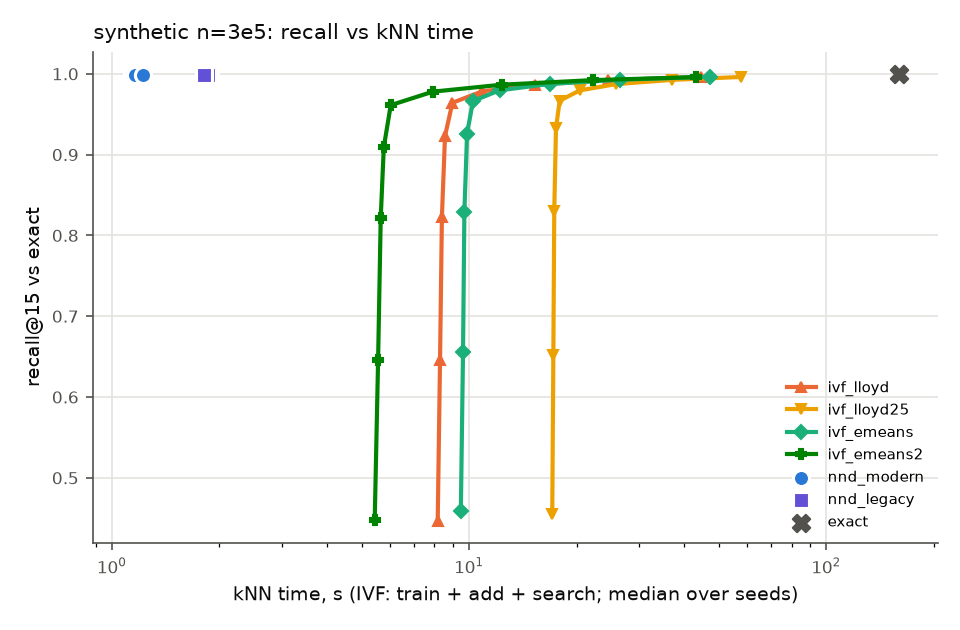

### Verdict lines

```
synthetic n=3e5 [informational: not in the evaluation set]:
   no  (a) ivf_emeans kNN time at matched recall / nnd_modern = inf [inf–inf] over 3 seeds (needs <= 0.8); unmatched seeds: cap 3; not decided by the nprobe cap: even with the end-of-sweep cost as a lower bound the median is >= 40.645; informational: inf with search time interpolated between swept nprobes
   no  (b) eumap_e2e / umap_e2e end-to-end = 1.290 (42.0 s vs 32.5 s, medians) (needs <= 0.85)
  YES  (c) eumap_e2e quality: np15 0.0207 vs umap 0.0201 [0.0200–0.0206] (+3.0% of the umap median) ok; trustworthiness 0.7323 vs umap 0.7289 [0.7280–0.7307] (+0.5% of the umap median) ok; knn_acc 1.0000 vs umap 1.0000 [1.0000–1.0000] (+0.0% of the umap median) ok
   no  (a)+(b)+(c) all hold (eUMAP worth using on this dataset)
   no  [Lloyd variant] (a) ivf_lloyd kNN time at matched recall / nnd_modern = inf [inf–inf] over 3 seeds (needs <= 0.8); unmatched seeds: cap 3; not decided by the nprobe cap: even with the end-of-sweep cost as a lower bound the median is >= 38.481; informational: inf with search time interpolated between swept nprobes
   no  [Lloyd variant] (b) eumap_lloyd_e2e / umap_e2e end-to-end = 1.294 (42.1 s vs 32.5 s, medians) (needs <= 0.85)
  YES  [Lloyd variant] (c) eumap_lloyd_e2e quality: np15 0.0206 vs umap 0.0201 [0.0200–0.0206] (+2.4% of the umap median) ok; trustworthiness 0.7302 vs umap 0.7289 [0.7280–0.7307] (+0.2% of the umap median) ok; knn_acc 1.0000 vs umap 1.0000 [1.0000–1.0000] (+0.0% of the umap median) ok
   no  e-means contributes: ivf_emeans t_train/lloyd 1.219 (<= 0.7), matched search inf s vs lloyd max inf s -> no; ivf_emeans2 t_train/lloyd 0.506 (<= 0.7), matched search inf s vs lloyd max inf s -> no; eumap_e2e / eumap_lloyd_e2e = 0.997 (needs <= 0.95)
   no  the Faiss IVF graph helps, e-means does not (e-means end-to-end gain 0.003, needs < 0.05 with (a)-(c) met by an IVF pair)
   no  some IVF arm beats the faster NN-descent arm at matched recall (median ratios: ivf_lloyd inf (>= 38.481 at the end of the sweep), ivf_lloyd25 inf (>= 49.788 at the end of the sweep), ivf_emeans inf (>= 40.645 at the end of the sweep), ivf_emeans2 inf (>= 37.245 at the end of the sweep))
```

## synthetic n=1e6

### kNN stage

| arm | recall@15 | t_knn | t_prepare | t_train | t_add | centroid MSE | imbalance | peak RSS GB |
|---|---|---|---|---|---|---|---|---|
| exact | 1.000 | 1632 | – | – | – | – | – | 2.2 |
| nnd_modern | 0.9959 [0.9959–0.9960] | 4.59 [4.25–4.69] | – | – | – | – | – | 5.1 |
| nnd_legacy | 0.9983 [0.9983–0.9983] | 10.80 [10.78–21.87] | – | – | – | – | – | 6.2 |
| ivf_lloyd | max 0.9991 [0.9991–0.9991] @nprobe 256 [256–256] | see sweep | 0.48 [0.48–0.50] | 43.95 [40.75–51.21] | 4.13 [3.50–4.32] | 806.3920 [806.2227–807.4281] | 1.071 [1.057–1.083] | 4.9 |
| ivf_lloyd25 | max 0.9992 [0.9992–0.9992] @nprobe 256 [256–256] | see sweep | 0.48 [0.47–0.48] | 92.15 [83.90–98.35] | 3.44 [3.08–4.19] | 800.7877 [800.7377–801.8627] | 1.071 [1.057–1.082] | 4.7 |
| ivf_emeans | max 0.9992 [0.9992–0.9992] @nprobe 256 [256–256] | see sweep | 0.48 [0.48–0.49] | 32.35 [31.16–32.85] | 3.80 [3.38–4.08] | 797.7243 [797.4003–798.0223] | 1.056 [1.052–1.062] | 4.7 |
| ivf_emeans2 | max 0.9991 [0.9991–0.9992] @nprobe 256 [256–256] | see sweep | 0.48 [0.46–0.48] | 12.90 [12.28–12.93] | 4.05 [4.00–4.95] | 803.5806 [803.2714–803.8070] | 1.054 [1.046–1.067] | 4.8 |

### IVF nprobe sweep

| arm | nprobe | recall | recall (tie-aware) | missing | t_search | t_train+add+search |
|---|---|---|---|---|---|---|
| ivf_lloyd | 1 | 0.4221 [0.4219–0.4227] | 0.4221 [0.4219–0.4228] | 0.0000 [0.0000–0.0000] | 7.14 [6.97–7.15] | 55.41 [52.04–61.68] |
| ivf_lloyd | 2 | 0.6138 [0.6135–0.6148] | 0.6139 [0.6136–0.6149] | 0.0000 [0.0000–0.0000] | 8.00 [7.86–8.05] | 56.32 [52.88–62.56] |
| ivf_lloyd | 4 | 0.8047 [0.8046–0.8076] | 0.8048 [0.8047–0.8077] | 0.0000 [0.0000–0.0000] | 8.84 [8.75–8.94] | 57.22 [53.72–63.46] |
| ivf_lloyd | 8 | 0.9363 [0.9360–0.9415] | 0.9364 [0.9361–0.9416] | 0.0000 [0.0000–0.0000] | 11.83 [11.52–11.91] | 60.18 [56.72–66.22] |
| ivf_lloyd | 16 | 0.9837 [0.9835–0.9849] | 0.9838 [0.9835–0.9849] | 0.0000 [0.0000–0.0000] | 20.36 [19.61–20.88] | 69.16 [65.24–74.32] |
| ivf_lloyd | 32 | 0.9929 [0.9927–0.9930] | 0.9929 [0.9927–0.9930] | 0.0000 [0.0000–0.0000] | 37.46 [36.89–38.11] | 85.74 [83.00–91.59] |
| ivf_lloyd | 64 | 0.9962 [0.9962–0.9963] | 0.9963 [0.9962–0.9963] | 0.0000 [0.0000–0.0000] | 73.90 [71.24–77.54] | 125.81 [118.79–125.95] |
| ivf_lloyd | 128 | 0.9981 [0.9980–0.9981] | 0.9981 [0.9981–0.9981] | 0.0000 [0.0000–0.0000] | 147.60 [143.27–149.08] | 197.36 [192.49–197.97] |
| ivf_lloyd | 256 | 0.9991 [0.9991–0.9991] | 0.9991 [0.9991–0.9991] | 0.0000 [0.0000–0.0000] | 297.55 [292.23–305.28] | 346.94 [345.83–350.17] |
| ivf_lloyd25 | 1 | 0.4307 [0.4306–0.4314] | 0.4307 [0.4307–0.4314] | 0.0000 [0.0000–0.0000] | 7.01 [7.00–7.04] | 102.24 [94.38–109.54] |
| ivf_lloyd25 | 2 | 0.6217 [0.6214–0.6227] | 0.6218 [0.6215–0.6227] | 0.0000 [0.0000–0.0000] | 7.95 [7.94–7.99] | 103.18 [95.33–110.48] |
| ivf_lloyd25 | 4 | 0.8101 [0.8098–0.8130] | 0.8102 [0.8099–0.8131] | 0.0000 [0.0000–0.0000] | 8.86 [8.79–9.02] | 104.25 [96.13–111.41] |
| ivf_lloyd25 | 8 | 0.9388 [0.9384–0.9442] | 0.9389 [0.9385–0.9443] | 0.0000 [0.0000–0.0000] | 11.87 [11.41–12.13] | 107.10 [98.75–114.67] |
| ivf_lloyd25 | 16 | 0.9847 [0.9845–0.9859] | 0.9848 [0.9845–0.9859] | 0.0000 [0.0000–0.0000] | 20.18 [19.70–21.01] | 115.42 [107.04–123.56] |
| ivf_lloyd25 | 32 | 0.9933 [0.9932–0.9934] | 0.9933 [0.9932–0.9934] | 0.0000 [0.0000–0.0000] | 37.99 [36.70–38.93] | 133.22 [124.04–141.48] |
| ivf_lloyd25 | 64 | 0.9965 [0.9964–0.9965] | 0.9965 [0.9964–0.9965] | 0.0000 [0.0000–0.0000] | 74.06 [71.52–75.97] | 171.20 [158.86–176.60] |
| ivf_lloyd25 | 128 | 0.9982 [0.9982–0.9982] | 0.9982 [0.9982–0.9982] | 0.0000 [0.0000–0.0000] | 146.57 [143.33–148.36] | 243.60 [230.67–249.11] |
| ivf_lloyd25 | 256 | 0.9992 [0.9992–0.9992] | 0.9992 [0.9992–0.9992] | 0.0000 [0.0000–0.0000] | 294.96 [290.18–300.13] | 395.36 [377.52–397.50] |
| ivf_emeans | 1 | 0.4361 [0.4359–0.4362] | 0.4361 [0.4359–0.4362] | 0.0000 [0.0000–0.0000] | 7.03 [6.96–7.10] | 42.83 [42.00–43.89] |
| ivf_emeans | 2 | 0.6266 [0.6265–0.6269] | 0.6266 [0.6266–0.6270] | 0.0000 [0.0000–0.0000] | 8.02 [7.99–8.06] | 43.79 [42.98–44.93] |
| ivf_emeans | 4 | 0.8128 [0.8120–0.8132] | 0.8129 [0.8121–0.8132] | 0.0000 [0.0000–0.0000] | 8.82 [8.68–8.91] | 44.64 [43.79–45.62] |
| ivf_emeans | 8 | 0.9372 [0.9357–0.9400] | 0.9372 [0.9357–0.9401] | 0.0000 [0.0000–0.0000] | 11.76 [11.32–11.78] | 47.51 [46.29–48.70] |
| ivf_emeans | 16 | 0.9838 [0.9838–0.9851] | 0.9838 [0.9838–0.9851] | 0.0000 [0.0000–0.0000] | 19.81 [18.85–20.30] | 55.54 [53.82–57.24] |
| ivf_emeans | 32 | 0.9933 [0.9932–0.9934] | 0.9934 [0.9932–0.9934] | 0.0000 [0.0000–0.0000] | 37.20 [35.85–38.87] | 72.93 [70.82–75.81] |
| ivf_emeans | 64 | 0.9966 [0.9965–0.9966] | 0.9966 [0.9965–0.9966] | 0.0000 [0.0000–0.0000] | 73.53 [72.20–78.95] | 109.26 [107.17–115.89] |
| ivf_emeans | 128 | 0.9982 [0.9982–0.9983] | 0.9982 [0.9982–0.9983] | 0.0000 [0.0000–0.0000] | 146.93 [146.88–158.66] | 182.66 [181.85–195.59] |
| ivf_emeans | 256 | 0.9992 [0.9992–0.9992] | 0.9992 [0.9992–0.9992] | 0.0000 [0.0000–0.0000] | 317.47 [305.26–321.26] | 353.20 [340.23–358.20] |
| ivf_emeans2 | 1 | 0.4263 [0.4259–0.4267] | 0.4263 [0.4260–0.4267] | 0.0000 [0.0000–0.0000] | 6.99 [6.93–7.01] | 23.98 [23.29–24.78] |
| ivf_emeans2 | 2 | 0.6177 [0.6176–0.6185] | 0.6178 [0.6177–0.6185] | 0.0000 [0.0000–0.0000] | 7.97 [7.88–8.04] | 24.86 [24.25–25.89] |
| ivf_emeans2 | 4 | 0.8076 [0.8053–0.8077] | 0.8076 [0.8054–0.8078] | 0.0000 [0.0000–0.0000] | 8.82 [8.77–8.82] | 25.76 [25.11–26.67] |
| ivf_emeans2 | 8 | 0.9378 [0.9300–0.9378] | 0.9378 [0.9300–0.9379] | 0.0000 [0.0000–0.0000] | 12.02 [11.29–12.80] | 29.14 [28.30–29.79] |
| ivf_emeans2 | 16 | 0.9843 [0.9812–0.9844] | 0.9844 [0.9812–0.9844] | 0.0000 [0.0000–0.0000] | 22.07 [19.18–22.92] | 39.05 [37.03–39.20] |
| ivf_emeans2 | 32 | 0.9931 [0.9928–0.9931] | 0.9931 [0.9928–0.9931] | 0.0000 [0.0000–0.0000] | 42.10 [37.35–44.71] | 59.08 [55.20–60.99] |
| ivf_emeans2 | 64 | 0.9964 [0.9963–0.9964] | 0.9964 [0.9963–0.9964] | 0.0000 [0.0000–0.0000] | 80.90 [74.92–86.08] | 97.88 [92.77–102.36] |
| ivf_emeans2 | 128 | 0.9981 [0.9981–0.9981] | 0.9981 [0.9981–0.9981] | 0.0000 [0.0000–0.0000] | 161.03 [153.70–171.58] | 178.01 [171.55–187.86] |
| ivf_emeans2 | 256 | 0.9991 [0.9991–0.9992] | 0.9992 [0.9991–0.9992] | 0.0000 [0.0000–0.0000] | 326.44 [308.75–350.55] | 343.42 [326.60–366.83] |

### kNN time to reach a fixed recall (informational)

IVF: train + add + search at the smallest swept nprobe reaching the recall (inf: not reached within the sweep). NN-descent has one operating point, shown for reference.

| arm | recall >= 0.90 | recall >= 0.95 | recall >= 0.99 |
|---|---|---|---|
| ivf_lloyd | 60.18 [56.72–66.22] | 69.16 [65.24–74.32] | 85.74 [83.00–91.59] |
| ivf_lloyd25 | 107.10 [98.75–114.67] | 115.42 [107.04–123.56] | 133.22 [124.04–141.48] |
| ivf_emeans | 47.51 [46.29–48.70] | 55.54 [53.82–57.24] | 72.93 [70.82–75.81] |
| ivf_emeans2 | 29.14 [28.30–29.79] | 39.05 [37.03–39.20] | 59.08 [55.20–60.99] |
| nnd_modern (single point, recall 0.9959 [0.9959–0.9960]) | 4.59 [4.25–4.69] | 4.59 [4.25–4.69] | 4.59 [4.25–4.69] |
| nnd_legacy (single point, recall 0.9983 [0.9983–0.9983]) | 10.80 [10.78–21.87] | 10.80 [10.78–21.87] | 10.80 [10.78–21.87] |

### Matched recall (faster NN-descent arm: `nnd_modern`)

| NN-descent arm | IVF arm | NN-descent recall | target | nprobe per seed | IVF kNN time | NN-descent time | ratio IVF/NND | ratio, interpolated (informational) | unmatched: ratio lower bound |
|---|---|---|---|---|---|---|---|---|---|
| nnd_modern | ivf_lloyd | 0.9959 [0.9959–0.9960] | 0.9959 [0.9959–0.9960] | 64,64,64 | 125.81 [118.79–125.95] | 4.59 [4.25–4.69] | 26.825 [25.874–29.616] | 25.923 [25.396–28.810] | – |
| nnd_modern | ivf_lloyd25 | 0.9959 [0.9959–0.9960] | 0.9959 [0.9959–0.9960] | 64,64,64 | 171.20 [158.86–176.60] | 4.59 [4.25–4.69] | 37.354 [37.291–37.653] | 36.131 [35.803–36.245] | – |
| nnd_modern | ivf_emeans | 0.9959 [0.9959–0.9960] | 0.9959 [0.9959–0.9960] | 64,64,64 | 109.26 [107.17–115.89] | 4.59 [4.25–4.69] | 23.798 [22.849–27.251] | 22.351 [21.494–25.248] | – |
| nnd_modern | ivf_emeans2 | 0.9959 [0.9959–0.9960] | 0.9959 [0.9959–0.9960] | 64,64,64 | 97.88 [92.77–102.36] | 4.59 [4.25–4.69] | 21.824 [20.206–23.015] | 20.605 [19.402–21.736] | – |
| nnd_legacy | ivf_lloyd | 0.9983 [0.9983–0.9983] | 0.9983 [0.9983–0.9983] | 256,256,256 | 346.94 [345.83–350.17] | 10.80 [10.78–21.87] | 32.131 [15.813–32.492] | 21.730 [10.858–21.886] | – |
| nnd_legacy | ivf_lloyd25 | 0.9983 [0.9983–0.9983] | 0.9983 [0.9983–0.9983] | 256,256,256 | 395.36 [377.52–397.50] | 10.80 [10.78–21.87] | 34.963 [18.176–36.685] | 22.827 [12.395–24.753] | – |
| nnd_legacy | ivf_emeans | 0.9983 [0.9983–0.9983] | 0.9983 [0.9983–0.9983] | 256,256,256 | 353.20 [340.23–358.20] | 10.80 [10.78–21.87] | 32.773 [15.557–33.174] | 18.220 [9.076–19.515] | – |
| nnd_legacy | ivf_emeans2 | 0.9983 [0.9983–0.9983] | 0.9983 [0.9983–0.9983] | 256,256,256 | 343.42 [326.60–366.83] | 10.80 [10.78–21.87] | 30.305 [16.774–31.805] | 18.769 [10.242–19.347] | – |

The pre-registered ratio uses the smallest swept power-of-two nprobe that reaches the target. *Interpolated* charges IVF the search time interpolated linearly in recall between the two swept nprobes that bracket the target, to show how much of the ratio is grid overshoot. *Unmatched (cap)* means the sweep stopped at nprobe = 256 (the spec's limit) below the target; *(nlist)* means every list was probed. For those seeds the ratio is inf, and the IVF cost at the last swept nprobe gives a lower bound on what a longer sweep could have reached.

### End to end and embedding quality

| arm | t_e2e | t_knn | t_graph | t_layout | graph recall | NP@15 | trustworthiness | kNN acc | notes |
|---|---|---|---|---|---|---|---|---|---|
| umap_e2e | 81.2 [80.8–83.5] | 4.6 [4.1–4.7] | 1.8 [1.8–1.9] | 75.3 [74.4–77.0] | 0.9959 [0.9959–0.9960] | 0.0187 [0.0187–0.0188] | 0.7821 [0.7815–0.7822] | 1.0000 [1.0000–1.0000] |  |
| eumap_e2e | 133.6 [132.5–137.4] | 56.8 [56.4–63.0] | 1.8 [1.7–1.8] | 74.0 [72.6–75.4] | 0.9838 [0.9838–0.9851] | 0.0188 [0.0186–0.0189] | 0.7807 [0.7794–0.7817] | 1.0000 [1.0000–1.0000] | nprobe 16,16,16 |
| eumap_lloyd_e2e | 140.5 [140.4–142.7] | 65.3 [62.2–67.0] | 1.7 [1.7–1.8] | 73.9 [73.3–76.5] | 0.9837 [0.9835–0.9849] | 0.0188 [0.0186–0.0188] | 0.7814 [0.7812–0.7814] | 1.0000 [1.0000–1.0000] | nprobe 16,16,16 |
| layout_exact | 76.8 [76.8–78.1] | 0.0 [0.0–0.0] | 1.8 [1.7–1.8] | 75.1 [75.0–76.3] | 1.0000 [1.0000–1.0000] | 0.0189 [0.0186–0.0189] | 0.7813 [0.7804–0.7816] | 1.0000 [1.0000–1.0000] |  |

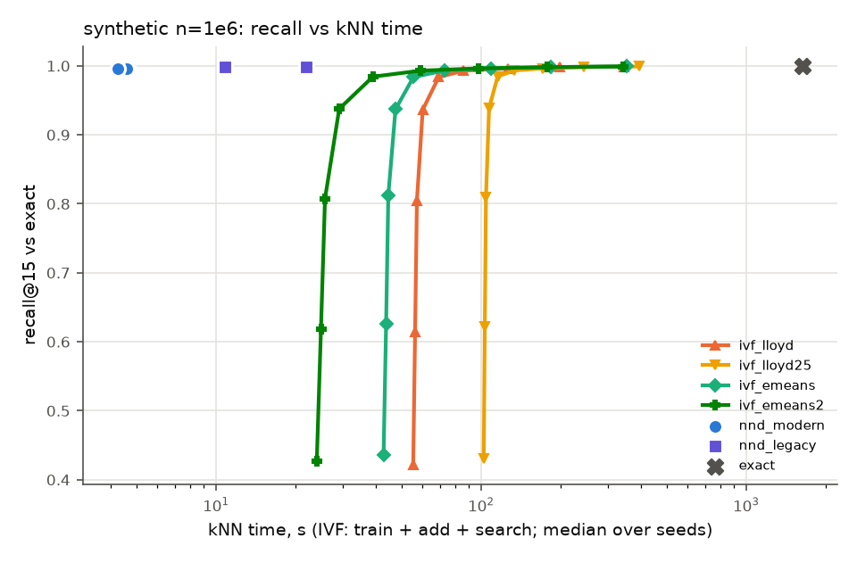

### Verdict lines

```
synthetic n=1e6:
   no  (a) ivf_emeans kNN time at matched recall / nnd_modern = 23.798 [22.849–27.251] over 3 seeds (needs <= 0.8); informational: 22.351 with search time interpolated between swept nprobes
   no  (b) eumap_e2e / umap_e2e end-to-end = 1.645 (133.6 s vs 81.2 s, medians) (needs <= 0.85)
  YES  (c) eumap_e2e quality: np15 0.0188 vs umap 0.0187 [0.0187–0.0188] (+0.1% of the umap median) ok; trustworthiness 0.7807 vs umap 0.7821 [0.7815–0.7822] (-0.2% of the umap median) ok; knn_acc 1.0000 vs umap 1.0000 [1.0000–1.0000] (+0.0% of the umap median) ok
   no  (a)+(b)+(c) all hold (eUMAP worth using on this dataset)
   no  [Lloyd variant] (a) ivf_lloyd kNN time at matched recall / nnd_modern = 26.825 [25.874–29.616] over 3 seeds (needs <= 0.8); informational: 25.923 with search time interpolated between swept nprobes
   no  [Lloyd variant] (b) eumap_lloyd_e2e / umap_e2e end-to-end = 1.730 (140.5 s vs 81.2 s, medians) (needs <= 0.85)
  YES  [Lloyd variant] (c) eumap_lloyd_e2e quality: np15 0.0188 vs umap 0.0187 [0.0187–0.0188] (+0.2% of the umap median) ok; trustworthiness 0.7814 vs umap 0.7821 [0.7815–0.7822] (-0.1% of the umap median) ok; knn_acc 1.0000 vs umap 1.0000 [1.0000–1.0000] (+0.0% of the umap median) ok
   no  e-means contributes: ivf_emeans t_train/lloyd 0.736 (<= 0.7), matched search 73.53 s vs lloyd max 77.54 s -> no; ivf_emeans2 t_train/lloyd 0.293 (<= 0.7), matched search 80.90 s vs lloyd max 77.54 s -> no; eumap_e2e / eumap_lloyd_e2e = 0.951 (needs <= 0.95)
   no  the Faiss IVF graph helps, e-means does not (e-means end-to-end gain 0.049, needs < 0.05 with (a)-(c) met by an IVF pair)
   no  some IVF arm beats the faster NN-descent arm at matched recall (median ratios: ivf_lloyd 26.825, ivf_lloyd25 37.354, ivf_emeans 23.798, ivf_emeans2 21.824)
```

## Summary figures

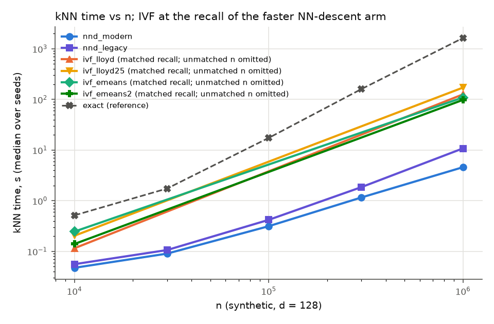
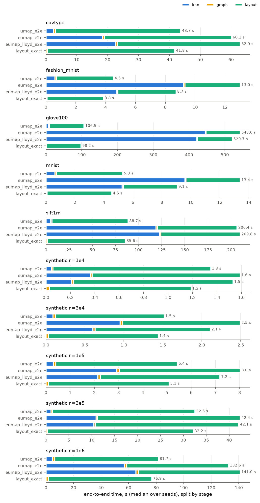
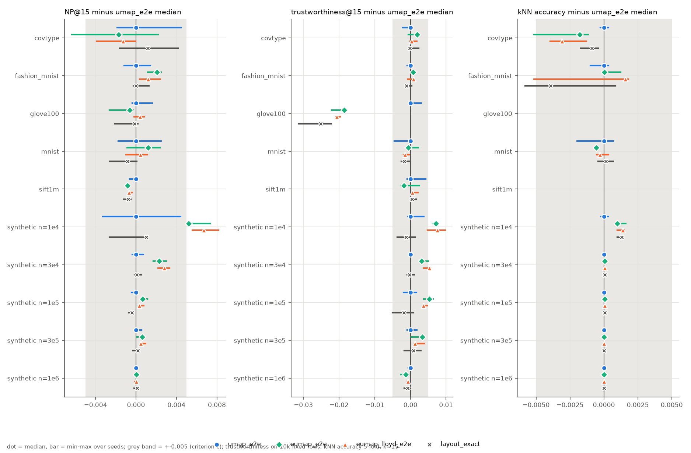
